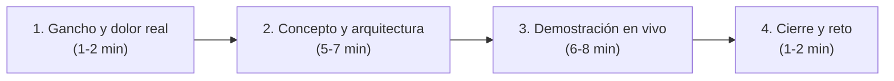

# 🎬 Guía para Instructores y Creadores de Contenido

Esta guía está diseñada para instructores, mentores y creadores que deseen impartir el curso de **Forward Deployed Engineer (FDE)** en vivo o utilizar este repositorio como base para grabar videos, cursos en línea y tutoriales.

---

## 🎯 Filosofía del curso

1. **Aterrizado en la realidad operativa:** No enseñes teoría en el vacío. Cada concepto técnico responde a una necesidad del cliente (ej. "¿por qué necesitamos idempotencia? Porque Halcón duplicó pedidos el mes pasado").
2. **El estudiante como protagonista técnico:** Un FDE no es un vendedor ni un tomador de notas; es una ingeniera o ingeniero que resuelve bloqueos con código y criterio.
3. **Fricción mínima de herramientas:** Todo el código base usa Python 3.10+ y su biblioteca estándar. Los estudiantes pueden concentrarse en los conceptos sin perder horas resolviendo incompatibilidades de librerías.

---

## 🎥 Formato recomendado para videos y clases

Cada lección del curso está diseñada para una cápsula de video de **10 a 20 minutos**.



### 1. Gancho y dolor real (1-2 min)
- Plantea la situación con el cliente (Distribuidora Halcón).
- Muestra el síntoma visible: un error 503, datos inconsistentes, pedidos duplicados o una llamada incómoda con un stakeholder.

### 2. Concepto y arquitectura (5-7 min)
- Explica el fundamento teórico con diagramas sencillos.
- Usa tablas de contraste (ej. *Polling vs. Webhooks*, *Batch vs. Streaming*).

### 3. Demostración práctica en código / terminal (6-8 min)
- Muestra la terminal con fuente legible (mínimo 16-18 pt).
- Ejecuta los ejemplos del repositorio paso a paso.
- Provoca el error intencionalmente primero (ej. token expirado o rate limit excedido) y luego muestra cómo el código lo maneja con elegancia.

### 4. Cierre y reto (1-2 min)
- Resume los 2 o 3 aprendizajes esenciales.
- Invita al estudiante a resolver el ejercicio práctico del módulo antes de ver la solución.

---

## 🛠️ Preparación previa a la grabación o clase

Antes de comenzar a grabar o iniciar una sesión en vivo:

1. **Inicia la API simulada:**
   ```bash
   python recursos/api-simulada/servidor.py
   ```
2. **Verifica la salud de la API:**
   ```bash
   curl -s http://127.0.0.1:8000/salud
   # Debe responder: {"estado": "ok"}
   ```
3. **Configura el entorno visual:**
   - Tema de editor con buen contraste (oscuro o claro consistente).
   - Oculta paneles innecesarios y notificaciones del sistema operativo.
   - Terminal limpia con prompt corto y descriptivo.
4. **Verifica las rutas relativas:** Asegúrate de ejecutar los comandos desde la raíz del proyecto.

---

## 📅 Propuestas de calendarios para impartir el curso

### Modalidad Intensiva (Bootcamp de 4 semanas)

Recomendada para cohortes de dedicación completa o media jornada (15-20 h/semana).

| Semana | Módulos | Foco principal | Hito / Entregable |
|--------|---------|----------------|-------------------|
| **Semana 1** | 00, 01, 02, 03 | Fundamentos de ingeniería para FDE (Terminal, Python, HTTP y APIs). | Limpieza del CSV del ERP y cliente básico de API. |
| **Semana 2** | 04, 05, 06 | Datos, descubrimiento con clientes e integración robusta. | Documento de alcance (SOW) y conector con reintentos. |
| **Semana 3** | 07, 08, 09 | Despliegue con Docker, observabilidad, incidentes y seguridad de datos. | Pipeline con Docker y simulación de resolución de incidente. |
| **Semana 4** | 10, 11, 12 | IA aplicada, comunicación ejecutiva y Proyecto Final. | Demo en vivo del proyecto integrador frente al panel evaluador. |

---

### Modalidad Flexible (Curso semestral o acompañamiento de 12 semanas)

Recomendada para profesionistas que estudian mientras trabajan (4-6 h/semana).

| Semana | Módulo | Tema clave | Dinámica en clase recomendada |
|--------|--------|------------|-------------------------------|
| **1** | [00](../modulos/00-el-rol-del-fde/README.md) | El rol del FDE en la industria | Debate: Casos de estudio y diferencias con SWE tradicional. |
| **2** | [01](../modulos/01-herramientas-esenciales/README.md) | Terminal, Git y entorno | Taller en vivo de terminal, pipes y resolución de conflictos en Git. |
| **3** | [02](../modulos/02-python-para-fde/README.md) | Python práctico para datos | Scripting para limpiar el CSV con datos corruptos de Halcón. |
| **4** | [03](../modulos/03-http-y-apis/README.md) | Protocolo HTTP y consumo de APIs | Pruebas de endpoints con curl y urllib contra la API simulada. |
| **5** | [04](../modulos/04-datos-y-sql/README.md) | Bases de datos relacionales y SQL | Carga ETL hacia SQLite y consultas operativas de inventario. |
| **6** | [05](../modulos/05-descubrimiento-con-clientes/README.md) | Entrevistas de descubrimiento | *Role-play* en parejas: FDE vs. Roberto Treviño (Gerente de TI). |
| **7** | [06](../modulos/06-integracion-de-sistemas/README.md) | Patrones de integración y resiliencia | Implementación de reintentos con backoff exponencial e idempotencia. |
| **8** | [07](../modulos/07-despliegue-y-cloud/README.md) | Docker, variables de entorno y nube | Contenedorización del sincronizador de datos y ejecución local. |
| **9** | [08](../modulos/08-debugging-y-produccion/README.md) | Debugging sistemático y postmortems | Simulación de caída del servicio con postmortem sin culpas (*blameless*). |
| **10** | [09](../modulos/09-seguridad-y-datos-del-cliente/README.md) | Seguridad, privacidad y PII | Auditoría de fuga de datos en el archivo de tiendas y enmascaramiento. |
| **11** | [10](../modulos/10-ia-aplicada/README.md) & [11](../modulos/11-comunicacion-demos-y-documentacion/README.md) | IA práctica y comunicación con directivos | Construcción de RAG mínimo y guion de demo ejecutiva. |
| **12** | [12](../modulos/12-proyecto-final/README.md) | Presentación del Proyecto Final | Demostración formal de la solución completa ante el cliente. |

---

## 🎭 Dinámicas interactivas recomendadas

### 1. El Role-Play de Descubrimiento (Módulo 05)
Divide al grupo en parejas: un estudiante actúa como el FDE y el otro como Roberto Treviño (Gerente de TI escéptico de Distribuidora Halcón). El objetivo del FDE es obtener los detalles técnicos del ERP sin provocar fricción ni prometer cosas fuera del alcance.

### 2. El Simulacro de "Llamada de Fuego" (Módulo 08)
El instructor levanta la API con `FALLAS=0.6` o detiene el servidor sin avisar. Los estudiantes deben diagnosticar la causa raíz mediante logs estructurados, mitigar el impacto y redactar un comunicado claro para Laura Garza en menos de 15 minutos.

---

## 📋 Criterios de evaluación del estudiante

Al evaluar a los estudiantes, utiliza esta ponderación sugerida:

- **40 % Proyecto Final Integrador (Módulo 12):** Funcionalidad, resiliencia del código, Dockerización y calidad de la documentación.
- **30 % Ejercicios prácticos de los módulos:** Solución correcta de los ejercicios individuales de cada carpeta `ejercicios/`.
- **20 % Comunicación técnica y demos:** Claridad al explicar decisiones de arquitectura y capacidad de síntesis ante no técnicos.
- **10 % Criterio operativo:** Buenas prácticas en seguridad (cero secretos quemados en código), logs legibles y manejo de errores.
