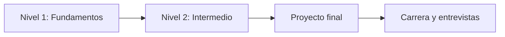

# Curso de Forward Deployed Engineer (FDE)

Material abierto para aprender los fundamentos del rol de **Forward Deployed Engineer**: la persona que combina ingeniería de software, integración de sistemas y trato directo con clientes para lograr que un producto funcione *de verdad* en el mundo real.

Este repositorio funciona como:

- 📚 **Guía de estudio** para quien quiere conseguir su primer trabajo como FDE.
- 🎥 **Guion base** para grabar tutoriales, clases y video cursos.
- 🧩 **Recurso complementario** con apuntes, ejemplos de código y ejercicios prácticos.

---

## 🗺️ Ruta de aprendizaje



| Nivel | Significado |
|-------|-------------|
| 🟢 Principiante | No se requiere experiencia previa en el tema. |
| 🟡 Intermedio | Requiere haber completado los módulos 🟢. |
| 🔵 Integrador | Combina todo lo aprendido en un caso realista. |

### 🟢 Nivel 1: Fundamentos

| # | Módulo | ¿Qué aprenderás? | Duración aprox. |
|---|--------|------------------|-----------------|
| 00 | [El rol del Forward Deployed Engineer](modulos/00-el-rol-del-fde/README.md) | Qué hace un FDE, en qué se diferencia de otros roles y cómo es su día a día. | 2 h |
| 01 | [Herramientas esenciales](modulos/01-herramientas-esenciales/README.md) | Terminal, Git, editor y entorno de desarrollo. | 4 h |
| 02 | [Python para FDE](modulos/02-python-para-fde/README.md) | Scripts, archivos, JSON/CSV, manejo de errores y automatización. | 6 h |
| 03 | [HTTP y APIs](modulos/03-http-y-apis/README.md) | Cómo funciona la web, REST, consumo de APIs y herramientas de prueba. | 5 h |
| 04 | [Datos y SQL](modulos/04-datos-y-sql/README.md) | Modelado básico, consultas SQL, limpieza y transformación de datos. | 6 h |
| 05 | [Descubrimiento con clientes](modulos/05-descubrimiento-con-clientes/README.md) | Entrevistas de descubrimiento, requisitos, mapeo de procesos y alcance. | 4 h |

### 🟡 Nivel 2: Intermedio

| # | Módulo | ¿Qué aprenderás? | Duración aprox. |
|---|--------|------------------|-----------------|
| 06 | [Integración de sistemas](modulos/06-integracion-de-sistemas/README.md) | Autenticación, paginación, webhooks, reintentos e idempotencia. | 6 h |
| 07 | [Despliegue y cloud](modulos/07-despliegue-y-cloud/README.md) | Docker, variables de entorno, secretos, nube y CI/CD básico. | 6 h |
| 08 | [Debugging y operación en producción](modulos/08-debugging-y-produccion/README.md) | Logs, observabilidad, resolución de incidentes y postmortems. | 5 h |
| 09 | [Seguridad y datos del cliente](modulos/09-seguridad-y-datos-del-cliente/README.md) | Mínimo privilegio, manejo de PII, cumplimiento y buenas prácticas. | 3 h |
| 10 | [IA aplicada para FDE](modulos/10-ia-aplicada/README.md) | APIs de LLMs, prompts, RAG y evaluación de soluciones con IA. | 6 h |
| 11 | [Comunicación, demos y documentación](modulos/11-comunicacion-demos-y-documentacion/README.md) | Demos efectivas, escritura técnica, manejo de expectativas y escalamiento. | 4 h |

### 🔵 Integrador

| # | Módulo | ¿Qué aprenderás? | Duración aprox. |
|---|--------|------------------|-----------------|
| 12 | [Proyecto final: implementación con un cliente](modulos/12-proyecto-final/README.md) | Simulación completa de una implementación, de la llamada de descubrimiento a la entrega. | 10 h+ |

---

## 🧰 Recursos transversales

| Recurso | Descripción |
|---------|-------------|
| [Caso de estudio del curso](recursos/caso-de-estudio/README.md) | La empresa ficticia y el cliente que usamos en todos los ejemplos y ejercicios. |
| [API simulada](recursos/api-simulada/README.md) | Servidor local (solo Python estándar) para practicar consumo de APIs e integraciones. |
| [Glosario](recursos/glosario.md) | Términos clave del rol y de la industria. |
| [Lecturas y referencias](recursos/lecturas.md) | Artículos, libros y documentación recomendada. |
| [Carrera: CV, portafolio y entrevistas](recursos/carrera/README.md) | Cómo prepararte para conseguir un trabajo como FDE. |

---

## 🚀 Cómo usar este repositorio

### Si eres estudiante

1. Sigue los módulos **en orden**. Cada módulo tiene un `README.md` con objetivos, prerrequisitos y lista de lecciones.
2. Lee las lecciones (`lecciones/`), ejecuta los ejemplos (`ejemplos/`) y resuelve los ejercicios (`ejercicios/`).
3. Intenta resolver cada ejercicio **antes** de ver las soluciones (`ejercicios/soluciones/`).
4. Guarda tus soluciones y el proyecto final en tu propio repositorio: será parte de tu portafolio.

### Si vas a enseñar o grabar contenido

- Cada módulo incluye una sección **🎥 Guion sugerido para video** con la secuencia de temas y demostraciones recomendadas.
- Las lecciones están pensadas para durar entre 10 y 20 minutos de video cada una.
- Consulta la [guía para instructores](GUIA-INSTRUCTOR.md) para recomendaciones de ritmo, evaluación y formato.

### Requisitos generales

- Computadora con macOS, Linux o Windows (con WSL recomendado).
- [Python 3.10+](https://www.python.org/downloads/) y [Git](https://git-scm.com/).
- [Docker](https://www.docker.com/) (a partir del módulo 07).
- Ganas de aprender a resolver problemas reales. 🙂

---

## 📁 Estructura del repositorio

```text
.
├── README.md                  # Este índice
├── GUIA-INSTRUCTOR.md         # Recomendaciones para enseñar/grabar
├── CONTRIBUTING.md            # Convenciones para mantener y escalar el material
├── plantillas/                # Plantillas para crear módulos, lecciones y ejercicios
├── modulos/
│   └── NN-nombre-del-modulo/
│       ├── README.md          # Objetivos, lecciones, guion de video
│       ├── lecciones/         # Apuntes teóricos (01-*.md, 02-*.md, ...)
│       ├── ejemplos/          # Código ejecutable de apoyo
│       └── ejercicios/        # Enunciados y soluciones/
└── recursos/                  # Caso de estudio, API simulada, glosario, carrera
```

---

## 🤝 Contribuir

¿Encontraste un error o quieres agregar un tema? Revisa [CONTRIBUTING.md](CONTRIBUTING.md) para conocer las convenciones de nombres, la estructura de cada módulo y las plantillas disponibles.

## 📄 Licencia

Contenido educativo de uso libre con atribución. Consulta el archivo `LICENSE` si está disponible.
