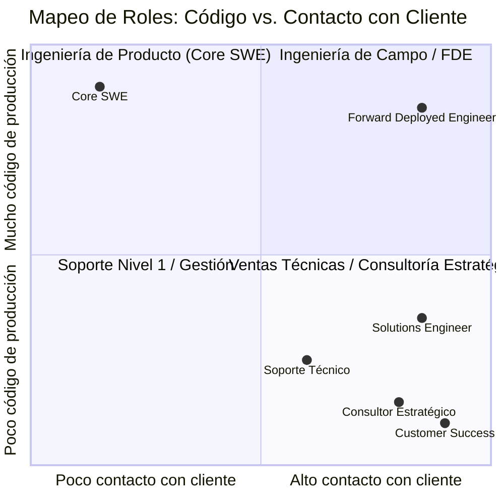

# Lección 02: Diferencias entre FDE y otros roles técnicos

> **Nivel:** 🟢 Principiante · **Duración estimada:** 20 min

---

## Situación

Cuando le cuentas a Roberto Treviño (Gerente de TI de Distribuidora Halcón) que eres el "Forward Deployed Engineer" asignado a su cuenta, Roberto frunce el ceño y comenta:

> *"Ah, o sea que eres el vendedor técnico que viene a convencernos de comprar más licencias... o el consultor externo que nos va a dejar un reporte de 80 páginas en Word para que nosotros hagamos todo el trabajo."*

Esta confusión es muy común. En el ecosistema tecnológico coexisten múltiples roles con contacto con clientes: *Software Engineer (SWE)*, *Solutions Engineer (SE / Sales Engineer)*, *Consultor de TI*, *Customer Success Manager (CSM)* e *Ingeniero de Soporte*. 

Para ganarte el respeto técnico de Roberto y la confianza de Laura Garza, necesitas tener clarísimo cuál es tu cancha y qué te hace único.

---

## Conceptos clave

### Matriz comparativa de roles

| Rol | Foco principal | ¿Escribe código de producción? | En qué etapa interviene | Métrica típica de éxito |
|-----|----------------|--------------------------------|-------------------------|--------------------------|
| **Forward Deployed Engineer (FDE)** | **Hacer que el producto funcione en el cliente resolviendo el "último kilómetro"** | **Sí** (conectores, pipelines, automatizaciones, extensiones) | **Post-venta temprana e integración crítica** (y preventa compleja) | **Time-to-Value, retención y adopción técnica** |
| **Software Engineer (Core SWE)** | Construir la plataforma general y producto escalable para todos los clientes | Sí (código base del producto) | Todo el ciclo de vida del producto | Estabilidad, deuda técnica, entrega de sprints |
| **Solutions Engineer / Sales Engineer** | Demostrar valor técnico antes de la compra para ayudar a cerrar la venta | A veces (demos rápidas, POCs ligeras, no código productivo) | Preventa (*Pre-sales*) | Nuevas ventas cerradas (*Win rate, ARR*) |
| **Consultor Tecnológico Tradicional** | Diagnóstico, asesoría estratégica o desarrollo a la medida por horas | Variable (a veces solo especificaciones o código ad-hoc) | Por proyecto contratado | Horas facturadas, entrega de hitos contractuales |
| **Customer Success Manager (CSM)** | Relación comercial, satisfacción, salud de la cuenta y renovaciones | No | Post-venta continua | NPS, tasa de renovación, prevención de cancelaciones (*churn*) |
| **Ingeniero de Soporte Técnico** | Resolver incidencias puntuales y fallas reportadas por usuarios | Ocasionalmente (scripts de corrección puntual) | Post-venta reactiva | Tiempo de primera respuesta, tiempo de resolución de tickets |

---

### Análisis detallado frente a cada rol

#### 1. FDE vs. Core Software Engineer
- El Core SWE construye la infraestructura central para decenas de miles de usuarios. Rara vez habla directamente con un cliente final y sus requerimientos vienen digeridos por un Product Manager.
- El FDE toma esa plataforma y la conecta con los sistemas imperfectos del cliente real (redes con firewalls estrictos, bases de datos no documentadas, servidores desactualizados). El FDE vive donde la teoría se estrella contra la realidad.

#### 2. FDE vs. Solutions Engineer (Sales Engineer)
- El Solutions Engineer crea prototipos rápidos para convencer a la junta directiva de comprar la solución. Si la demo funciona en un entorno controlado durante 20 minutos, el objetivo se cumplió.
- El FDE debe asegurarse de que la solución corra 24 horas al día, 7 días a la semana, con datos reales y sin caídas silenciosas.

#### 3. FDE vs. Consultor
- Los consultores tradicionales cobran por hora y a menudo tienen incentivos para alargar los proyectos o crear soluciones completamente personalizadas e irrepetibles.
- El FDE pertenece a la empresa de producto y busca lo contrario: que el cliente sea autosuficiente lo antes posible utilizando la mayor cantidad de producto estándar, retroalimentando a la empresa para que el producto sea cada vez más fácil de instalar.

---

## Errores comunes

- **Actuar como "agente de ventas encubierto":** Si priorizas vender licencias por encima de resolver los dolores técnicos genuinos de Roberto y Mariana, perderás su confianza de inmediato.
- **Asumir tareas de soporte de nivel básico:** Si un usuario olvidó su contraseña o una impresora no funciona, canalízalo cordialmente al canal de soporte adecuado; de lo contrario, tu tiempo técnico de integración se evaporará.
- **Aislarte de tus compañeros de Core Engineering:** Creer que estás "solo contra el mundo" en las instalaciones del cliente. El mejor FDE mantiene una comunicación constante y fluida con los desarrolladores del producto central.

---

## En el día a día de un FDE

Cuando Roberto Treviño te pregunte qué rol juegas tú en el proyecto, tu respuesta debe sonar así:

> *"Roberto, mi rol como Forward Deployed Engineer no es venderte nada ni dejarte tareas pendientes. Mi trabajo es sentarme contigo y tu equipo para entender exactamente cómo exporta los datos tu ERP, escribir el código necesario para conectarlo con nuestra plataforma y asegurarme de que el flujo corra de forma automática y segura sin quitarle tiempo a tus ingenieros."*

---

## Resumen

- El FDE es un rol híbrido de alta ingeniería: escribe código robusto de integración y al mismo tiempo gestiona expectativas técnicas directamente con el cliente.
- Se diferencia del Solutions Engineer en que su código vive en producción continua, y del Core SWE en que trabaja inmerso en el contexto y los datos del cliente.
- Clarificar este rol desde el inicio genera confianza inmediata con los equipos técnicos del cliente.

---

## Preguntas de repaso

1. ¿Por qué el código que escribe un Solutions Engineer en una preventa rara vez es adecuado para usarse directamente en producción?
2. Si un cliente reporta que un botón de la plataforma tiene una falta de ortografía, ¿debe el FDE detener su integración para arreglarlo de inmediato? ¿Por qué?
3. ¿Cómo le explicarías a un Director General la diferencia entre contratar un despacho de consultoría y contar con un FDE asignado por el proveedor de software?

---

⬅️ [Lección anterior: ¿Qué es un FDE?](01-que-es-un-fde.md) | 📦 [Módulo](../README.md) | [Siguiente lección: Ciclo de vida](03-ciclo-de-vida-de-implementacion.md) ➡️
