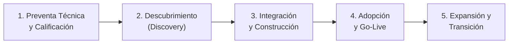

# Lección 03: El ciclo de vida de una implementación

> **Nivel:** 🟢 Principiante · **Duración estimada:** 25 min

---

## Situación

Nexo y Distribuidora Halcón acaban de firmar el acuerdo de colaboración. Laura Garza (Directora de Operaciones) te envía un mensaje entusiasta:

> *"¡Excelente noticia! Ya queremos ver los tableros de inventario funcionando en Monterrey mañana mismo. ¿A qué hora nos conectamos para ver la pantalla lista?"*

Si eres un ingeniero novato, entrarás en pánico o harás una promesa imposible de cumplir. Una implementación empresarial no ocurre de la noche a la mañana: requiere seguir una secuencia lógica de etapas para garantizar que los datos sean confiables, la seguridad esté cubierta y los usuarios adopten la herramienta.

---

## Conceptos clave

Toda implementación exitosa liderada por un FDE atraviesa **5 fases esenciales**:

---

### Fase 1: Preventa Técnica y Calificación (*Pre-sales & Scoping*)
- **Objetivo:** Verificar la viabilidad técnica antes de firmar compromisos inviables.
- **Rol del FDE:** Revisar las restricciones iniciales del cliente: ¿tienen APIs disponibles? ¿qué versión de base de datos usan? ¿existen bloqueos regulatorios insalvables?
- **Riesgo común:** Que ventas prometa *"conexión mágica en 2 clics"* con un sistema propietario sin soporte. El FDE ayuda a aterrizar la realidad.

---

### Fase 2: Descubrimiento (*Discovery & Architecture*)
- **Objetivo:** Entender a fondo los procesos de negocio reales (*As-Is*) y definir la solución deseada (*To-Be*).
- **Actividades del FDE:**
  - Entrevistar a los usuarios que operan el sistema a diario (como Mariana López en almacenes).
  - Inspeccionar muestras reales de datos (detectar errores en el CSV del ERP antes de programar).
  - Redactar el **Documento de Alcance (SOW)**: qué se entregará, qué queda fuera y cuáles son los criterios de aceptación medibles.
- **Entregable clave:** Arquitectura de integración aprobada por TI y alcance firmado.

---

### Fase 3: Integración y Construcción (*Build & Integration*)
- **Objetivo:** Escribir el código que conecta los sistemas y validar la canalización de datos.
- **Actividades del FDE:**
  - Escribir scripts de limpieza y normalización (Python, SQL).
  - Configurar clientes HTTP con autenticación robusta, reintentos y manejo de errores.
  - Empaquetar la solución en contenedores Docker para que corra de manera predecible.
  - Realizar pruebas de estrés con datos duplicados o caídas simuladas de red.
- **Entregable clave:** Conector desplegado en ambiente de pruebas (*Staging*) funcionando sin intervención manual.

---

### Fase 4: Adopción y Puesta en Marcha (*Go-Live & Adoption*)
- **Objetivo:** Llevar la solución a producción con usuarios reales de forma controlada.
- **Estrategia recomendada: Lanzamiento piloto escalonado**
  - **Día 1:** Solo almacén Monterrey (MTY) con un grupo reducido de productos (ej. abarrotes básicos).
  - **Día 7:** Validación de alertas y reconciliación de inventario con los datos físicos.
  - **Día 15:** Expansión a Guadalajara (GDL) y Ciudad de México (CDMX).
- **Rol del FDE:** Monitorear logs activamente, resolver fricciones iniciales de los usuarios y capacitar a los analistas operativos.

---

### Fase 5: Expansión y Transición (*Handoff & Productization*)
- **Objetivo:** Hacer que el cliente sea autosuficiente y devolver aprendizajes a tu empresa.
- **Actividades del FDE:**
  - Entregar el manual de operación (*Runbook*) y capacitar al equipo de TI del cliente para soporte rutinario.
  - Transferir la cuenta a Customer Success para seguimiento continuo.
  - Documentar las adaptaciones realizadas y proponerlas al equipo de Producto para convertirlas en funcionalidades estándar de la plataforma.

---

## Errores comunes

- **Saltarse el descubrimiento e ir directo a programar:** Empezar a picar código en Python sin saber que el ERP del cliente se apaga por mantenimiento todos los domingos a las 3:00 AM.
- **Hacer un *Big Bang Go-Live*:** Conectar los 3 almacenes y las 1,200 tiendas al mismo segundo sin haber probado en un entorno controlado.
- **Quedarse atrapado para siempre en la cuenta:** Si el FDE no documenta la solución ni capacita al cliente, se convierte en el soporte técnico vitalicio y nunca podrá desplegarse en proyectos nuevos.

---

## En el día a día de un FDE

Ante el entusiasmo de Laura Garza pidiendo la solución para mañana, la respuesta profesional del FDE sigue la estructura de las fases:

> *"¡Hola Laura! Estamos muy entusiasmados de arrancar. Para asegurar que los datos de Monterrey sean 100 % confiables y no arriesgar la operación de los pedidos diarios, tenemos un plan de 4 semanas muy claro: esta primera semana analizaremos el archivo nocturno del ERP para validar que no haya descuadres; en la semana 2 conectamos el conector de prueba; en la semana 3 corremos en paralelo con el almacén de Monterrey y en la semana 4 salimos a producción oficial. Mañana mismo tendremos nuestra sesión de arranque técnico con Roberto para revisar los accesos."*

---

## Resumen

- Una implementación profesional se compone de 5 fases estructuradas: Preventa, Descubrimiento, Integración, Adopción y Expansión/Transición.
- El despliegue progresivo (piloto por fases) minimiza el riesgo operativo tanto para el cliente como para tu empresa.
- El éxito del FDE concluye cuando el sistema funciona de forma autónoma y el cliente es capaz de operarlo con su propia documentación.

---

## Preguntas de repaso

1. ¿Qué problemas puede generar en una empresa cliente intentar un lanzamiento masivo de tipo "Big Bang" sin fase piloto?
2. ¿Por qué es fundamental que un FDE entregue un Runbook antes de dar por cerrada su intervención principal?
3. En la fase de descubrimiento con Distribuidora Halcón, ¿qué tipo de información debe recolectar el FDE antes de escribir la primera línea de código?

---

⬅️ [Lección anterior: Diferencias con otros roles](02-diferencias-con-otros-roles.md) | 📦 [Módulo](../README.md) | [Siguiente lección: Día a día y métricas](04-el-dia-a-dia-y-metricas.md) ➡️
