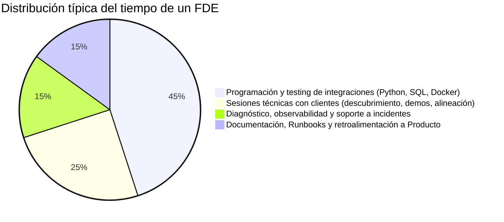
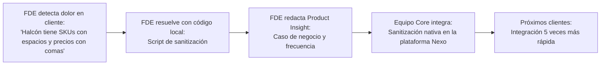

# Lección 04: El día a día de un FDE y métricas de éxito

> **Nivel:** 🟢 Principiante · **Duración estimada:** 25 min

---

## Situación

Llevas tres semanas trabajando con Distribuidora Halcón. Durante el fin de semana escribiste un script de más de 800 líneas de código con tipos genéricos avanzados en Python, pruebas unitarias exhaustivas y un algoritmo de balanceo de carga para consultar el inventario. Te sientes sumamente orgulloso de tu hazaña técnica.

Sin embargo, el lunes por la mañana el Director General de Nexo te pregunta:

> *"¿Cómo va la cuenta de Halcón? ¿Ya están los gerentes de almacén tomando decisiones con la plataforma o seguimos quemando horas sin impacto?"*

En ese instante te das cuenta de una realidad fundamental: a los líderes de tu empresa y al cliente no les importa cuántas líneas de código escribiste ni qué tan elegante es tu arquitectura interna. Lo que importa es si la aguja del negocio se está moviendo.

---

## Conceptos clave

### 1. ¿Cómo se distribuye una semana típica de un FDE?

A diferencia de un desarrollador de producto tradicional (que puede dedicar 80 % de su tiempo a picar código en su editor), el tiempo de un FDE suele repartirse de forma balanceada:

---

### 2. Las métricas clave de éxito (KPIs)

Para saber si tu trabajo como FDE está funcionando, debes monitorear tanto métricas de negocio como métricas técnicas:

| Métrica | Qué mide | Por qué importa | En el caso de Halcón |
|---------|----------|-----------------|----------------------|
| **Time-to-Value (TTV)** | Días transcurridos desde la firma del contrato hasta que el cliente obtiene el primer valor real. | Cuanto más corto el TTV, menor es el riesgo de que el cliente cancele por desilusión. | Tiempo que tardamos en emitir la primera alerta real de stock bajo en Monterrey. |
| **Tasa de Adopción de Usuarios** | % de usuarios previstos que usan activamente la herramienta en su trabajo semanal. | Si TI aprueba la integración pero los supervisores de almacén siguen usando Excel, la implementación fracasó. | Si Mariana y los 3 jefes de almacén consultan la plataforma diariamente. |
| **Tasa de Error en Sincronización** | % de registros o llamadas API que fallan al procesarse. | Mide la robustez técnica de tu conector frente a la red o datos corruptos. | Lograr menos de 0.1 % de errores no recuperables en el procesamiento nocturno. |
| **Tiempo de Resolución de Bloqueos (*Unblock Time*)** | Horas o días que toma resolver un impedimento técnico o de accesos. | La velocidad con la que el FDE destraba problemas de red, certificados o credenciales. | Obtener las credenciales de la API de pedidos con Roberto Treviño en menos de 48 horas. |
| **Impacto Operativo del Cliente (ROI)** | Beneficio económico cuantificable derivado del uso del software. | Justifica la renovación anual y la expansión del contrato. | Reducción del 15 % en faltantes de mercancía en tiendas abarroteras. |

---

### 3. La retroalimentación al equipo de producto (*Product Feedback Loop*)

Uno de los mayores aportes del FDE para su propia empresa es evitar que los ingenieros centrales construyan funciones en una "torre de marfil":

---

## Errores comunes

- **Medir el progreso por horas dedicadas o líneas de código:** El esfuerzo no equivale a resultados. Diez líneas de Python que destraban la carga diaria de pedidos valen más que un framework completo que nadie usa.
- **No llevar un registro semanal de avances y bloqueos:** Si no documentas lo que hiciste y lo que necesitas del cliente cada viernes, los proyectos se alargan indefinidamente.
- **Ocultar los problemas técnicos por pena:** Si la API del cliente está fallando constantemente, documenta la evidencia de inmediato con logs objetivos en lugar de sufrir en silencio.

---

## En el día a día de un FDE

Así reporta un FDE experimentado su estatus semanal al equipo directivo de Nexo y al cliente:

> *"Resumen semanal de Distribuidora Halcón:*  
> *- **Hito alcanzado:** Conector nocturno en staging procesó 100 % de los productos del almacén Monterrey sin fallas.*  
> *- **Métrica:** Detectamos 3 productos críticos con inventario en cero antes de que las tiendas generaran reclamos.*  
> *- **Bloqueo activo:** Seguimos esperando la aprobación de Roberto Treviño para abrir el puerto 8000 en el firewall del almacén Guadalajara.*  
> *- **Próximo paso:** Sesión de capacitación de 30 minutos con Mariana López el jueves para validar el tablero de alertas."*

---

## Resumen

- El valor del FDE se mide en impacto de negocio (*Time-to-Value*, adopción y estabilidad) y no en complejidad de código o volumen de horas.
- La gestión proactiva de bloqueos y la comunicación regular son tan importantes como escribir buenos algoritmos.
- Los dolores descubiertos en el cliente son oro molido para alimentar el roadmap del equipo de producto central.

---

## Preguntas de repaso

1. ¿Qué es el *Time-to-Value* y qué acciones concretas puede tomar un FDE para reducirlo en sus primeras dos semanas?
2. Si un cliente tiene contratadas 50 licencias de la plataforma pero solo 3 personas la abren una vez a la semana, ¿se considera una implementación exitosa? Justifica tu respuesta.
3. ¿Cómo transforma un FDE un problema técnico repetitivo en una mejora permanente para el producto central de su compañía?

---

⬅️ [Lección anterior: Ciclo de vida](03-ciclo-de-vida-de-implementacion.md) | 📦 [Módulo](../README.md) | [Ir a Ejemplos del módulo](01-que-es-un-fde.md) ➡️
