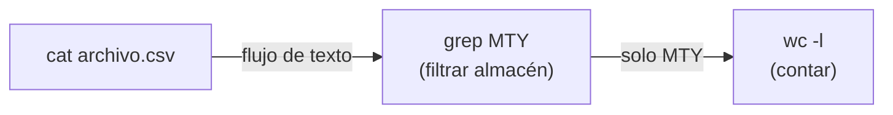

# Lección 01: Terminal y línea de comandos para integración

> **Nivel:** 🟢 Principiante · **Duración estimada:** 25 min

---

## Situación

Te conectas por primera vez a una máquina virtual de pruebas que Roberto Treviño habilitó en la red de Distribuidora Halcón. Solo tienes una ventana de SSH con una pantalla negra y el cursor parpadeando. 

En ese servidor se descargó el archivo del ERP nocturno y Roberto te pregunta: *"¿Llegaron los datos de hoy completos o falló la exportación?"*. 

No hay interfaz gráfica, ni ratón, ni explorador de carpetas. Con tres comandos en la terminal vas a saber cuántas líneas tiene el archivo, si hay registros nulos y cuál fue la última actualización.

---

## Conceptos clave

### 1. Navegación y manipulación básica

| Comando | Para qué sirve | Ejemplo práctico |
|---------|----------------|------------------|
| `pwd` | Ver la ruta actual de trabajo (*Print Working Directory*). | `pwd` |
| `ls -la` | Listar todos los archivos con permisos, peso y fechas detalladas. | `ls -lh datos/` |
| `cd` | Cambiar de directorio. | `cd ..` o `cd modulos/` |
| `mkdir -p` | Crear carpetas (incluso directorios padres si no existen). | `mkdir -p logs/2026/10/` |
| `cp` / `mv` | Copiar o mover/renombrar archivos. | `cp datos.csv respaldo.csv` |
| `rm` | Eliminar archivos (usar con mucha precaución; en terminal no hay papelera). | `rm temporal.txt` |

---

### 2. Inspección rápida de archivos grandes

Como FDE nunca debes abrir un archivo CSV de 500 MB con un editor de texto convencional (se congelará la máquina). En su lugar:

```bash
# Ver las primeras 5 líneas (ideal para ver los encabezados)
head -n 5 recursos/caso-de-estudio/datos/inventario_erp.csv

# Ver las últimas 5 líneas (para verificar si el archivo terminó bien)
tail -n 5 recursos/caso-de-estudio/datos/inventario_erp.csv

# Contar líneas del archivo (número total de registros)
wc -l recursos/caso-de-estudio/datos/inventario_erp.csv
```

---

### 3. La filosofía Unix: Pipes (`|`) y filtros

El verdadero poder de la terminal surge al conectar la salida de un programa con la entrada de otro mediante la tubería o *pipe* (`|`):



Comandos esenciales para filtrar datos:
- `grep "patrón"`: Busca líneas que contengan un texto.
  - `grep -i "abarrotes"` (ignora mayúsculas/minúsculas).
  - `grep -v "CDMX"` (invierte el filtro: muestra todo lo que NO sea CDMX).
- `sort` y `uniq`: Ordenar y eliminar/contar valores repetidos.
  - `sort archivo.txt | uniq -c` (muestra cuántas veces se repite cada valor).

---

### 4. Variables de entorno y el PATH

Las aplicaciones modernas no deben guardar credenciales fijas en el código. Se configuran mediante variables de entorno del sistema operativo:

```bash
# Definir una variable para la sesión actual
export PUERTO=9000
export CLIENT_ID="nexo-demo"

# Consultar el valor de una variable
echo $PUERTO

# Ver todas las variables disponibles
env | grep NEXO
```

La variable especial `PATH` le indica al sistema en qué carpetas buscar los ejecutables cuando escribes un comando (como `python3` o `git`).

---

## Ejemplo práctico con los datos del curso

Abre tu terminal en la raíz del repositorio y ejecuta:

```bash
# 1. ¿Cuántos registros tiene el CSV del ERP?
wc -l recursos/caso-de-estudio/datos/inventario_erp.csv

# 2. Filtrar únicamente los productos del almacén Monterrey (MTY)
grep ",MTY," recursos/caso-de-estudio/datos/inventario_erp.csv

# 3. Buscar si hay algún almacén extraño que no debería existir
cut -d',' -f4 recursos/caso-de-estudio/datos/inventario_erp.csv | sort | uniq
# ¡Notarás que aparece el almacén 'XYZ' que Roberto no reconoció!
```

---

## Errores comunes

- **Usar espacios al asignar variables en Bash:** `PUERTO = 8000` fallará; debe ser `PUERTO=8000` sin espacios alrededor del signo igual.
- **Ejecutar `rm -rf` sin revisar la ruta:** Un descuido con comodines (`rm -rf *`) en una carpeta equivocada puede borrar datos irreparables del servidor del cliente.
- **Olvidar el `export`:** Si defines `MI_VARIABLE="valor"` sin `export`, los programas hijos (como scripts de Python) no podrán leerla.

---

## En el día a día de un FDE

En llamadas de soporte técnico con clientes, un comando de una línea con `grep` y `wc -l` te permite responder en 3 segundos: *"El ERP envió 25 filas, pero solo 18 tenían formato válido; las otras 7 no incluían almacén asignado"*. Esa precisión desarma cualquier discusión subjetiva.

---

## Resumen

- La terminal es el entorno de trabajo estándar en servidores e integraciones remotas.
- Con `head`, `tail`, `wc` y `grep` puedes inspeccionar y validar volúmenes de datos masivos sin agotar memoria.
- Los pipes (`|`) te permiten encadenar utilidades simples para crear diagnósticos potentes.
- Las variables de entorno son el estándar para configurar credenciales y puertos de forma segura.

---

## Preguntas de repaso

1. ¿Cuál es la diferencia entre usar `head` y abrir un archivo directamente con un editor como VS Code o Nano?
2. ¿Qué hace la combinación de comandos `cut -d',' -f2 inventario.csv | sort | uniq -c`?
3. ¿Por qué es una mala práctica dejar valores fijos como contraseñas en el código en lugar de usar variables de entorno?

---

📦 [Volver al módulo](../README.md) | [Siguiente lección: Git y control de versiones](02-git-y-control-de-versiones.md) ➡️
