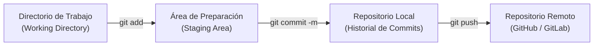

# Lección 02: Git profesional y trabajo colaborativo

> **Nivel:** 🟢 Principiante · **Duración estimada:** 25 min

---

## Situación

Estás modificando el conector de inventario de Halcón para agregar soporte a los productos de limpieza. Haces cambios directamente en la rama principal (`main`) a las 6:00 PM. De pronto, el conector deja de procesar los pedidos de abarrotes de Monterrey y comienzas a recibir llamadas urgentes. Quieres volver a la versión que funcionaba hace una hora, pero no guardaste una copia previa ni hiciste commits claros.

Un FDE no puede trabajar a ciegas: el control de versiones con Git es tu póliza de seguro, tu bitácora de auditoría y tu herramienta de colaboración con otros ingenieros.

---

## Conceptos clave

### 1. El ciclo de vida de los cambios en Git



- **Working Directory:** Donde editas tus archivos.
- **Staging Area:** Donde seleccionas cuidadosamente qué cambios formarán parte de tu siguiente versión.
- **Commit:** Una instantánea permanente e inmutable con autor, fecha y un mensaje que explica el *por qué*.

---

### 2. Flujo de trabajo con ramas (*Branching Strategy*)

Nunca trabajes directamente en la rama `main` en un proyecto de producción. Crea ramas cortas y descriptivas:

```bash
# Crear y cambiarse a una nueva rama
git checkout -b feature/limpieza-csv-halcon
# (En versiones modernas de git: git switch -c feature/limpieza-csv-halcon)

# Ver en qué rama estás actualmente
git status
```

Convenciones recomendadas para nombres de ramas:
- `feature/nombre-de-la-mejora` (ej. `feature/reintentos-api`)
- `fix/error-corregido` (ej. `fix/formato-fechas-mty`)
- `docs/documentacion` (ej. `docs/runbook-operativo`)

---

### 3. Mensajes de commit atómicos y profesionales

Un commit debe contener un cambio lógico coherente, no 20 cosas inconexas.

❌ **Mensajes malos:**
- `cambios`
- `arreglado bug`
- `asdfg`
- `subiendo código viernes`

✅ **Mensajes profesionales (estilo Conventional Commits):**
- `feat: normalizar categorias y precios en conector de inventario`
- `fix: corregir token expirado en llamadas recurrentes a /pedidos`
- `docs: agregar runbook de recuperacion ante error 503`
- `test: agregar prueba de reintentos con backoff exponencial`

---

### 4. La regla de oro: `.gitignore` y seguridad

El error más grave que puede cometer un FDE es subir accidentalmente credenciales reales, archivos `.env`, llaves privadas SSH o volcados de bases de datos a un repositorio remoto.

Para evitarlo, todo proyecto debe incluir un archivo `.gitignore` en su raíz que excluya automáticamente:

```text
# Archivos de entorno y credenciales (¡CRÍTICO!)
.env
.env.local
*.pem
*.key

# Archivos compilados y temporales de Python
__pycache__/
*.pyc
.pytest_cache/

# Entornos virtuales
venv/
.venv/
env/

# Datos locales y volcados temporales
*.db
*.sqlite3
logs/
*.log
```

---

## Comandos indispensables del día a día

```bash
# Ver qué archivos cambiaron y cuáles están en staging
git status

# Ver las diferencias exactas línea por línea antes de hacer commit
git diff

# Agregar un archivo específico
git add modulos/02-python-para-fde/ejemplos/limpiar_csv.py

# Guardar la versión con mensaje claro
git commit -m "feat: sanitizar espacios en blanco en SKUs de Halcon"

# Ver el historial de versiones resumido
git log --oneline -n 5
```

---

## Errores comunes

- **Hacer `git add .` sin revisar:** Agregar accidentalmente carpetas enteras de basura (`__pycache__` o archivos de configuración locales del editor como `.vscode/`).
- **Commits gigantescos de 2,000 líneas:** Hacen imposible que otro ingeniero revise tu código o que puedas revertir un error puntual sin perder todo lo demás.
- **Forzar un push con `git push --force` en ramas compartidas:** Puedes sobreescribir el trabajo de tus compañeros de equipo de forma destructiva.

---

## En el día a día de un FDE

Cuando termines una integración para Distribuidora Halcón, abrirás un **Pull Request (PR)** hacia el repositorio central de Nexo. En la descripción documentarás:
1. Qué problema del cliente resuelve.
2. Cómo se probó contra la API simulada.
3. El plan de reversión (*rollback*) en caso de que falle en producción.

Tus compañeros aprobarán tu cambio con total confianza.

---

## Resumen

- Git permite trabajar de forma segura, rastrear cada modificación y colaborar sin pisarse el código.
- Trabajar en ramas aisladas (`feature/`, `fix/`) mantiene la rama `main` siempre estable y desplegable.
- El archivo `.gitignore` es la primera línea de defensa para prevenir filtraciones de seguridad y datos de clientes.

---

## Preguntas de repaso

1. ¿Por qué es peligroso trabajar directamente sobre la rama `main` de un proyecto en producción?
2. Si ejecutaste `git status` y ves que el archivo `.env` aparece como pendiente de commit, ¿qué debes hacer antes de cualquier otra cosa?
3. ¿Qué información mínima debe contener un buen mensaje de commit?

---

⬅️ [Lección anterior: Terminal y comandos](01-terminal-y-linea-de-comandos.md) | 📦 [Módulo](../README.md) | [Siguiente lección: Entorno Python](03-entorno-python-y-paquetes.md) ➡️
