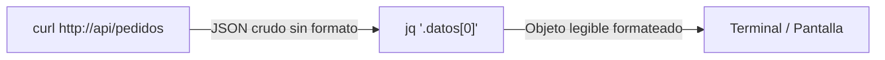

# Lección 04: Herramientas de diagnóstico: curl y jq

> **Nivel:** 🟢 Principiante · **Duración estimada:** 25 min

---

## Situación

Mariana López te envía un mensaje: *"Alex, estamos intentando crear un pedido desde nuestra terminal de Monterrey y el sistema arroja error, pero no sabemos si el servidor de pedidos está caído o si las credenciales fallaron"*.

Antes de ponerte a modificar código en Python o dudar de tu lógica, necesitas aislar el problema en la capa de transporte de red. Tu mejor aliado para probar APIs directamente en la línea de comandos es la dupla **`curl`** y **`jq`**.

---

## Conceptos clave

### 1. ¿Qué es `curl`?

`curl` (*Client URL*) es la herramienta de línea de comandos más extendida del mundo para transferir datos con sintaxis URL. Te permite hacer cualquier tipo de petición HTTP (GET, POST, PUT, DELETE), inspeccionar encabezados de respuesta, medir tiempos de latencia y probar autenticación sin intermediarios.

Banderas esenciales de `curl`:
- `-s` (*silent*): Oculta barras de progreso y métricas no solicitadas.
- `-i` (*include*): Muestra los encabezados de respuesta HTTP (código de estado, Content-Type, cookies, etc.).
- `-X METODO`: Especifica el verbo HTTP (por defecto es `GET`; usa `-X POST` para crear recursos).
- `-H "Encabezado: valor"`: Agrega cabeceras personalizadas (como `Authorization` o `Content-Type`).
- `-d '{"clave": "valor"}'`: Envía datos en el cuerpo de la petición (*payload*).

---

### 2. ¿Qué es `jq`?

La mayoría de las APIs modernas responden con JSON plano sin formatear (en una sola línea kilométrica). `jq` es un procesador de JSON ligero y ultra flexible para la terminal: no solo colorea y formatea el JSON para lectura humana (*pretty-print*), sino que permite filtrar, cortar y transformar estructuras complejas en una sola línea.

Comandos básicos de `jq`:
- `curl ... | jq .`: Formatea e indenta el JSON con colores legibles.
- `curl ... | jq .clave`: Extrae el valor de un campo específico.
- `curl ... | jq '.datos[] | {sku: .sku, nombre: .nombre}'`: Itera sobre un arreglo y proyecta solo los campos necesarios.



---

## Ejemplos prácticos contra la API simulada del curso

Inicia primero la API simulada en una terminal secundaria si aún no está corriendo:
```bash
python recursos/api-simulada/servidor.py
```

En tu terminal de trabajo ejecuta estos comandos:

### 1. Verificar salud del servicio (GET)
```bash
curl -s http://127.0.0.1:8000/salud | jq .
# Salida esperada:
# {
#   "estado": "ok"
# }
```

### 2. Obtener un token de autenticación (POST con JSON)
```bash
curl -s -X POST http://127.0.0.1:8000/auth/token \
  -H "Content-Type: application/json" \
  -d '{"client_id": "nexo-demo", "client_secret": "secreto-de-practica"}' | jq .
```

### 3. Extraer el token y guardarlo en una variable de entorno
```bash
TOKEN=$(curl -s -X POST http://127.0.0.1:8000/auth/token \
  -H "Content-Type: application/json" \
  -d '{"client_id": "nexo-demo", "client_secret": "secreto-de-practica"}' | jq -r .access_token)

echo "Mi token obtenido es: $TOKEN"
```

### 4. Consultar pedidos con token Bearer y filtrar con `jq`
```bash
# Consultar los primeros 3 pedidos pendientes del almacén Monterrey
curl -s "http://127.0.0.1:8000/pedidos?almacen=MTY&por_pagina=3" \
  -H "Authorization: Bearer $TOKEN" | jq '.datos[] | {id: .id, tienda: .tienda, estado: .estado}'
```

---

## Errores comunes

- **Olvidar el encabezado `Content-Type: application/json` en peticiones POST:** Si envías un cuerpo JSON sin esta cabecera, muchos servidores asumirán que envías texto plano o formulario web y responderán con error `400 Bad Request` o `415 Unsupported Media Type`.
- **No escapar comillas en argumentos JSON de `curl` en Windows:** En PowerShell o CMD de Windows, las comillas dobles dentro de una cadena pueden requerir barras invertidas (`\"`). En Bash / Zsh en macOS y Linux, envolver todo el cuerpo con comillas simples (`-d '{...}'`) funciona directamente.
- **Usar `jq` sobre una respuesta que no es JSON:** Si el servidor responde con un error 502 Bad Gateway en formato HTML, `jq` arrojará un error de parseo (`parse error: Invalid numeric literal`). Usa `curl -i` para ver los encabezados reales.

---

## En el día a día de un FDE

Cuando un cliente afirma: *"Su plataforma no está guardando los pedidos"*, un FDE no especula. Ejecuta un comando `curl -i` simulando el pedido exacto del cliente, captura el código HTTP retornado y el encabezado `Retry-After` o el mensaje de error, y envía la captura de pantalla:

> *"Roberto, probamos el endpoint directamente desde la red: el servidor respondió 422 porque la tienda 'T9999' no está dada de alta en el catálogo maestro. El conector está funcionando según las reglas de negocio acordadas."*

---

## Resumen

- `curl` permite probar cualquier endpoint HTTP de forma directa y reproducible.
- Las opciones `-s` (silencioso), `-i` (mostrar headers), `-X` (verbo) y `-H` (cabeceras) son las más utilizadas.
- `jq` formatea, filtra y proyecta información de respuestas JSON en la línea de comandos.
- Probar primero con `curl` permite aislar si un problema es de red, de credenciales o de la aplicación.

---

## Preguntas de repaso

1. ¿Qué diferencia hay entre ejecutar `curl http://ejemplo.com` y `curl -i http://ejemplo.com`?
2. ¿Cómo le pedirías a `jq` que te entregue solo el valor de texto crudo de un campo sin comillas dobles?
3. Si un endpoint requiere autenticación Bearer, ¿cuál es la sintaxis exacta de la cabecera HTTP que debes pasar en `curl`?

---

⬅️ [Lección anterior: Entorno Python](03-entorno-python-y-paquetes.md) | 📦 [Módulo](../README.md) | [Ir a Ejemplos del módulo](01-terminal-y-linea-de-comandos.md) ➡️
