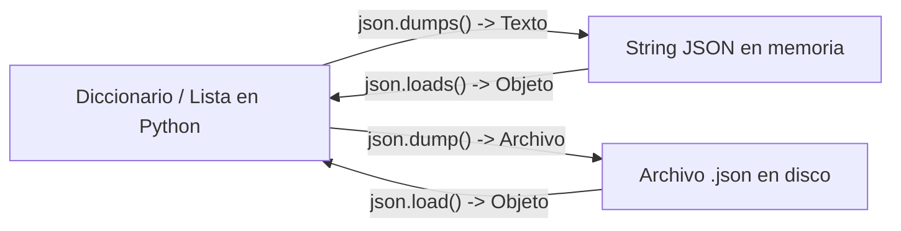

# Lección 02: Manipulación de archivos: CSV y JSON en la práctica

> **Nivel:** 🟢 Principiante · **Duración estimada:** 30 min

---

## Situación

Cada día a las 4:00 AM, el script de integración de Nexo debe:
1. Abrir la exportación CSV del ERP de Halcón (`inventario_erp.csv`).
2. Descartar registros no válidos y corregir inconsistencias.
3. Exportar un archivo JSON estructurado con el resumen de productos con stock bajo para que la API de alertas de Nexo lo procese.

Hacer esto leyendo líneas con `archivo.split(",")` a mano es una receta para desastres (¿qué pasa si el nombre de un producto tiene una coma dentro, como `"Frijol, especial 1kg"`?). Necesitamos utilizar las herramientas nativas especializadas: `csv` y `json`.

---

## Conceptos clave

### 1. El módulo `csv` y `DictReader`

La mejor forma de procesar archivos tabulares en Python es con `csv.DictReader`. En lugar de trabajar con índices numéricos confusos (`fila[0]`, `fila[4]`), cada fila se convierte en un diccionario con los nombres de las columnas:

```python
import csv

with open("recursos/caso-de-estudio/datos/inventario_erp.csv", mode="r", encoding="utf-8") as f:
    lector = csv.DictReader(f)
    for fila in lector:
        print(fila["sku"], fila["nombre"], fila["cantidad"])
```

Para escribir un nuevo archivo CSV limpio:
```python
campos = ["sku", "nombre", "almacen", "cantidad", "precio", "fecha"]

with open("inventario_limpio.csv", mode="w", encoding="utf-8", newline="") as f:
    escritor = csv.DictWriter(f, fieldnames=campos)
    escritor.writeheader()
    escritor.writerow({
        "sku": "HAL-1001",
        "nombre": "Arroz chico",
        "almacen": "MTY",
        "cantidad": 120,
        "precio": 18.50,
        "fecha": "2026-10-01"
    })
```

> **Nota crítica:** En Windows y Linux, siempre especifica `newline=""` al abrir un archivo para escritura con `csv.writer`, de lo contrario se insertarán saltos de línea dobles accidentales.

---

### 2. El módulo `json`: `dump` vs. `dumps`

JSON es el lenguaje universal de las APIs web:



Regla nemotécnica:
- Con **"s"** al final (`dumps`, `loads`): trabaja con **Strings** (cadenas de texto).
- Sin "s" (`dump`, `load`): trabaja con un **File** (archivo abierto con `open`).

```python
import json

payload_alerta = {
    "cliente": "Distribuidora Halcón",
    "fecha_corte": "2026-10-14",
    "productos_criticos": [
        {"sku": "HAL-1001", "almacen": "CDMX", "stock_actual": 0, "minimo": 50}
    ]
}

# Guardar en archivo con indentación bonita y caracteres especiales legibles
with open("alerta_stock.json", mode="w", encoding="utf-8") as f:
    json.dump(payload_alerta, f, indent=2, ensure_ascii=False)
```

> **Buenas prácticas con JSON:** Siempre usa `ensure_ascii=False` para que caracteres con acento o la letra "ñ" no se conviertan en secuencias crípticas como `\u00f1`.

---

## Errores comunes

- **Olvidar el parámetro `encoding="utf-8"`:** Si abres archivos sin especificar la codificación, en Windows se usará la página de códigos local (como `cp1252`), arruinando acentos y nombres con `UnicodeDecodeError`.
- **Hacer parsing manual de CSV usando `.split(",")`:** Rompe catastróficamente cuando los campos contienen comas dentro de comillas (ejemplo: `"76,50"` o `"Abarrotes, S.A."`).
- **Serializar objetos que no son nativos en JSON:** Intentar guardar objetos `datetime.date` directamente en JSON sin convertirlos antes a cadenas ISO (`.isoformat()`) provocará `TypeError: Object of type date is not JSON serializable`.

---

## En el día a día de un FDE

A menudo te pedirán conectar dos sistemas que no se entienden: uno solo exporta un archivo plano delimitado por tabuladores y el otro solo acepta un JSON por POST. Con 15 líneas de Python usando `csv.DictReader` y `json.dumps`, eres capaz de construir ese puente en 20 minutos.

---

## Resumen

- Usa `csv.DictReader` y `csv.DictWriter` para manipular datos tabulares sin depender de índices numéricos frágiles.
- Usa `encoding="utf-8"` y `newline=""` siempre al abrir archivos.
- `json.dump` / `json.load` interactúan con archivos; `json.dumps` / `json.loads` interactúan con cadenas en memoria.
- `ensure_ascii=False` preserva el español correctamente legible en JSON.

---

## Preguntas de repaso

1. ¿Qué diferencia hay entre `json.loads()` y `json.load()`?
2. Si un archivo CSV contiene un valor con comas dentro de comillas (como `"76,50"`), ¿por qué falla `linea.split(",")` y cómo lo soluciona `csv.reader`?
3. ¿Para qué sirve el parámetro `ensure_ascii=False` en `json.dump()`?

---

⬅️ [Lección anterior: Estructuras de datos](01-fundamentos-y-estructuras-de-datos.md) | 📦 [Módulo](../README.md) | [Siguiente lección: Manejo de errores](03-manejo-de-errores-y-validaciones.md) ➡️
