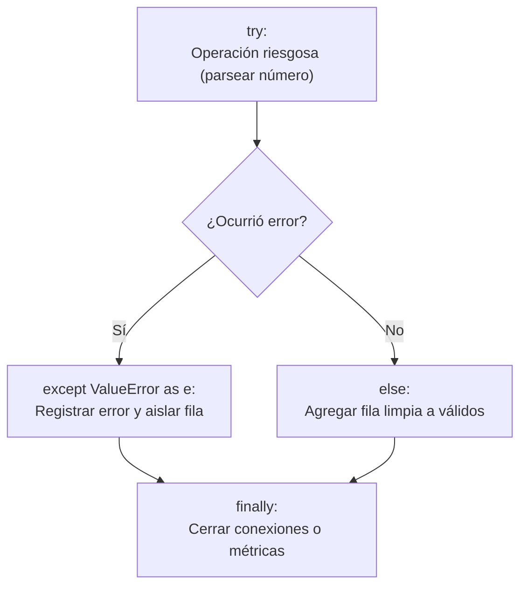

# Lección 03: Manejo defensivo de errores y validación de datos

> **Nivel:** 🟢 Principiante · **Duración estimada:** 30 min

---

## Situación

Son las 3:05 AM. Tu conector nocturno comienza a procesar el archivo `inventario_erp.csv`. Todo va perfecto hasta la línea 10: el precio viene con el formato `"76,50"` con coma decimal y la línea 16 trae `N/D` en la columna de cantidad.

Tu script no tenía manejo defensivo de errores. Lanza un `ValueError: could not convert string to float`, el programa aborta abruptamente y las 15 filas siguientes nunca se procesaron. A las 8:00 AM, Laura Garza abre su tablero y descubre que el almacén de Guadalajara no tiene inventario actualizado.

Un FDE escribe código que se dobla pero no se rompe: captura las anomalías, las aísla en una bitácora de rechazos y continúa procesando el resto del lote.

---

## Conceptos clave

### 1. El bloque `try / except / else / finally`



- **`try`**: Código que podría fallar (conversiones de tipo, peticiones de red, lectura de archivos).
- **`except TipoDeError`**: Captura específica del error esperado. ¡Nunca uses `except:` desnudo sin especificar el tipo!
- **`else`**: Se ejecuta únicamente si el bloque `try` tuvo éxito completo.
- **`finally`**: Se ejecuta **siempre**, haya ocurrido error o no (ideal para liberar recursos).

```python
def parsear_precio(precio_str: str) -> float:
    """Convierte cadenas con comas o puntos a número flotante válido."""
    if not precio_str:
        raise ValueError("El precio no puede estar vacío.")
    # Reemplazar comas por puntos (formato común en México/Latam: '76,50' -> '76.50')
    limpio = precio_str.replace(",", ".").strip()
    valor = float(limpio)
    if valor < 0:
        raise ValueError(f"Precio negativo inválido: {valor}")
    return valor
```

---

### 2. El patrón "Dead Letter Queue" (Buzón de rechazos)

En pipelines de datos profesionales, las filas no se descartan silenciosamente al piso ni detienen la ejecución. Se dividen en dos listas:

```python
filas_validas: list[dict] = []
filas_rechazadas: list[dict] = []

for numero_linea, fila in enumerate(lector_csv, start=2):
    errores = []
    
    # 1. Validar SKU
    sku = fila.get("sku", "").strip().upper()
    if not sku.startswith("HAL-"):
        errores.append(f"SKU inválido: '{sku}'")
        
    # 2. Validar Almacén
    almacen = fila.get("almacen", "").strip().upper()
    if almacen not in {"MTY", "GDL", "CDMX"}:
        errores.append(f"Almacén desconocido: '{almacen}'")
        
    # 3. Validar Cantidad
    try:
        cant_str = fila.get("cantidad", "")
        if cant_str in {"N/D", ""}:
            raise ValueError("Cantidad no disponible o vacía")
        cantidad = int(cant_str)
        if cantidad < 0:
            raise ValueError(f"Cantidad negativa: {cantidad}")
    except ValueError as e:
        errores.append(str(e))
        
    # Decisión
    if errores:
        filas_rechazadas.append({
            "linea": numero_linea,
            "sku": sku,
            "motivos": errores,
            "fila_cruda": fila
        })
    else:
        filas_validas.append({
            "sku": sku,
            "almacen": almacen,
            "cantidad": cantidad
        })
```

---

### 3. Crear excepciones personalizadas de negocio

Para distinguir entre un error técnico del lenguaje y una violación de las reglas del cliente:

```python
class ErrorDeNegocioHalcon(Exception):
    """Excepción base para errores de negocio con el cliente."""
    pass

class AlmacenNoAutorizadoError(ErrorDeNegocioHalcon):
    """Lanzada cuando un registro hace referencia a un almacén inexistente."""
    pass
```

---

## Errores comunes

- **El silencio de los corderos (`except: pass`):** Tragar todas las excepciones sin registrar nada. Cuando el cliente pregunte por qué faltan productos, no tendrás ni una sola pista en los logs.
- **Detener el lote completo por un solo campo corrupto:** En un archivo de 5,000 productos, descartar los 4,999 válidos porque el producto 2,100 tenía un precio vacío es inaceptable para el negocio.
- **No registrar el número de línea del archivo:** Si le dices a Roberto Treviño *"hay un SKU malo en alguna parte del archivo de 10,000 líneas"*, tardará horas en encontrarlo. Si le dices *"la línea 412 contiene 'hal-xyz'"*, lo corrige en 1 minuto.

---

## En el día a día de un FDE

Cada mañana, tu script debe poder enviar un resumen automatizado que diga:
> *"Procesamiento nocturno concluido: 498 productos sincronizados exitosamente (99.6 %). 2 filas enviadas al reporte de anomalías (Línea 10: precio con coma corregido; Línea 16: cantidad N/D en CDMX)."*

Eso demuestra control total del sistema.

---

## Resumen

- Escribe código defensivo: nunca asumas que los datos externos son correctos.
- Usa `try/except` específico para aislar fallas sin abortar el procesamiento de filas válidas.
- Implementa el patrón de buzón de rechazos guardando el número de línea y el motivo exacto de descarte.

---

## Preguntas de repaso

1. ¿Por qué se considera una mala práctica usar `except Exception:` o `except:` sin especificar el error?
2. ¿Qué ventaja ofrece separar las filas rechazadas en un archivo de auditoría independiente?
3. ¿En qué escenario utilizarías el bloque `else` dentro de una estructura `try / except`?

---

⬅️ [Lección anterior: Archivos CSV y JSON](02-archivos-csv-y-json.md) | 📦 [Módulo](../README.md) | [Siguiente lección: CLI y Logging](04-cli-con-argparse-y-logging.md) ➡️
