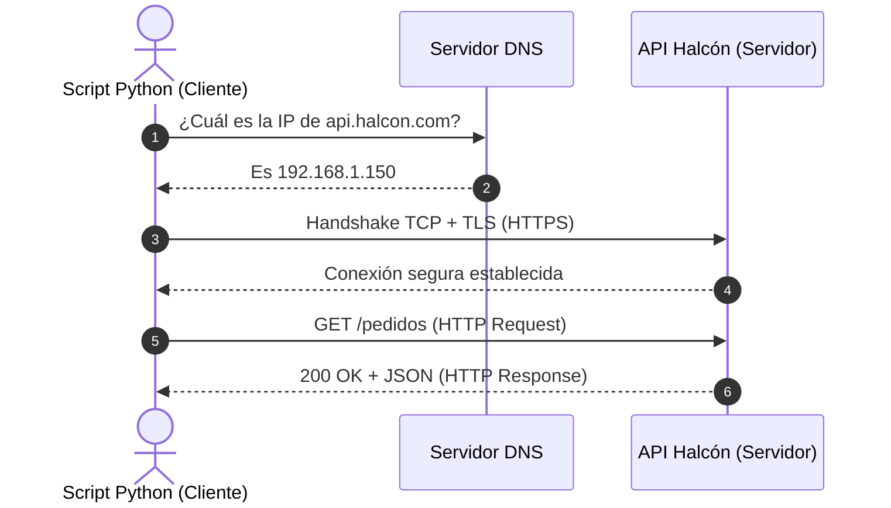

# Lección 01: Cómo funciona la Web: Modelo cliente-servidor y HTTP

> **Nivel:** 🟢 Principiante · **Duración estimada:** 20 min

---

## Situación

Roberto Treviño te pregunta: *"Nuestros servidores del ERP están dentro de nuestra red privada en Monterrey protegidos por un firewall corporativo. ¿Cómo se va a comunicar el conector de Nexo con nuestra API interna de pedidos sin comprometer nuestra seguridad?"*.

Para responder con autoridad técnica y diseñar una arquitectura viable, necesitas tener absoluta claridad sobre el modelo cliente-servidor, la resolución de nombres con DNS y el protocolo HTTP/HTTPS sobre TCP/IP.

---

## Conceptos clave

### 1. El modelo Cliente - Servidor

Toda interacción web involucra dos roles bien definidos:
- **Cliente:** El programa que **inicia** la conversación enviando una petición (*Request*). En nuestro curso, el cliente suele ser un script en Python corriendo en la infraestructura local.
- **Servidor:** El programa que escucha pasivamente en un puerto de red (ej. puerto 8000 o 443), procesa la solicitud y devuelve una respuesta (*Response*).

---

### 2. DNS y Capa de Transporte

Antes de que un mensaje HTTP pueda viajar:
1. **Resolución DNS:** Se traduce el nombre de dominio humano (`api.halcon.com`) a una dirección IP numérica (`192.168.1.150`).
2. **Conexión TCP (Puerto):** Se abre un canal de comunicación confiable en un puerto específico (por convención, puerto `80` para HTTP y `443` para HTTPS).
3. **Cifrado TLS (HTTPS):** En HTTPS, los datos viajan cifrados de extremo a extremo mediante certificados digitales. Nadie que intercepte el tráfico en la red intermedia puede leer las contraseñas ni los datos de inventario.

---

### 3. HTTP: Un protocolo sin estado (*Stateless*)

El protocolo HTTP es inherentemente **sin estado**: el servidor no recuerda quién eres entre una petición y otra. Cada petición debe incluir toda la información necesaria para identificarte y autorizar la acción (por ejemplo, mediante una cabecera `Authorization: Bearer <token>`).

---

## Errores comunes

- **Confundir HTTP con TCP o IP:** IP se encarga del direccionamiento de paquetes; TCP garantiza que los paquetes lleguen completos y en orden; HTTP define el formato del mensaje de negocio (petición/respuesta).
- **Asumir que localhost es accesible desde otra máquina:** `127.0.0.1` o `localhost` solo apunta a la misma computadora donde corre el proceso. Si Roberto intenta conectarse desde su máquina a tu `127.0.0.1:8000`, la conexión será rechazada.
- **Ignorar advertencias de certificados TLS:** Desactivar la verificación SSL (`verify=False`) en clientes de producción expone al cliente a ataques de intermediario (*Man-in-the-Middle*).

---

## En el día a día de un FDE

En la reunión con Roberto, puedes explicarle:
> *"Roberto, el conector operará como cliente saliente: iniciará peticiones HTTPS hacia los endpoints que ustedes nos indiquen a través del puerto seguro estándar 443. Su firewall no necesita abrir puertos de entrada al exterior, lo que mantiene su red privada completamente aislada."*

---

## Resumen

- La web opera bajo el modelo cliente-servidor: el cliente inicia la petición, el servidor responde.
- HTTP corre sobre TCP y es un protocolo sin estado (*stateless*).
- HTTPS añade una capa de cifrado TLS para proteger la confidencialidad e integridad de los datos en tránsito.

---

## Preguntas de repaso

1. ¿Por qué se dice que el protocolo HTTP es "sin estado" (*stateless*)?
2. ¿Cuál es la función del servidor DNS antes de que pueda enviarse una petición HTTP?
3. Si un script corre en el servidor A y necesita consultar una API en el servidor B, ¿quién actúa como cliente y quién como servidor?

---

📦 [Volver al módulo](../README.md) | [Siguiente lección: Anatomía de petición y respuesta](02-anatomia-de-peticion-y-respuesta.md) ➡️
