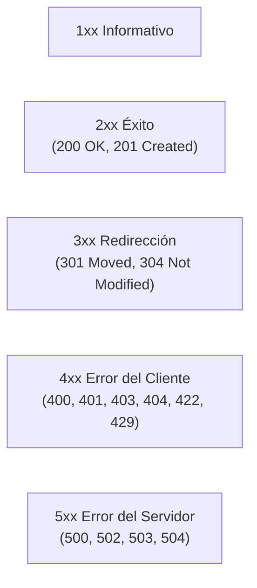

# Lección 02: Anatomía de una petición y respuesta HTTP

> **Nivel:** 🟢 Principiante · **Duración estimada:** 25 min

---

## Situación

Estás probando la creación de un pedido para una tienda abarrotera en la API simulada de Distribuidora Halcón. Envías los datos y la API responde con un número: **422**. 

Si no comprendes la estructura exacta de un mensaje HTTP, el número 422 no te dirá nada. Pero si sabes leer la respuesta HTTP completa, verás que en los encabezados dice `Content-Type: application/json` y en el cuerpo viene un objeto con el detalle exacto: `{"error": "validacion", "detalles": ["sku desconocido: HAL-9999"]}`.

---

## Conceptos clave

Un mensaje HTTP en texto plano tiene 4 componentes esenciales:

```mermaid
flowchart TD
    subgraph Petición HTTP (Request)
        A["1. Línea de solicitud: MÉTODO + RUTA + VERSIÓN<br/>(POST /pedidos HTTP/1.1)"]
        B["2. Encabezados (Headers): Metadatos clave-valor<br/>(Authorization, Content-Type)"]
        C["3. Línea en blanco separadora"]
        D["4. Cuerpo (Body / Payload): Datos en JSON"]
        A --> B --> C --> D
    end

    subgraph Respuesta HTTP (Response)
        E["1. Línea de estado: VERSIÓN + CÓDIGO + MENSAJE<br/>(HTTP/1.1 201 Created)"]
        F["2. Encabezados: Metadatos del servidor<br/>(Content-Type, Content-Length)"]
        G["3. Línea en blanco separadora"]
        H["4. Cuerpo: Datos retornados en JSON"]
        E --> F --> G --> H
    end
```

---

### 1. Métodos HTTP (Verbos)

Indican la intención de la operación sobre el recurso:

| Método | Propósito principal | ¿Lleva cuerpo (*Body*)? | ¿Es seguro (solo lectura)? | ¿Es idempotente? |
|--------|---------------------|--------------------------|----------------------------|------------------|
| **`GET`** | Consultar o leer información | No | Sí | Sí |
| **`POST`** | Crear un recurso nuevo o procesar una acción | Sí | No | No (por defecto) |
| **`PUT`** | Reemplazar completamente un recurso existente | Sí | No | Sí |
| **`PATCH`**| Actualizar parcialmente campos específicos | Sí | No | No |
| **`DELETE`**| Eliminar un recurso | Generalmente no | No | Sí |

---

### 2. Códigos de Estado (*Status Codes*)

El código de estado resume el resultado de la petición mediante una convención numérica de 3 dígitos:



#### Los códigos que verás todos los días como FDE:

| Código | Nombre | Significado operativo para el FDE |
|--------|--------|-----------------------------------|
| **`200`** | OK | Éxito en lectura (`GET`) o actualización (`PUT`). |
| **`201`** | Created | Recurso creado exitosamente (ej. nuevo pedido generado con `POST`). |
| **`400`** | Bad Request | El cuerpo enviado no es JSON válido o la sintaxis es incorrecta. |
| **`401`** | Unauthorized | Token ausente, vencido o credenciales inválidas. Toca renovar token. |
| **`403`** | Forbidden | Estás autenticado pero no tienes permisos para esa acción o almacén. |
| **`404`** | Not Found | La URL o el ID del recurso no existe (ej. `/productos/HAL-9999`). |
| **`422`** | Unprocessable Entity | Sintaxis válida pero falló la lógica de negocio (ej. SKU inexistente o cantidad $\le 0$). |
| **`429`** | Too Many Requests | Excediste el límite de peticiones por minuto (*Rate Limit*). Revisa cabecera `Retry-After`. |
| **`500`** | Internal Server Error | Falla no controlada dentro del servidor del cliente (bug en su backend). |
| **`503`** | Service Unavailable | Servidor temporalmente fuera de servicio o sobrecargado. Apto para reintentar. |

---

### 3. Encabezados cruciales (*Headers*)

- `Content-Type: application/json`: Avisa que el cuerpo que envías está en formato JSON.
- `Authorization: Bearer <token>`: Envía el token de acceso para identificarte.
- `Retry-After: 60`: Enviado por el servidor ante un código 429 para indicar cuántos segundos debes esperar antes de reintentar.
- `Idempotency-Key: <uuid>`: Llave única para evitar procesar dos veces la misma transacción en reintentos.

---

## Errores comunes

- **Usar `GET` para enviar datos mutables en el cuerpo:** Aunque algunas librerías lo permiten técnicamente, muchos servidores y proxies intermedios descartan el cuerpo de peticiones `GET`.
- **Tratar todos los errores como 500:** Culpar al servidor cuando la respuesta fue un 401 (token expirado) o un 422 (datos mal formados por tu script).
- **Ignorar el encabezado `Retry-After`:** Bombardear con más peticiones a una API que acaba de responderte 429 solo empeora el bloqueo.

---

## En el día a día de un FDE

Cuando un cliente dice: *"La integración falló"*, lo primero que haces es inspeccionar el código de estado retornado:
- Si es `401`: Verificas si el proceso de renovación de token corrió a tiempo.
- Si es `422`: Muestras qué campo del pedido no cumplió las validaciones.
- Si es `503`: Activas el reintento automático con backoff exponencial.

---

## Resumen

- Una petición HTTP se compone de Método, Ruta, Encabezados y Cuerpo opcional.
- Una respuesta contiene Código de Estado, Encabezados y Cuerpo.
- Los códigos 2xx indican éxito, 4xx indican que el cliente debe corregir la solicitud y 5xx indican problemas en el servidor.

---

## Preguntas de repaso

1. ¿Cuál es la diferencia de concepto entre un error `401 Unauthorized` y un `403 Forbidden`?
2. ¿Qué indica un código de estado `422 Unprocessable Entity` y en qué se diferencia de un `400 Bad Request`?
3. Si recibes una respuesta con código `429`, ¿qué encabezado HTTP debes inspeccionar para saber cuánto esperar?

---

⬅️ [Lección anterior: Cómo funciona la Web](01-como-funciona-la-web-y-http.md) | 📦 [Módulo](../README.md) | [Siguiente lección: Principios REST](03-principios-rest-y-diseno-de-apis.md) ➡️
