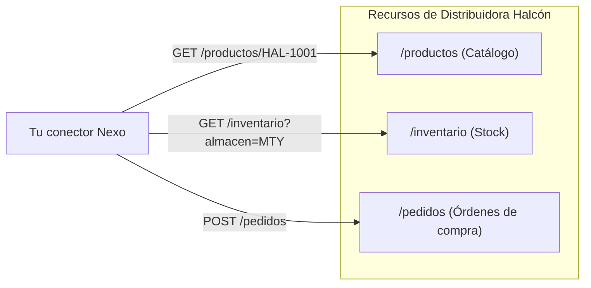

# Lección 03: Arquitectura REST y lectura de documentación

> **Nivel:** 🟢 Principiante · **Duración estimada:** 25 min

---

## Situación

Roberto Treviño te envía un archivo Swagger / OpenAPI o un documento en PDF de 30 páginas con la especificación de la API de Distribuidora Halcón. 

Si no estás acostumbrado a los patrones de diseño REST, navegar por decenas de endpoints parecerá abrumador. Pero las APIs bien diseñadas siguen patrones lógicos y predecibles basados en **recursos**, **sustantivos en plural** y **relaciones anidadas**.

---

## Conceptos clave

### 1. ¿Qué es REST?

**REST** (*Representational State Transfer*) es un estilo arquitectónico para diseñar servicios web centrado en **recursos** identificados por URLs únicas:

- Las URLs utilizan **sustantivos en plural**, nunca verbos de acción.
  - ❌ Mal diseño estilo RPC: `/obtenerPedidos`, `/crearPedido`, `/borrarPedido`
  - ✅ Buen diseño REST: `/pedidos` con métodos `GET`, `POST`, `DELETE`
- Las operaciones se definen mediante los verbos HTTP estándar (`GET`, `POST`, `PUT`, `DELETE`).



---

### 2. Estructura estándar de endpoints REST

| Operación | Método | URL | Descripción | Código de éxito |
|-----------|--------|-----|-------------|-----------------|
| Listar colección | `GET` | `/pedidos` | Obtiene una lista paginada de pedidos | `200 OK` |
| Consultar detalle | `GET` | `/pedidos/{id}` | Obtiene los datos de un pedido específico | `200 OK` |
| Crear nuevo | `POST` | `/pedidos` | Crea un nuevo pedido con el JSON del cuerpo | `201 Created` |
| Reemplazar | `PUT` | `/pedidos/{id}` | Actualiza todos los campos del pedido | `200 OK` |
| Eliminar | `DELETE`| `/pedidos/{id}` | Cancela o elimina el pedido | `200 OK` o `204 No Content` |

---

### 3. Parámetros de consulta (*Query Parameters*)

Se usan para **filtrar**, **ordenar** o **paginar** colecciones sin cambiar la ruta base:

```text
GET /pedidos?estado=pendiente&almacen=MTY&pagina=1&por_pagina=20
```

- `?`: Marca el inicio de los parámetros de consulta.
- `&`: Separa múltiples parámetros clave-valor.

---

### 4. Estructuras de respuesta paginada

Cuando una base de datos contiene 100,000 pedidos, una API nunca los devuelve todos en una sola respuesta (haría colapsar la memoria). Devuelve páginas:

```json
{
  "datos": [
    { "id": 101, "tienda": "Tienda 0001", "estado": "pendiente" },
    { "id": 102, "tienda": "Tienda 0002", "estado": "pendiente" }
  ],
  "pagina": 1,
  "por_pagina": 2,
  "total": 43,
  "siguiente_pagina": 2
}
```

Un FDE lee el campo `siguiente_pagina` (o cursores de paginación) para automatizar la descarga completa recorriendo página por página en un ciclo `while`.

---

## Errores comunes

- **Tratar de inventar endpoints ad-hoc:** Intentar llamar a `/pedidos/cancelar` cuando la API estándar requiere un `DELETE /pedidos/{id}` o un `PATCH /pedidos/{id}` con `{"estado": "cancelado"}`.
- **Asumir que la página 1 contiene todo:** Consultar `/productos` y asumir que solo existen los primeros 20 productos porque no revisaste los metadatos de paginación.
- **No leer la sección de errores de la documentación:** Pasar horas depurando un error sin consultar la tabla donde el proveedor explica qué significa el código de error devuelto.

---

## En el día a día de un FDE

Antes de escribir una sola línea de código para un nuevo cliente, un FDE invierte 30 minutos en inspeccionar la documentación:
1. ¿Cómo se autentica? (¿API Key, Basic Auth, Bearer Token?)
2. ¿Cuáles son los límites de tasa (*rate limits*)?
3. ¿Cómo maneja la paginación?
4. ¿Tiene entorno de pruebas (*sandbox / staging*)?

---

## Resumen

- REST organiza las APIs en torno a recursos representados por sustantivos (`/pedidos`).
- Los métodos HTTP (`GET`, `POST`, `PUT`, `DELETE`) determinan la acción a realizar.
- Los query parameters permiten filtrar y paginar colecciones de datos masivas.
- Leer la documentación antes de programar ahorra días de retrabajo.

---

## Preguntas de repaso

1. ¿Por qué una ruta como `POST /crear_nuevo_producto` no sigue las mejores prácticas de diseño REST?
2. En una respuesta paginada, ¿qué indica que hemos llegado a la última página de resultados?
3. ¿Cuál es la diferencia entre pasar un identificador en la ruta (`/pedidos/15`) vs. en un query param (`/pedidos?id=15`)?

---

⬅️ [Lección anterior: Anatomía HTTP](02-anatomia-de-peticion-y-respuesta.md) | 📦 [Módulo](../README.md) | [Siguiente lección: Consumir APIs desde Python](04-consumir-apis-desde-python.md) ➡️
