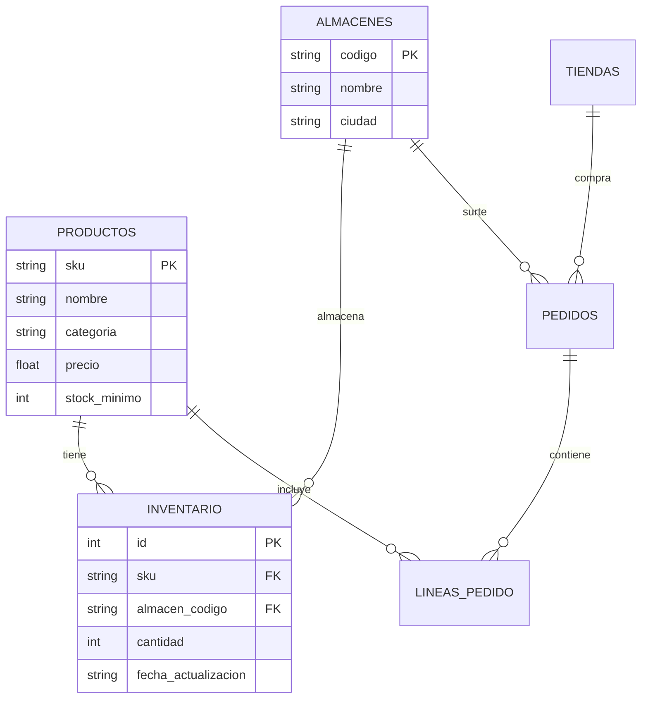

# Lección 01: Modelado relacional para integraciones de FDE

> **Nivel:** 🟢 Principiante · **Duración estimada:** 25 min

---

## Situación

En el archivo `inventario_erp.csv`, cada fila repite el nombre del producto, la categoría y el precio junto con el almacén y la cantidad:

```text
HAL-1001,Arroz chico,abarrotes,MTY,120,18.50,2026-10-01
HAL-1001,Arroz chico,abarrotes,GDL,85,18.50,2026-10-01
HAL-1001,Arroz chico,abarrotes,CDMX,0,18.50,2026-10-01
```

Si el día de mañana el precio del arroz sube a `$19.50`, el ERP tendría que actualizar cientos de registros. Si por error solo actualiza la fila de Monterrey, el sistema quedará en un estado inconsistente con precios contradictorios para el mismo artículo.

El **modelado relacional** resuelve esto separando las entidades independientes (el catálogo maestro de productos) de los hechos transaccionales (cuántas cajas hay físicamente en cada almacén).

---

## Conceptos clave

### 1. Entidades, Atributos y Normalización

Un esquema relacional descompone el dominio en **tablas**:



---

### 2. Llaves Primarias y Foráneas

- **`PRIMARY KEY` (Llave primaria):** Identificador único inmutable de cada fila en una tabla (ej. `sku` en `productos` o `id` autoincremental).
- **`FOREIGN KEY` (Llave foránea):** Columna que apunta a la llave primaria de otra tabla, garantizando **integridad referencial** (no puedes registrar inventario de un SKU que no exista previamente en la tabla de productos).

---

### 3. Definición DDL en SQLite (`esquema.sql`)

```sql
-- 1. Tabla de Productos (Catálogo Maestro)
CREATE TABLE IF NOT EXISTS productos (
    sku TEXT PRIMARY KEY,
    nombre TEXT NOT NULL,
    categoria TEXT NOT NULL,
    precio REAL NOT NULL CHECK(precio > 0),
    stock_minimo INTEGER DEFAULT 20
);

-- 2. Tabla de Almacenes
CREATE TABLE IF NOT EXISTS almacenes (
    codigo TEXT PRIMARY KEY,
    nombre TEXT NOT NULL,
    ciudad TEXT NOT NULL
);

-- 3. Tabla de Inventario (Existencias por almacén)
CREATE TABLE IF NOT EXISTS inventario (
    id INTEGER PRIMARY KEY AUTOINCREMENT,
    sku TEXT NOT NULL,
    almacen_codigo TEXT NOT NULL,
    cantidad INTEGER NOT NULL CHECK(cantidad >= 0),
    fecha_actualizacion TEXT NOT NULL,
    FOREIGN KEY (sku) REFERENCES productos(sku),
    FOREIGN KEY (almacen_codigo) REFERENCES almacenes(codigo),
    UNIQUE(sku, almacen_codigo) -- ¡Evita duplicar el mismo producto en el mismo almacén!
);
```

---

## Errores comunes

- **No habilitar llaves foráneas en SQLite:** Por compatibilidad histórica, SQLite viene con llaves foráneas deshabilitadas por defecto. En toda conexión debes ejecutar `PRAGMA foreign_keys = ON;`.
- **Usar cadenas arbitrarias como identificadores mutables:** Usar el nombre del producto como llave primaria. Si el nombre se corrige de `"Arroz chico"` a `"Arroz Chico 500g"`, romperías todas las relaciones. Usa códigos inmutables como el SKU.
- **Permitir cantidades negativas:** Olvidar restricciones `CHECK(cantidad >= 0)` permite que entren datos corruptos que desbalancean los reportes financieros.

---

## En el día a día de un FDE

En tus proyectos de FDE, una base de datos local SQLite es la mejor herramienta intermedia (*staging area*): cargas los CSVs o JSONs crudos, los insertas en tablas relacionales limpias y luego ejecutas consultas SQL con total confianza antes de enviar los datos a la plataforma central de tu empresa.

---

## Resumen

- El modelado relacional elimina la redundancia de datos y garantiza consistencia mediante tablas conectadas.
- Las llaves primarias identifican filas de forma única y las llaves foráneas aseguran integridad referencial.
- Las restricciones (`NOT NULL`, `CHECK`, `UNIQUE`) actúan como guardianes de calidad de datos a nivel de base de datos.

---

## Preguntas de repaso

1. ¿Por qué es una mala práctica guardar el nombre y precio del producto dentro de la tabla de inventario por almacén?
2. ¿Qué previene la restricción `UNIQUE(sku, almacen_codigo)` en la tabla de inventario?
3. ¿Qué comando PRAGMA debe ejecutarse en SQLite para forzar la validación de llaves foráneas?

---

📦 [Volver al módulo](../README.md) | [Siguiente lección: Consultas SQL esenciales](02-consultas-sql-esenciales.md) ➡️
