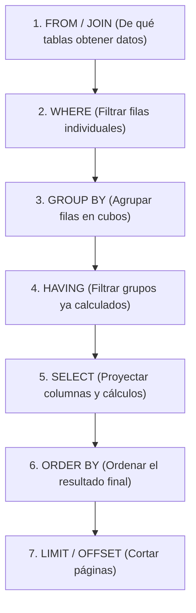

# Lección 02: Consultas SQL esenciales y agregaciones

> **Nivel:** 🟢 Principiante · **Duración estimada:** 30 min

---

## Situación

Laura Garza entra a tu oficina con una urgencia operativa: *"Alex, necesitamos saber cuántas unidades físicas totales tenemos de productos de la categoría 'abarrotes' sumando los 3 almacenes, y cuáles son los 3 productos con menor existencia general"*.

En una hoja de cálculo, esto requiere filtrar por categoría, sumar columnas a mano y ordenar rangos con riesgo de error humano. En SQL, se resuelve con dos consultas declarativas de 3 líneas cada una.

---

## Conceptos clave

### 1. El orden lógico de ejecución de una consulta SQL

Para escribir buen SQL es crucial saber cómo procesa la base de datos tu consulta:



---

### 2. Filtros con `WHERE` y operadores comunes

```sql
-- Productos de bebidas que cuestan más de 20 pesos
SELECT sku, nombre, precio
FROM productos
WHERE categoria = 'bebidas' AND precio > 20.0
ORDER BY precio DESC;

-- Buscar productos cuyo nombre contenga la palabra 'chico'
SELECT sku, nombre
FROM productos
WHERE nombre LIKE '%chico%';

-- Productos en almacenes de la zona norte
SELECT *
FROM inventario
WHERE almacen_codigo IN ('MTY', 'GDL');
```

---

### 3. Agregaciones: `COUNT`, `SUM`, `AVG`, `MIN`, `MAX`

Las funciones de agregación colapsan múltiples filas en un solo valor numérico:

```sql
-- ¿Cuántos productos tenemos registrados en catálogo?
SELECT COUNT(*) AS total_productos FROM productos;

-- ¿Cuál es el precio promedio de los productos de limpieza?
SELECT ROUND(AVG(precio), 2) AS precio_promedio
FROM productos
WHERE categoria = 'limpieza';
```

---

### 4. Agrupaciones con `GROUP BY` y `HAVING`

Cuando quieres calcular agregados **por cada categoría** o **por cada almacén**:

```sql
-- Total de unidades en stock agrupadas por almacén
SELECT 
    almacen_codigo,
    COUNT(sku) AS total_skus_distintos,
    SUM(cantidad) AS unidades_totales
FROM inventario
GROUP BY almacen_codigo
ORDER BY unidades_totales DESC;

-- Almacenes que tienen menos de 500 unidades totales (filtro sobre grupos con HAVING)
SELECT 
    almacen_codigo,
    SUM(cantidad) AS unidades_totales
FROM inventario
GROUP BY almacen_codigo
HAVING SUM(cantidad) < 500;
```

> **Diferencia clave:** `WHERE` filtra filas **antes** de agrupar; `HAVING` filtra **después** de agrupar.

---

## Errores comunes

- **Usar `WHERE` para filtrar el resultado de una función de agregación:** Escribir `WHERE SUM(cantidad) < 100` es un error de sintaxis en SQL; debe usarse `HAVING SUM(cantidad) < 100`.
- **Seleccionar columnas no agrupadas:** En `SELECT categoria, nombre, SUM(precio) ... GROUP BY categoria`, el campo `nombre` no tiene un valor único por categoría y generará resultados ambiguos o errores.
- **Tratar valores nulos con `=` en lugar de `IS NULL`:** En SQL, `WHERE columna = NULL` siempre evalúa a falso. La sintaxis correcta es `WHERE columna IS NULL`.

---

## En el día a día de un FDE

En cuestión de segundos puedes abrir la terminal con la utilidad interactiva `sqlite3 inventario.db` y responder preguntas de auditoría en vivo frente al cliente con total precisión.

---

## Resumen

- SQL procesa consultas siguiendo un orden lógico estricto: `FROM` -> `WHERE` -> `GROUP BY` -> `HAVING` -> `SELECT` -> `ORDER BY` -> `LIMIT`.
- Las funciones de agregación (`SUM`, `COUNT`, `AVG`, `MIN`, `MAX`) resumen datos numéricos.
- `GROUP BY` divide los datos en segmentos y `HAVING` filtra sobre los resultados agregados.

---

## Preguntas de repaso

1. ¿Cuál es la diferencia fundamental entre la cláusula `WHERE` y la cláusula `HAVING`?
2. ¿Por qué una consulta como `SELECT * FROM productos WHERE fecha = NULL;` nunca devolverá filas?
3. ¿Qué operador comodín se utiliza con `LIKE` para buscar cadenas que comiencen con un prefijo específico?

---

⬅️ [Lección anterior: Modelado relacional](01-modelado-relacional-para-integraciones.md) | 📦 [Módulo](../README.md) | [Siguiente lección: ETL a SQLite](03-etl-de-csv-a-sqlite-con-python.md) ➡️
