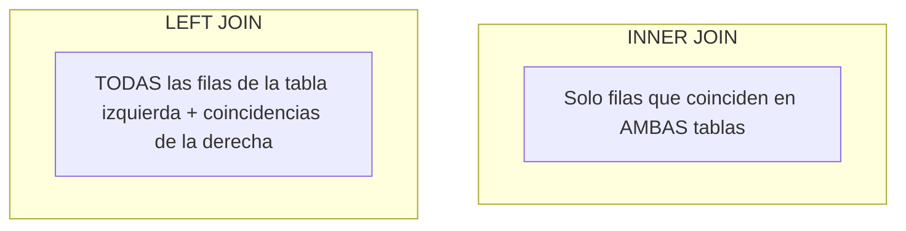

# Lección 04: Consultas avanzadas: Joins y reportes operativos

> **Nivel:** 🟢 Principiante · **Duración estimada:** 30 min

---

## Situación

Mariana López te muestra su reporte diario de faltantes: *"Alex, para saber qué productos están en riesgo crítico en Monterrey, necesito ver el SKU, el nombre del producto, la categoría, el stock que tenemos en almacén y compararlo contra el stock mínimo definido por compras. Pero esos datos están en dos tablas separadas: `productos` e `inventario`"*.

Aquí es donde entra la operación más poderosa de las bases de datos relacionales: el **`JOIN`**.

---

## Conceptos clave

### 1. Tipos de JOIN

Un `JOIN` combina filas de dos o más tablas basándose en una columna común (la llave foránea y la llave primaria):



| Tipo de JOIN | Comportamiento | Cuándo usarlo en el rol de FDE |
|--------------|----------------|--------------------------------|
| **`INNER JOIN`** | Devuelve solo filas que tienen coincidencia exacta en ambas tablas. | Cuando solo te interesan productos que efectivamente tienen existencias registradas. |
| **`LEFT JOIN`** | Devuelve **todas** las filas de la tabla izquierda, y rellena con `NULL` si la tabla derecha no tiene datos. | Para auditorías: ¿Hay productos en el catálogo que **nunca** han tenido registro de inventario en ningún almacén? |

---

### 2. Cruzando Productos con Inventario (`INNER JOIN`)

```sql
SELECT 
    p.sku,
    p.nombre,
    p.categoria,
    i.almacen_codigo AS almacen,
    i.cantidad AS stock_actual,
    p.stock_minimo,
    (p.stock_minimo - i.cantidad) AS faltante_estimado
FROM productos p
INNER JOIN inventario i ON p.sku = i.sku
WHERE i.cantidad <= p.stock_minimo
ORDER BY faltante_estimado DESC;
```

Esta consulta genera en un instante el reporte exacto que Mariana tardaba 40 minutos en armar a mano cada mañana.

---

### 3. Detección de productos "huérfanos" con `LEFT JOIN`

¿Qué pasa si compraste productos nuevos pero el personal de almacén olvidó ingresarlos en el sistema?

```sql
-- Productos en catálogo que NO tienen existencia en Monterrey
SELECT 
    p.sku,
    p.nombre
FROM productos p
LEFT JOIN inventario i ON p.sku = i.sku AND i.almacen_codigo = 'MTY'
WHERE i.id IS NULL;
```

Al filtrar `WHERE i.id IS NULL`, encontramos de inmediato los productos que no tienen registro en ese almacén.

---

### 4. Consultas con Expresiones de Tabla Común (*CTEs*)

Para reportes complejos, las **CTEs** (`WITH ... AS`) permiten dividir la lógica en pasos legibles en lugar de anidar subconsultas ilegibles:

```sql
WITH ResumenPorAlmacen AS (
    SELECT 
        almacen_codigo,
        COUNT(sku) AS total_productos,
        SUM(cantidad) AS unidades_totales,
        ROUND(AVG(cantidad), 1) AS promedio_unidades
    FROM inventario
    GROUP BY almacen_codigo
)
SELECT 
    a.nombre AS nombre_almacen,
    r.total_productos,
    r.unidades_totales,
    r.promedio_unidades
FROM ResumenPorAlmacen r
INNER JOIN almacenes a ON r.almacen_codigo = a.codigo
ORDER BY r.unidades_totales DESC;
```

---

## Errores comunes

- **Olvidar la condición `ON` en el JOIN:** Escribir `SELECT * FROM productos, inventario` sin especificar `ON` genera un producto cartesiano (multiplica todas las filas de una tabla por todas las de la otra), inundando la memoria y dando datos falsos.
- **Ambigüedad de nombres de columnas:** Si ambas tablas tienen una columna llamada `id` o `nombre`, escribir `SELECT nombre` arrojará un error `ambiguous column name`. Califica siempre las columnas con el alias de la tabla (ej. `p.nombre`, `a.nombre`).
- **Asumir que un `INNER JOIN` devuelve todo:** Si un producto no tiene fila en `inventario`, un `INNER JOIN` lo omitirá por completo de forma silenciosa. Si necesitas ver todos los productos sin importar si tienen stock, usa `LEFT JOIN`.

---

## En el día a día de un FDE

En juntas operativas con Laura Garza y Don Javier Halcón, proyectar en pantalla una consulta SQL bien estructurada con CTEs que calcule en 2 segundos el valor total del inventario retenido por almacén demuestra un nivel de competencia técnica que genera confianza total en Nexo.

---

## Resumen

- `INNER JOIN` combina registros cuando hay coincidencia en ambas tablas.
- `LEFT JOIN` conserva todos los registros de la tabla izquierda y es ideal para detectar datos faltantes (`WHERE campo IS NULL`).
- Las CTEs (`WITH`) mejoran drásticamente la legibilidad y mantenimiento de consultas analíticas complejas.

---

## Preguntas de repaso

1. ¿Qué resultado entrega un `LEFT JOIN` en las columnas de la tabla derecha cuando no existe coincidencia para una fila de la tabla izquierda?
2. ¿Por qué es fundamental usar alias de tabla (ej. `p.sku`, `i.sku`) al unir tablas relacionales?
3. ¿Cuál es la ventaja de utilizar una CTE (`WITH`) frente a escribir subconsultas anidadas en la cláusula `FROM`?

---

⬅️ [Lección anterior: ETL a SQLite](03-etl-de-csv-a-sqlite-con-python.md) | 📦 [Módulo](../README.md) | [Ir a Ejemplos del módulo](01-modelado-relacional-para-integraciones.md) ➡️
