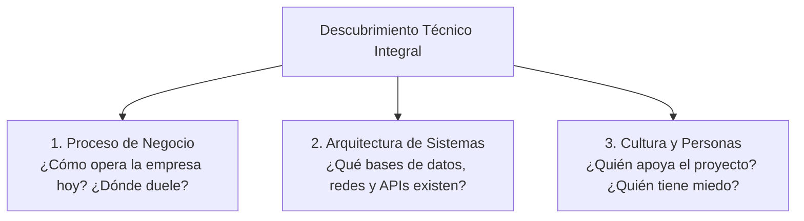

# Lección 01: El arte del descubrimiento técnico y escucha activa

> **Nivel:** 🟢 Principiante · **Duración estimada:** 25 min

---

## Situación

Llegas a tu primera videollamada con Laura Garza y Roberto Treviño. Como tienes muchas ganas de demostrar tus conocimientos técnicos, comienzas la reunión hablando 25 minutos seguidos sobre la arquitectura de microservicios de Nexo, el algoritmo de backoff exponencial y los contenedores Docker.

Al terminar tu presentación, Roberto mira su reloj y dice: *"Muy interesante tu presentación técnica, Alex. Pero nuestro problema es que no sabemos qué camiones van a salir vacíos mañana. ¿Cómo nos ayuda eso?"*.

Un FDE no llega a una llamada de descubrimiento a presumir su tecnología; llega con curiosidad genuina a **escuchar el 80 % del tiempo y hablar solo el 20 %** para diagnosticar el problema real.

---

## Conceptos clave

### 1. ¿Qué es el Descubrimiento Técnico (*Discovery*)?

Es la fase de investigación en la que el FDE indaga sobre tres dimensiones críticas:

---

### 2. La técnica de las preguntas abiertas (*The Mom Test*)

Las preguntas que haces determinan la calidad de las respuestas que obtienes. 

| Tipo de pregunta | ❌ Pregunta cerrada / sesgada | ✅ Pregunta abierta efectiva | Por qué funciona mejor |
|------------------|-------------------------------|------------------------------|------------------------|
| **Sobre el dolor real** | *"¿Les gustaría tener una gráfica en tiempo real en la pantalla?"* | *"Cuéntame paso a paso qué pasó el fin de semana cuando faltaron cajas de aceite en Monterrey."* | Obtienes hechos del pasado en lugar de opiniones hipotéticas. |
| **Sobre procesos** | *"¿Su ERP tiene una API REST moderna?"* | *"¿Cómo sale la información del inventario desde el ERP hacia las manos de Mariana hoy en día?"* | Descubres que no hay API directa y que usan un CSV nocturno. |
| **Sobre restricciones** | *"¿Pueden darnos acceso root a su servidor?"* | *"¿Cuál es la política habitual de su equipo de seguridad para autorizar nuevas conexiones salientes?"* | Evitas un "no" rotundo y entiendes las reglas de TI. |

---

### 3. Las 5 preguntas indispensables en todo descubrimiento

1. **El síntoma visible:** *"¿Qué problema concreto ocurrió la semana pasada que no debería repetirse?"*
2. **El impacto cuantificable:** *"¿Cuánto tiempo o dinero le cuesta este problema a la operación cada mes?"*
3. **El flujo de datos real:** *"¿Dónde nace el dato, quién lo manipula, en qué formato viaja y dónde termina?"*
4. **La definición de éxito:** *"Si nos volvemos a reunir en 30 días, ¿qué tendría que estar pasando para que consideres que este proyecto fue un éxito absoluto?"*
5. **Los bloqueos previos:** *"¿Han intentado resolver esto antes con otra herramienta? Si fue así, ¿por qué no funcionó?"*

---

## Errores comunes

- **Preguntar por soluciones en lugar de dolores:** *"¿Quieres que la tabla tenga 5 columnas o 7?"* en lugar de *"¿Qué información necesita ver el supervisor en los primeros 10 segundos para despachar un camión?"*.
- **Aceptar respuestas vagas sin profundizar:** Si el cliente dice *"los datos a veces vienen mal"*, no te quedes con eso. Pregunta: *"¿A qué te refieres con 'mal'? ¿Vienen nulos? ¿Llegan tarde? ¿Traen fechas invertidas?"*.
- **Interrumpir al cliente para ofrecer la solución de inmediato:** Deja que el usuario termine de desahogar su frustración antes de proponer código.

---

## En el día a día de un FDE

En una sesión de descubrimiento, tus mejores herramientas no son tu editor de código ni tu terminal, sino una libreta digital y la pregunta mágica:
> *"Ayúdame a entender: cuando ocurre X, ¿qué hace tu equipo a continuación?"*.

---

## Resumen

- El descubrimiento técnico consiste en diagnosticar el problema antes de proponer soluciones.
- Haz preguntas abiertas sobre hechos y eventos pasados reales en lugar de opiniones teóricas.
- Identifica el proceso de negocio, la arquitectura técnica y los incentivos de las personas.

---

## Preguntas de repaso

1. ¿Por qué es más valioso preguntar sobre cómo resolvieron un problema la semana pasada que preguntar si les gustaría una nueva función en el futuro?
2. Si un cliente te dice *"nuestra API es muy rápida"*, ¿qué pregunta de seguimiento deberías hacer como FDE?
3. ¿Cuál es la proporción ideal de tiempo entre escuchar y hablar para un FDE durante una primera sesión de descubrimiento?

---

📦 [Volver al módulo](../README.md) | [Siguiente lección: Mapeo de stakeholders](02-identificar-stakeholders-e-incentivos.md) ➡️
