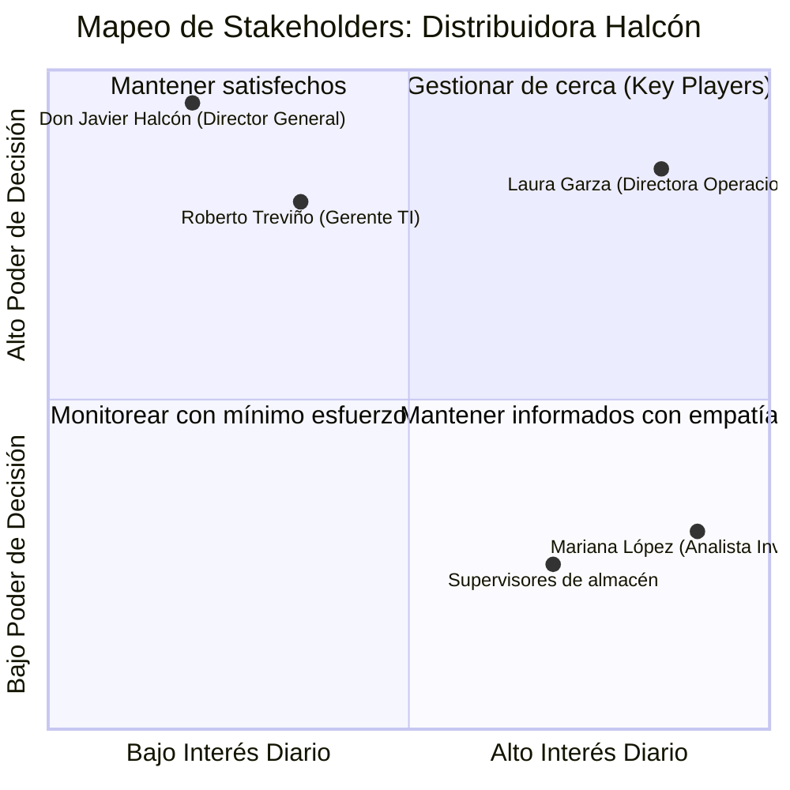

# Lección 02: Mapeo de stakeholders e incentivos ocultos

> **Nivel:** 🟢 Principiante · **Duración estimada:** 25 min

---

## Situación

Estás avanzando a toda velocidad con la integración técnica de Halcón. Laura Garza (Operaciones) está encantada contigo. Sin embargo, en la semana 3, Roberto Treviño (Gerente de TI) le envía un correo al Director General solicitando pausar el proyecto porque *"Nexo no ha presentado el dictamen de seguridad de red ni el análisis de consumo de ancho de banda"*.

¿Qué pasó aquí? Olvidaste una regla de oro: **una empresa no es una entidad homogénea**. Está compuesta por personas con roles, miedos, metas e incentivos distintos, y a veces contradictorios.

---

## Conceptos clave

### 1. La Matriz de Poder e Interés de Stakeholders

---

### 2. Los cuatro arquetipos de stakeholders en proyectos B2B

| Arquetipo | En Distribuidora Halcón | Qué le quita el sueño | Cómo hablarle como FDE |
|-----------|-------------------------|-----------------------|------------------------|
| **El Patrocinador Ejecutivo (*Sponsor*)** | **Laura Garza** (Operaciones) | Reducir pérdidas por faltantes de inventario y cumplir sus KPIs de entrega a tiempo. | Háblale en términos de impacto operativo, tiempos de despacho y dinero ahorrado. |
| **El Guardián Técnico (*Gatekeeper*)** | **Roberto Treviño** (TI) | Seguridad, estabilidad de los servidores y que su pequeño equipo no reciba más trabajo del que puede manejar. | Háblale de puertos, certificados TLS, bajo consumo de CPU, Docker y nula intrusión en su base de datos. |
| **El Usuario Clave (*Champion* / Operativo)** | **Mariana López** (Analista) | Dejar de perder 3 horas todas las mañanas copiando y pegando datos en Excel bajo estrés constante. | Hazla co-diseñadora de las alertas; escúchala y alivia su carga diaria desde la primera semana. |
| **El Tomador de Decisiones Financieras** | **Don Javier Halcón** (Director) | El Retorno de Inversión (ROI), el prestigio de la compañía y que el proyecto se entregue en plazo. | Preséntale avances ejecutivos breves, claros y sin jerga técnica incomprensible. |

---

### 3. Alinear incentivos: El juego de suma positiva

Un proyecto fracasa si para que Operaciones gane, TI tiene que sufrir. El trabajo del FDE es encontrar soluciones donde todos ganen:

- **Para Laura:** Alertas de stock bajo en tiempo real antes de las 8:00 AM.
- **Para Roberto:** Un contenedor Docker aislado que corre en segundo plano sin instalar librerías globales y con límites de RAM de 256 MB.
- **Para Mariana:** Una pantalla limpia donde ve en 1 minuto lo que antes le tomaba 3 horas armar.

---

## Errores comunes

- **Tratar a TI como un obstáculo burocrático:** Si ves a Roberto como "el que frena el proyecto", se pondrá a la defensiva y encontrará 20 motivos técnicos para bloquearte. Si lo tratas como tu socio técnico de arquitectura, se convertirá en tu mejor aliado.
- **Ignorar al usuario operativo que no tiene poder de firma:** Diseñar la herramienta solo para los directores sin hablar con Mariana. El resultado será una plataforma que nadie usa en la práctica (*shelfware*).
- **Prometer cosas a espaldas de TI:** Decirle a Laura: *"Sí, podemos leer directo su base de producción cada 10 segundos"* sin consultarlo con Roberto.

---

## En el día a día de un FDE

En tu calendario semanal, reserva 30 minutos a solas con Roberto Treviño para revisar aspectos técnicos antes de las reuniones generales con Laura. Ganarte la aprobación técnica previa del líder de TI garantiza que las reuniones ejecutivas fluyan sin contratiempos.

---

## Resumen

- Cada stakeholder tiene prioridades, miedos e incentivos diferentes.
- Laura busca velocidad y resultados de negocio; Roberto busca estabilidad y seguridad; Mariana busca simplicidad en su día a día.
- El FDE diseña soluciones técnicas que satisfacen los requerimientos de negocio sin sobrecargar a los equipos técnicos del cliente.

---

## Preguntas de repaso

1. ¿Por qué un proyecto puede fracasar aunque la Directora de Operaciones esté totalmente convencida de la solución?
2. ¿Qué argumentos técnicos le darías al Gerente de TI para demostrarle que el conector no afectará el rendimiento de su ERP?
3. ¿Cuál es el riesgo de diseñar una solución escuchando únicamente a la junta directiva y no a los analistas operativos?

---

⬅️ [Lección anterior: Arte del descubrimiento](01-el-arte-del-descubrimiento-tecnico.md) | 📦 [Módulo](../README.md) | [Siguiente lección: Mapeo As-Is y To-Be](03-mapeo-de-procesos-as-is-y-to-be.md) ➡️
