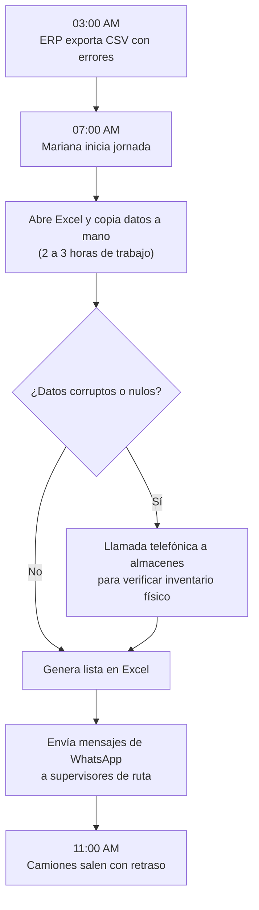
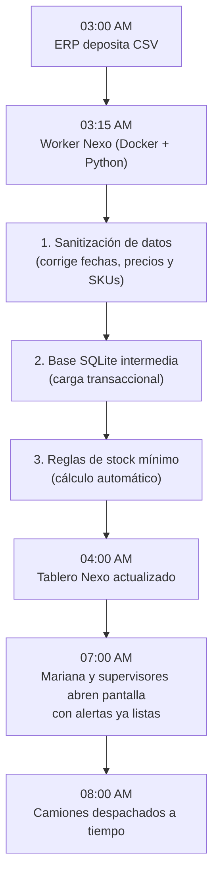

# Lección 03: Mapeo de procesos: De 'As-Is' a 'To-Be'

> **Nivel:** 🟢 Principiante · **Duración estimada:** 25 min

---

## Situación

Mariana López te intenta explicar cómo funciona la consolidación de inventario: *"Bueno, primero me llega un correo a las 4:00 AM con un CSV, pero a veces no llega entonces tengo que entrar al ERP por escritorio remoto y exportarlo a mano. Luego abro mi plantilla de Excel, copio las columnas, quito los productos que tienen fecha vieja, abro otro archivo con las órdenes del día anterior, hago un BUSCARV, y si me sale negativo le marco por teléfono al jefe de almacén de Guadalajara..."*.

Tratar de entender y programar sobre una explicación verbal desordenada garantiza cometer errores. El FDE traduce relatos caóticos en **diagramas visuales de proceso**: primero documenta la realidad actual (**As-Is**) y luego diseña la arquitectura futura automatizada (**To-Be**).

---

## Conceptos clave

### 1. El flujo actual: Estado "As-Is" (Cómo operan hoy)

Documentar el proceso actual con honestidad brutal permite identificar cuellos de botella, riesgos de error humano y tiempos muertos:

#### Problemas evidentes del flujo As-Is:
- **Punto único de falla:** Si Mariana se enferma o sale de vacaciones, nadie consolida el inventario.
- **Latencia excesiva:** Las decisiones se toman a las 11:00 AM con datos de las 3:00 AM.
- **Riesgo de error humano:** Al copiar y pegar miles de celdas en Excel, es inevitable borrar fórmulas o desplazar filas.

---

### 2. El flujo futuro: Estado "To-Be" (La solución con Nexo)

El diagrama To-Be ilustra la arquitectura técnica que implementará el FDE:

#### Beneficios inmediatos del flujo To-Be:
- **Reducción de tiempo:** De 3 horas de trabajo manual diario a 0 minutos de esfuerzo mecánico.
- **Disponibilidad:** El tablero está listo 3 horas antes de que el personal llegue al almacén.
- **Auditoría:** Los errores se aíslan automáticamente en la tabla de auditoría para revisión de TI.

---

### 3. Cómo presentar el contraste a los directivos

El contraste visual entre el diagrama As-Is y el To-Be es la herramienta más poderosa para alinear a la junta directiva:

| Dimensión | Proceso Actual (*As-Is*) | Proceso Propuesto (*To-Be*) |
|-----------|--------------------------|-----------------------------|
| **Tiempo de preparación** | 180 minutos diarios (manual) | 3 minutos (automático) |
| **Hora de disponibilidad** | 10:30 AM - 11:00 AM | 04:00 AM |
| **Tasa de error en datos** | Alta (copiado manual de celdas) | Cero errores no controlados |
| **Dependencia de personas** | 100 % dependiente de Mariana | Proceso desatendido y documentado |

---

## Errores comunes

- **Diseñar el To-Be sin entender los casos extremos del As-Is:** Automatizar el camino feliz (*happy path*) e ignorar qué pasa los días en que el almacén de Guadalajara hace inventario físico rotativo.
- **Hacer diagramas técnicos incomprensibles para el negocio:** Llenar el diagrama de nombres de clases de Python y puertos de red cuando se lo presentas a Laura Garza.
- **Prometer automatización del 100 % el día 1:** Es más sabio automatizar el 80 % del volumen estándar en la primera fase y dejar excepciones complejas para una fase posterior.

---

## En el día a día de un FDE

En tu documento de propuesta de arquitectura, incluye siempre ambos diagramas hechos en Mermaid o en una herramienta visual. Cuando Laura y Don Javier vean el antes y el después lado a lado, aprobarán el inicio de la construcción sin dudarlo.

---

## Resumen

- El diagrama As-Is mapea la realidad operativa actual con sus dolores y cuellos de botella.
- El diagrama To-Be define la arquitectura técnica objetivo y el nuevo flujo de datos.
- Comparar ambos diagramas cuantifica el valor tangible que generará la implementación.

---

## Preguntas de repaso

1. ¿Por qué es fundamental documentar el proceso As-Is antes de diseñar la solución To-Be?
2. En el caso de Halcón, ¿cuál es el mayor riesgo operativo identificado en el diagrama As-Is?
3. ¿Cómo ayuda el contraste As-Is vs. To-Be a justificar el retorno de inversión ante el Director General?

---

⬅️ [Lección anterior: Mapeo de stakeholders](02-identificar-stakeholders-e-incentivos.md) | 📦 [Módulo](../README.md) | [Siguiente lección: Documento de alcance y SOW](04-documento-de-alcance-sow-y-criterios-de-exito.md) ➡️
