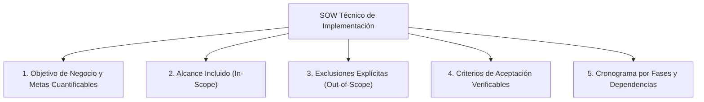

# Lección 04: El Documento de Alcance (SOW) y criterios de éxito

> **Nivel:** 🟢 Principiante · **Duración estimada:** 25 min

---

## Situación

Llevas tres semanas trabajando intensamente en el conector de Halcón. El conector procesa el inventario de Monterrey a la perfección. Sin embargo, Laura Garza te llama entusiasmada:

> *"Alex, quedó increíble lo de Monterrey. Oye, como ya casi terminas, ¿puedes conectarte también con el sistema de facturación electrónica del SAT para timbrar facturas, y de una vez crear una app móvil para que los choferes firmen con el dedo al entregar las cajas?"*.

Este fenómeno se llama **corrimiento del alcance** (*Scope Creep*). Si no estableciste por escrito desde el primer día qué estaba incluido y qué estaba expresamente excluido, te verás atrapado en un proyecto interminable que nunca llega a su fin.

---

## Conceptos clave

### 1. ¿Qué es un SOW ligero (*Statement of Work*)?

Un **Documento de Alcance (SOW)** no tiene que ser un contrato legal denso de 100 páginas. Para un FDE, es un **acuerdo técnico de trabajo de 2 a 3 páginas** firmado o aprobado por correo por los stakeholders clave antes de programar.

Estructura esencial de un SOW:

---

### 2. La sección más importante: Fuera de Alcance (*Out of Scope*)

Definir lo que **NO** vas a hacer es más importante que definir lo que sí vas a hacer:

| En Alcance (*In-Scope*) para Halcón | Fuera de Alcance (*Out-of-Scope*) Fase 1 |
|-------------------------------------|------------------------------------------|
| Procesar la exportación nocturna `inventario_erp.csv`. | Modificar el código fuente interno del ERP del cliente. |
| Normalizar fechas, precios y SKUs de los 3 almacenes. | Desarrollar aplicaciones móviles para choferes de reparto. |
| Alertas automáticas de stock bajo en la plataforma Nexo. | Integración con sistemas de facturación fiscal del SAT. |
| Consulta de pedidos mediante la API simulada. | Migración de datos históricos de más de 3 años de antigüedad. |

---

### 3. Criterios de Aceptación Objetivos (*Acceptance Criteria*)

Evita adjetivos subjetivos como *"el sistema debe ser rápido"* o *"la interfaz debe ser intuitiva"*. Los criterios deben ser **binarios (pasan o no pasan)**:

❌ **Criterio subjetivo y peligroso:**
- *"El conector de inventario debe funcionar bien y sin errores."*

✅ **Criterios de aceptación objetivos:**
- [ ] El conector procesa el archivo nocturno de al menos 500 SKUs en menos de 60 segundos.
- [ ] Todo registro con errores se almacena en la tabla `auditoria_rechazos` con número de línea y motivo.
- [ ] La plataforma Nexo emite una alerta visual antes de las 06:00 AM para cualquier producto con `cantidad <= stock_minimo`.
- [ ] El proceso de sincronización corre dentro de un contenedor Docker con consumo de memoria inferior a 256 MB.

---

### 4. Supuestos y Dependencias del Cliente

El SOW debe documentar qué necesitas que el cliente cumpla para no retrasar el proyecto:
- *Supuesto 1:* El ERP de Halcón depositará el archivo CSV diariamente a más tardar a las 03:30 AM en la ruta acordada.
- *Dependencia 2:* Roberto Treviño proporcionará credenciales de prueba con permisos de solo lectura a más tardar el viernes 16 de octubre.
- *Supuesto 3:* Mariana López dispondrá de 2 horas semanales para validar las alertas generadas.

---

## Errores comunes

- **Empezar a programar sin SOW aprobado:** Cualquier malentendido posterior se convertirá en una discusión de *"tú me prometiste que..."*.
- **Aceptar peticiones adicionales de pasillo sin negociar:** Si Laura te pide la app de choferes, nunca digas *"sí, yo me encargo"*. Responde: *"Es una excelente idea, Laura. Para no poner en riesgo la salida en vivo de Monterrey en 2 semanas, anotémoslo formalmente como el objetivo número uno de la Fase 2"*.
- **No definir qué sucede ante retrasos del cliente:** Si TI tarda 3 semanas en darte accesos, el cronograma de entrega debe recorrerse formalmente la misma cantidad de días.

---

## En el día a día de un FDE

Tener un SOW claro te da paz mental y protege la relación con el cliente:
> *"Laura, revisando nuestro SOW acordado, la integración con facturación fiscal no forma parte de este entregable. Para garantizar que las alertas de faltantes salgan a producción este viernes como acordamos, mantengamos el foco en el inventario y con gusto cotizamos la facturación con el equipo de producto para el siguiente trimestre."*

---

## Resumen

- El SOW delimita el alcance, define entregables y protege al proyecto del *Scope Creep*.
- La lista de exclusiones (*Out-of-Scope*) previene falsas expectativas desde el inicio.
- Los criterios de aceptación deben ser medibles, verificables y objetivos.
- Documentar dependencias protege al FDE de retrasos causados por el cliente.

---

## Preguntas de repaso

1. ¿Qué es el *Scope Creep* y qué consecuencias puede tener en una implementación?
2. ¿Por qué es fundamental incluir una sección explícita de "Fuera de Alcance" en un SOW?
3. Redacta un criterio de aceptación objetivo para verificar la velocidad de carga de un archivo de datos.

---

⬅️ [Lección anterior: Mapeo As-Is y To-Be](03-mapeo-de-procesos-as-is-y-to-be.md) | 📦 [Módulo](../README.md) | [Ir a Ejemplos del módulo](01-el-arte-del-descubrimiento-tecnico.md) ➡️
