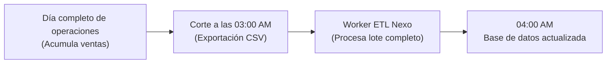
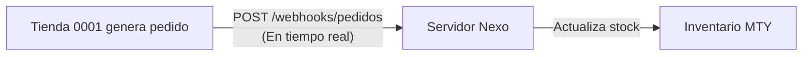

# Lección 01: Patrones de integración: Batch vs. Tiempo Real

> **Nivel:** 🟡 Intermedio · **Duración estimada:** 25 min

---

## Situación

Don Javier Halcón (Director General) te pide en una reunión: *"Queremos que cada vez que una cajera en cualquier tienda de abarrotes venda una lata de atún, el inventario se descuente al segundo exacto en nuestra plataforma central"*.

Suena como un sueño de modernidad. Sin embargo, cuando analizas los sistemas de Halcón, descubres que las tiendas se conectan con módems 4G inestables, el ERP central se bloquea si recibe más de 20 transacciones simultáneas y las tiendas no tienen internet garantizado todo el día.

Intentar forzar una arquitectura de "tiempo real" en un entorno que no está preparado para ello provocará caídas continuas y pérdida de transacciones. Un FDE sabe cuándo usar procesamiento por lotes (**Batch**) y cuándo usar eventos en tiempo real (**Event-Driven / Streaming**).

---

## Conceptos clave

### 1. Procesamiento por Lotes (*Batch Processing*)

Los datos se acumulan durante un periodo de tiempo (ej. todo el día) y se procesan en un único bloque masivo durante una ventana de baja actividad (como las 3:00 AM):

- **Ventajas:** Extremadamente predecible, fácil de auditar, no requiere que los sistemas estén conectados 24/7, óptimo para bases de datos relacionales tradicionales.
- **Desventajas:** Alta latencia de datos (la información tiene horas de retraso).

---

### 2. Procesamiento Orientado a Eventos (*Event-Driven / Webhooks*)

Cada vez que ocurre una mutación individual (ej. `pedido_creado`), el sistema emite inmediatamente una notificación HTTP (Webhook) hacia el receptor:

- **Ventajas:** Latencia mínima (milisegundos o segundos), tableros operativos en vivo.
- **Desventajas:** Requiere alta disponibilidad de red, manejo estricto de eventos desordenados o repetidos, y arquitectura tolerante a picos de tráfico.

---

### 3. Matriz de decisión para el FDE

| Criterio | ¿Cuándo elegir Batch? | ¿Cuándo elegir Tiempo Real / Webhooks? |
|----------|-----------------------|----------------------------------------|
| **Tolerancia al retraso** | El negocio tolera ver datos con horas de desfase (ej. consolidación contable). | La decisión debe tomarse en segundos (ej. autorizar un pago o apartar la última pieza). |
| **Madurez del cliente** | Sistemas legados sin APIs de eventos (ERPs antiguos con exportación CSV). | Plataformas modernas con soporte nativo de webhooks o colas de mensajería (Kafka/RabbitMQ). |
| **Capacidad de cómputo** | Servidores pequeños que colapsarían con miles de llamadas concurrentes. | Infraestructura elástica capaz de absorber picos de tráfico. |
| **En Distribuidora Halcón** | **El inventario nocturno** (cambia de noche, se analiza en la mañana). | **La creación de pedidos urgentes** (debe validarse de inmediato). |

---

## Errores comunes

- **El mito del "tiempo real para todo":** Venderle al cliente la idea de que todo debe ser en tiempo real. En la práctica, el 80 % de los reportes operativos de almacenes funcionan perfectamente con una sincronización por lotes nocturna bien ejecutada.
- **No definir una ventana de tiempo clara para Batch:** Ejecutar un proceso ETL pesado a las 11:00 AM, justo cuando los usuarios están usando el ERP al máximo, provocando lentitud general.
- **Olvidar la reconciliación:** Incluso si tienes un sistema en tiempo real con webhooks, una falla de red puede hacer que se pierdan eventos. Siempre se debe acompañar con un proceso Batch nocturno de reconciliación que compare saldos finales.

---

## En el día a día de un FDE

La arquitectura más elegante que puedes presentarle a Don Javier y a Roberto es un **modelo híbrido**:
> *"Don Javier, para no saturar su servidor ni arriesgar la operación de las tiendas, sincronizaremos el catálogo maestro y el inventario general por lotes a las 3:15 AM (Batch). Pero las órdenes de surtido urgentes viajarán en tiempo real por API individual (Event-driven). Lo mejor de ambos mundos sin riesgo técnico."*

---

## Resumen

- *Batch* es ideal para grandes volúmenes de datos donde la latencia de horas es aceptable y la estabilidad es primordial.
- *Tiempo Real* es necesario para transacciones interactivas que requieren confirmación inmediata.
- El patrón híbrido (Batch nocturno para consolidación + Eventos para transacciones clave) es el estándar de oro en integraciones empresariales.

---

## Preguntas de repaso

1. ¿Por qué intentar procesar el inventario de 1,200 tiendas en tiempo real sobre un ERP antiguo puede ser peligroso?
2. ¿Qué significa el proceso de "reconciliación nocturna" en una arquitectura basada en eventos?
3. En el caso de Halcón, ¿qué flujo debe ser Batch y cuál debe ser interactivo por API?

---

📦 [Volver al módulo](../README.md) | [Siguiente lección: Autenticación robusta](02-autenticacion-robusta-y-renovacion-de-tokens.md) ➡️
