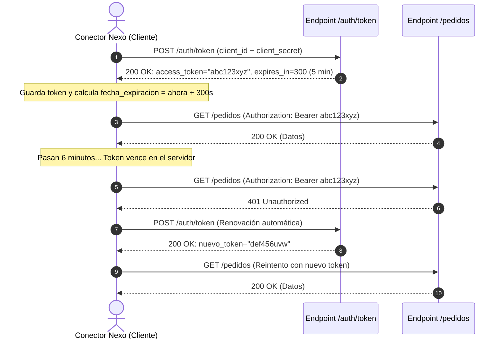

# Lección 02: Autenticación robusta y renovación de tokens

> **Nivel:** 🟡 Intermedio · **Duración estimada:** 30 min

---

## Situación

Tu script de sincronización lleva 8 minutos corriendo porque está procesando un lote grande de pedidos. A los 5 minutos exactos de ejecución, la API simulada de Halcón comienza a rechazar todas las peticiones con el código:

```text
HTTP 401 Unauthorized: {"error": "no_autorizado", "mensaje": "Token ausente, inválido o expirado."}
```

El script asume que un token dura para siempre. Truena a mitad del proceso, deja la sincronización incompleta y requiere que una persona reinicie el proceso manualmente.

Los sistemas de seguridad empresariales usan **tokens efímeros de corta duración** para mitigar el riesgo si una credencial se filtra. Tu cliente HTTP debe saber renovar el token de forma automática y transparente sin interrumpir las operaciones.

---

## Conceptos clave

### 1. El ciclo de vida de un Token de Acceso (*OAuth 2.0 Client Credentials*)

El estándar para comunicación máquina a máquina (M2M) intercambia credenciales maestras por un pase temporal:



---

### 2. Las dos estrategias de renovación

Un conector profesional combina **ambas** estrategias:

1. **Renovación Proactiva (Por tiempo):**
   - Cuando obtienes el token con `expires_in: 300` segundos, guardas en memoria:
     $$\text{expira\_en} = \text{tiempo\_actual}() + 300 - 30\text{ (margen de seguridad)}$$
   - Antes de hacer cualquier llamada, verificas si `tiempo_actual() >= expira_en`. Si ya está por vencer, solicitas un nuevo token antes de que la API te rechace.
2. **Renovación Reactiva (Ante error 401):**
   - Si por alguna razón el servidor revocó el token anticipadamente o el reloj del sistema se desfasó, capturas la excepción `HTTPError 401`, renuevas el token y reintentas la petición original una sola vez.

---

### 3. Implementación limpia en Python

```python
import time
import urllib.request
import json

class GestorDeToken:
    def __init__(self, url_auth: str, client_id: str, client_secret: str):
        self.url_auth = url_auth
        self.client_id = client_id
        self.client_secret = client_secret
        self.token_actual: str | None = None
        self.expiracion_epoch: float = 0.0

    def obtener_token_valido(self) -> str:
        # Renovar si no tenemos token o si vencerá en los próximos 30 segundos
        if not self.token_actual or time.time() >= (self.expiracion_epoch - 30):
            self._renovar()
        return self.token_actual

    def _renovar(self) -> None:
        payload = json.dumps({
            "client_id": self.client_id,
            "client_secret": self.client_secret
        }).encode("utf-8")

        req = urllib.request.Request(
            self.url_auth,
            data=payload,
            headers={"Content-Type": "application/json"},
            method="POST"
        )
        with urllib.request.urlopen(req, timeout=5) as resp:
            data = json.loads(resp.read().decode("utf-8"))
            self.token_actual = data["access_token"]
            # Calcular tiempo absoluto de expiración
            self.expiracion_epoch = time.time() + data.get("expires_in", 300)
```

---

## Errores comunes

- **Pedir un token nuevo en cada petición individual:** Hacer un `POST /auth/token` antes de cada `GET /pedidos`. Esto satura el servidor de autenticación y te provocará bloqueos por límite de tasa (*Rate Limit*).
- **Entrar en un ciclo infinito de 401:** Si las credenciales `client_secret` cambiaron o son inválidas, reintentar indefinidamente tras un 401 congelará el programa. Solo debes reintentar la renovación **una vez**. Si vuelve a fallar con 401, aborta con un error claro de credenciales.
- **No descontar un margen de seguridad (*skew time*):** Si renuevas al segundo 300 exacto, la latencia de la red puede hacer que el token venza justo mientras viaja por el cable. Renueva siempre 30 a 60 segundos antes del vencimiento oficial.

---

## En el día a día de un FDE

Un conector con gestión transparente de tokens puede correr durante meses continuos sin que nadie tenga que intervenir para refrescar credenciales manualmente. Esa es la definición de estabilidad en producción.

---

## Resumen

- Los tokens Bearer tienen una vigencia finita (`expires_in`) por motivos de seguridad.
- La renovación proactiva renueva el token unos segundos antes de que expire.
- La renovación reactiva captura el código 401, renueva el token y reintenta la petición.
- Nunca solicites un token por cada petición; almacénalo en memoria mientras sea válido.

---

## Preguntas de repaso

1. ¿Por qué es una mala práctica solicitar un nuevo token de acceso en cada petición HTTP que realiza tu aplicación?
2. ¿Qué significa el "margen de seguridad" (*skew time*) al calcular la expiración de un token?
3. ¿Cómo previenes que un script quede atrapado en un ciclo infinito si el servidor responde 401 repetidamente?

---

⬅️ [Lección anterior: Patrones de integración](01-patrones-de-integracion-batch-vs-streaming.md) | 📦 [Módulo](../README.md) | [Siguiente lección: Resiliencia y Backoff](03-resiliencia-backoff-exponencial-y-rate-limiting.md) ➡️
