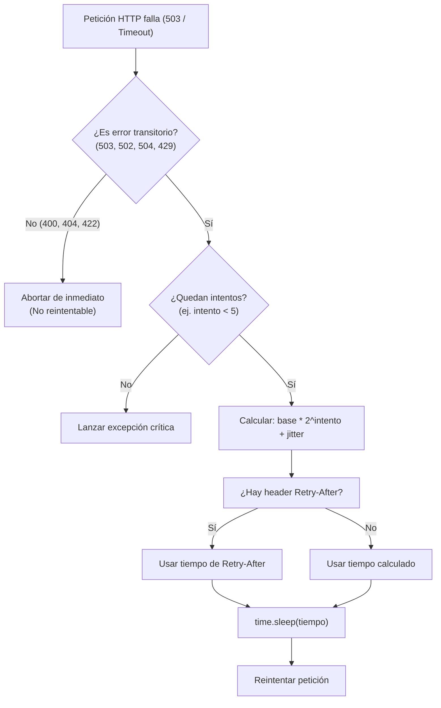

# Lección 03: Resiliencia: Backoff exponencial, jitter y rate limiting

> **Nivel:** 🟡 Intermedio · **Duración estimada:** 35 min

---

## Situación

Estás sincronizando los pedidos del almacén de Guadalajara. De pronto, la red parpadea y la API devuelve un código **`503 Service Unavailable`**. Tu script reintenta inmediatamente 5 veces en el mismo segundo:

```text
Intento 1: 503 Falla
Intento 2 (0.01s): 503 Falla
Intento 3 (0.02s): 503 Falla
Intento 4 (0.03s): 429 Too Many Requests (Límite de tasa excedido)
Intento 5 (0.04s): 429 Too Many Requests -> Proceso ABORTADO.
```

No solo no resolviste el problema, sino que empeoraste la situación: al reintentar agresivamente saturaste el servidor y activaste el bloqueo por límite de tasa (*Rate Limit*).

Los sistemas distribuidos requieren paciencia algorítmica: **backoff exponencial** con **aleatoriedad (jitter)** y respeto escrupuloso de los límites de tráfico.

---

## Conceptos clave

### 1. ¿Qué es el Backoff Exponencial?

En lugar de reintentar de inmediato o esperar un tiempo fijo (ej. 1 segundo siempre), el tiempo de espera se **duplica** en cada intento fallido:

$$t = \text{base} \times 2^{\text{intento}}$$

- Intento 1: Espera $1 \times 2^0 = 1$ segundo
- Intento 2: Espera $1 \times 2^1 = 2$ segundos
- Intento 3: Espera $1 \times 2^2 = 4$ segundos
- Intento 4: Espera $1 \times 2^3 = 8$ segundos
- Intento 5: Espera $\min(16, \text{espera\_maxima})$

Esto le da tiempo al servidor para recuperarse de sobrecargas temporales.

---

### 2. El problema de la "Estampida" (*Thundering Herd*) y la solución: Jitter

Si 100 tiendas abarroteras pierden conexión a la vez y todas usan backoff exponencial puro, todas reintentarán exactamente al segundo 1, luego todas al segundo 2, y luego todas al segundo 4. Ese pico simultáneo volverá a tumbar el servidor (*Thundering Herd Problem*).

Para evitarlo, se agrega **Jitter** (una variación aleatoria):

$$t_{\text{real}} = t \pm \text{random}(0, \text{factor})$$

Al agregar un desfase aleatorio de unos milisegundos, los reintentos de los diferentes clientes se distribuyen uniformemente a lo largo del tiempo.



---

### 3. Rate Limiting y el encabezado `Retry-After`

Las APIs protegen su estabilidad imponiendo un número máximo de llamadas por minuto o por segundo (en nuestra API simulada: 60 peticiones/minuto por token).

Cuando superas ese límite, el servidor responde:
```http
HTTP/1.1 429 Too Many Requests
Retry-After: 45
Content-Type: application/json

{"error": "demasiadas_peticiones", "mensaje": "Límite excedido."}
```

Si recibes un código 429, **nunca inventes cuánto tiempo esperar**: lee el valor de la cabecera `Retry-After` (en el ejemplo anterior: 45 segundos) y duerme el hilo con `time.sleep(45)`.

---

### 4. ¿Qué errores se deben reintentar y cuáles jamás?

| Código HTTP | ¿Se debe reintentar? | Acción técnica recomendada |
|-------------|-----------------------|----------------------------|
| **`503` / `502` / `504`** | **SÍ** | Error temporal de infraestructura del servidor. Aplicar backoff exponencial. |
| **`429`** | **SÍ** | Servidor saturado. Esperar el valor de `Retry-After`. |
| **Timeouts / Conexión caída** | **SÍ** | Falla de red transitoria. Reintentar con jitter. |
| **`400` / `422`** | **JAMÁS** | Error de sintaxis o de validación de negocio. Reintentar enviará los mismos datos erróneos y volverá a fallar. |
| **`404`** | **JAMÁS** | El recurso no existe. |
| **`401`** | **Condicional** | Renovar token y reintentar **una sola vez**. Si vuelve a dar 401, abortar. |

---

## Errores comunes

- **Reintentar errores 400 o 422:** Provoca saturación inútil; un pedido con SKU inexistente nunca se volverá válido por reintentarlo 5 veces.
- **Reintentos infinitos:** Dejar un `while True` sin un límite de intentos máximos (`max_reintentos=5`). Si el servidor del cliente se cae por 4 horas, tu proceso quedará colgado para siempre.
- **No definir un tiempo máximo de espera (*max_backoff*):** Si la base se duplica sin límite ($2^{10} = 1024$ segundos), tu conector podría esperar 17 minutos antes de hacer un intento. Define un tope como `max_backoff=30` segundos.

---

## En el día a día de un FDE

En redes empresariales complejas, las caídas de microsegundos ocurren todos los días. Un conector con backoff exponencial absorbe esos sobresaltos sin que nadie en la oficina se entere ni se interrumpa el flujo de inventario.

---

## Resumen

- El backoff exponencial duplica el tiempo de espera en cada reintento ante errores transitorios.
- El jitter añade aleatoriedad para evitar que cientos de clientes colisionen al mismo segundo.
- Respeta siempre el encabezado `Retry-After` ante respuestas 429.
- Solo reintenta errores transitorios (503, 502, 504, 429, Timeouts). Nunca reintentes 400, 404 o 422.

---

## Preguntas de repaso

1. ¿Qué es el problema de la "Estampida" (*Thundering Herd*) y cómo lo soluciona el Jitter?
2. Si una API responde con código `422 Unprocessable Entity`, ¿debe tu script aplicar reintentos? ¿Por qué?
3. ¿Cómo calcula el tiempo de espera un algoritmo de backoff exponencial estándar en el intento número 3 si la base es de 2 segundos?

---

⬅️ [Lección anterior: Autenticación robusta](02-autenticacion-robusta-y-renovacion-de-tokens.md) | 📦 [Módulo](../README.md) | [Siguiente lección: Idempotencia](04-idempotencia-y-evitar-duplicados.md) ➡️
