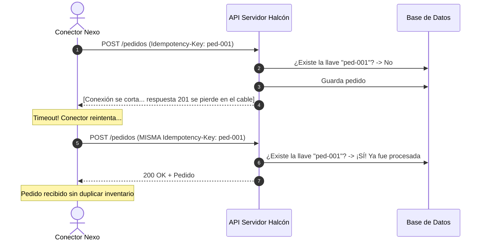

# Lección 04: Idempotencia: Cómo evitar duplicados en operaciones críticas

> **Nivel:** 🟡 Intermedio · **Duración estimada:** 30 min

---

## Situación

Estás enviando un pedido urgente de 50 cajas de aceite a través de `POST /pedidos`. El servidor de Halcón procesa la solicitud, guarda el pedido en su base de datos y le asigna el ID `#251`. Sin embargo, justo en el milisegundo en que el servidor te envía la respuesta `201 Created`, la conexión Wi-Fi de la oficina parpadea.

Tu script no recibió la confirmación y experimentó un `Timeout`. Como aprendiste en la lección anterior, el script activa el reintento automático y vuelve a enviar la misma petición `POST /pedidos`.

El servidor de Halcón recibe la segunda petición como si fuera una orden completamente nueva, crea el pedido `#252` y aparta otras 50 cajas de aceite. A la mañana siguiente, llegan dos camiones con 100 cajas a la tienda de Doña Mary, quien enfurecida rechaza el segundo camión.

¿Cómo resolvemos este dilema? Mediante el principio de **Idempotencia**.

---

## Conceptos clave

### 1. ¿Qué es la Idempotencia?

En matemáticas y computación, una operación es **idempotente** si ejecutarla una sola vez produce exactamente el mismo resultado y estado que ejecutarla múltiples veces consecutivas:

$$f(f(x)) = f(x)$$

- En HTTP:
  - `GET`, `PUT`, `DELETE` son idempotentes por diseño de protocolo (borrar el pedido 10 diez veces deja el pedido 10 borrado).
  - `POST` **no es idempotente por defecto**: enviar `POST /pedidos` dos veces crea dos pedidos diferentes.

---

### 2. El mecanismo de `Idempotency-Key`

Para hacer que un endpoint `POST` sea idempotente, el cliente genera un identificador único único (generalmente un UUID v4 o un hash determinista de la transacción) y lo envía en el encabezado HTTP:

```http
POST /pedidos HTTP/1.1
Host: api.halcon.com
Authorization: Bearer <token>
Content-Type: application/json
Idempotency-Key: ped-halcon-20261014-mty-001

{"tienda": "Tienda Doña Mary", "almacen": "MTY", "lineas": [{"sku": "HAL-1001", "cantidad": 50}]}
```



---

### 3. Generación de llaves de idempotencia en Python

Existen dos estrategias principales para generar la llave:

#### Opción A: Llave determinista basada en el contenido del pedido
Ideal cuando no quieres enviar dos veces el mismo pedido para la misma tienda en el mismo día:
```python
import hashlib
import json

def generar_llave_idempotente(tienda: str, almacen: str, fecha: str, lineas: list) -> str:
    contenido = f"{tienda}:{almacen}:{fecha}:" + json.dumps(lineas, sort_keys=True)
    return hashlib.sha256(contenido.encode("utf-8")).hexdigest()[:32]
```

#### Opción B: UUID v4 por intento de transacción
Si el usuario pulsa deliberadamente "Reintentar envío":
```python
import uuid

llave_transaccion = str(uuid.uuid4())  # ej. '9b1deb4d-3b7d-4bad-9bdd-2b0d7b3dcb6d'
```

---

## Errores comunes

- **Generar una llave nueva en cada reintento del mismo bucle:** Si en el intento 1 mandas la llave `uuid-1` y en el intento 2 mandas la llave `uuid-2`, destruyes el propósito de la idempotencia y el servidor creará dos pedidos. La llave debe crearse **antes** de entrar al ciclo de reintentos y conservarse idéntica en todos los intentos.
- **Usar llaves de idempotencia para peticiones `GET`:** Es innecesario y confuso; las lecturas son intrínsecamente seguras e idempotentes.
- **No inspeccionar la cabecera `Idempotent-Replay`:** Saber si el servidor procesó el recurso en ese instante o si devolvió una respuesta previamente cacheada es crucial para depuración y auditoría.

---

## En el día a día de un FDE

En Distribuidora Halcón, donde un solo pedido puede valer decenas de miles de pesos en mercancía, garantizar la idempotencia en tu cliente HTTP es lo que previene llamadas de emergencia de gerentes de almacén por duplicidad de carga.

---

## Resumen

- Una operación es idempotente si repetirla no altera el resultado final más allá de la primera ejecución.
- Las cabeceras `Idempotency-Key` permiten a los servidores detectar peticiones retransmitidas por caídas de red.
- La misma llave debe reutilizarse en todos los reintentos de una misma transacción.
- La idempotencia es mandatoria al procesar pagos, apartados de inventario o envíos de mercancía.

---

## Preguntas de repaso

1. ¿Por qué el método HTTP `POST` no es idempotente por defecto y qué riesgo operativo implica en redes inestables?
2. Si tu script reintenta una petición con backoff exponencial, ¿debe generar un nuevo UUID de idempotencia en cada intento? Justifica tu respuesta.
3. ¿Cómo le indica un servidor compatible al cliente que la respuesta entregada es la repetición de una operación ya ejecutada previamente?

---

⬅️ [Lección anterior: Resiliencia y Backoff](03-resiliencia-backoff-exponencial-y-rate-limiting.md) | 📦 [Módulo](../README.md) | [Siguiente lección: Webhooks y HMAC](05-webhooks-y-firmas-criptograficas-hmac.md) ➡️
