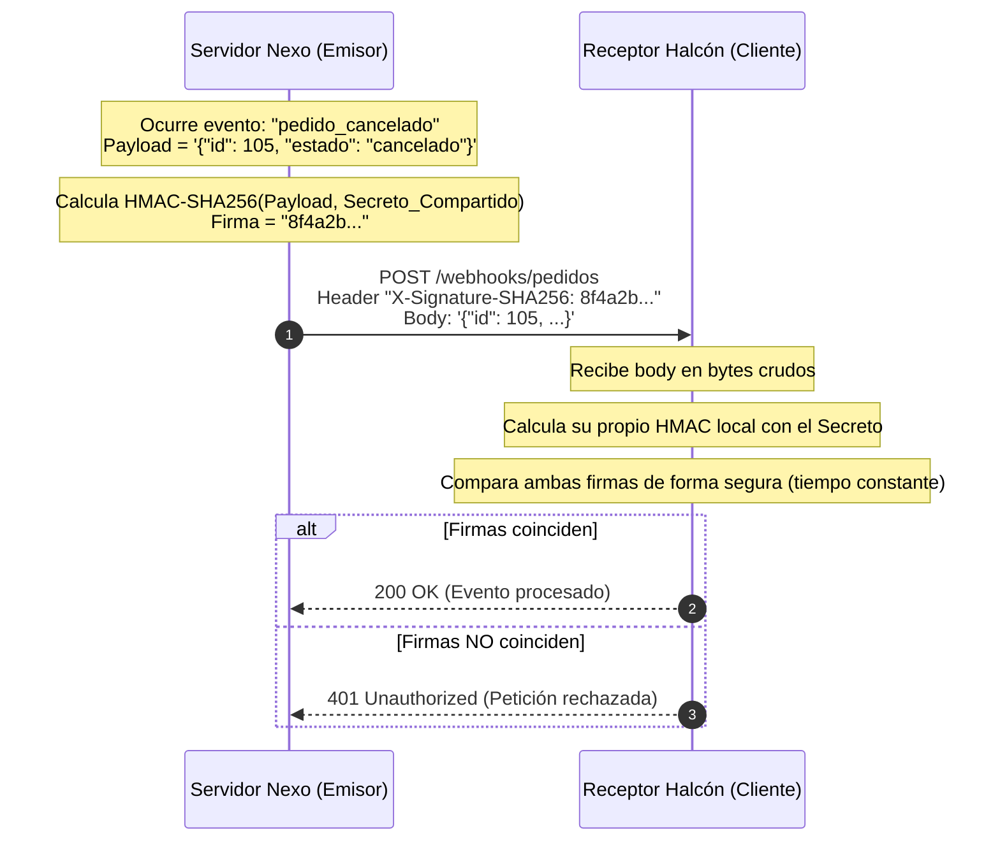

# Lección 05: Webhooks y validación de firmas criptográficas HMAC

> **Nivel:** 🟡 Intermedio · **Duración estimada:** 30 min

---

## Situación

Nexo implementa un sistema de alertas para notificar a los clientes en tiempo real. Roberto Treviño levanta una ceja escéptica:

> *"A ver Alex, ustedes nos van a mandar un Webhook por HTTP cada vez que una tienda cancele un pedido. Pero ese endpoint estará expuesto en un servidor. ¿Cómo sé yo que la petición la mandó realmente Nexo y no un atacante malicioso o un empleado disgustado intentando cancelar pedidos falsos?"*.

La respuesta técnica a esta preocupación de seguridad es la **firma digital criptográfica mediante HMAC** (*Hash-based Message Authentication Code*).

---

## Conceptos clave

### 1. ¿Cómo funciona un Webhook con firma HMAC?

En lugar de confiar ciegamente en la IP de origen, el emisor y el receptor comparten un **secreto compartido** (*Webhook Secret*):



---

### 2. Implementación de verificación HMAC en Python estándar

El módulo `hmac` y `hashlib` de la biblioteca estándar permiten validar firmas con seguridad de grado bancario:

```python
import hashlib
import hmac

def verificar_firma_webhook(cuerpo_bytes: bytes, firma_recibida: str, secreto: str) -> bool:
    """Verifica que el cuerpo recibido no haya sido alterado y provenga del emisor legítimo."""
    # 1. Calcular el digest HMAC-SHA256 esperado
    firma_esperada = hmac.new(
        key=secreto.encode("utf-8"),
        msg=cuerpo_bytes,
        digestmod=hashlib.sha256
    ).hexdigest()

    # 2. Comparación en tiempo constante contra ataques de timing (Timing Attacks)
    return hmac.compare_digest(firma_esperada, firma_recibida)
```

> **Regla de seguridad crítica:** Nunca uses `firma_esperada == firma_recibida` con el operador `==` habitual. En su lugar, usa siempre **`hmac.compare_digest()`**, el cual tarda exactamente el mismo tiempo en comparar cadenas sin importar cuántos caracteres coincidan, protegiendo tu servidor contra ataques de análisis de tiempo (*Timing Attacks*).

---

### 3. Las tres reglas de oro para diseñar receptores de Webhooks

1. **Trabajar siempre sobre bytes crudos:** Debes calcular el hash sobre el cuerpo en bytes exacto como llegó de la red (`request.body`), **antes** de parsearlo con `json.loads()`. Si lo parseas a diccionario y lo vuelves a convertir a string con `json.dumps()`, los espacios o el orden de las claves cambiarán y la firma no coincidirá.
2. **Responder rápido con `200 OK`:** Si el procesamiento de la alerta toma varios segundos o minutos, no hagas esperar al emisor: valida la firma, responde `200 OK` en menos de 500 ms y encola el trabajo pesado para un worker en segundo plano. De lo contrario, el emisor asumirá timeout y te enviará el webhook repetido.
3. **Manejar retransmisiones de forma idempotente:** Si la red falla tras la confirmación, el emisor volverá a mandar el webhook. Guarda el ID del evento en una base de datos para no procesarlo dos veces.

---

## Errores comunes

- **Decodificar a texto antes de verificar la firma:** Hacer `.decode("utf-8")` o parsear a JSON altera los bytes originales del mensaje.
- **Guardar el secreto del webhook en el código:** Quemar `SECRETO = "clave_123"` en el repositorio en lugar de leerlo desde una variable de entorno `os.environ["WEBHOOK_SECRET"]`.
- **No verificar la antigüedad del evento (*Replay Attacks*):** Muchos proveedores (como Stripe o Slack) incluyen una marca de tiempo en la cabecera (ej. `X-Timestamp`) y firman tanto el timestamp como el cuerpo. Si el timestamp tiene más de 5 minutos de diferencia con el reloj local, se descarta para evitar que un atacante capture y retransmita una petición vieja.

---

## En el día a día de un FDE

Demostrarle a Roberto Treviño cómo su receptor de webhooks valida la firma HMAC y rechaza cualquier paquete modificado le da la tranquilidad que necesita para certificar la integración ante su comité de seguridad.

---

## Resumen

- Los webhooks son llamadas HTTP inversas ("no me llames, yo te llamo") para notificar eventos en tiempo real.
- Las firmas HMAC con SHA-256 garantizan autenticidad e integridad del mensaje sin exponer contraseñas.
- Siempre valida la firma sobre los bytes crudos recibidos antes de parsear a JSON.
- Usa `hmac.compare_digest` para evitar vulnerabilidades de análisis de tiempo.

---

## Preguntas de repaso

1. ¿Por qué es fundamental verificar la firma HMAC sobre los `bytes` crudos de la petición en lugar de sobre el objeto ya parseado con `json.loads()`?
2. ¿Qué vulnerabilidad previene el uso de la función `hmac.compare_digest()` frente al operador tradicional `==`?
3. ¿Por qué un servidor de webhooks debe responder con código `200 OK` en pocos milisegundos en lugar de esperar a que termine el procesamiento completo de la tarea?

---

⬅️ [Lección anterior: Idempotencia](04-idempotencia-y-evitar-duplicados.md) | 📦 [Módulo](../README.md) | [Ir a Ejemplos del módulo](01-patrones-de-integracion-batch-vs-streaming.md) ➡️
