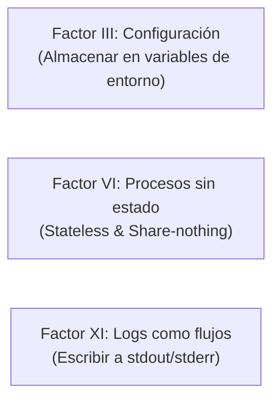

# Lección 01: De mi máquina a producción: Metodología 12-Factor

> **Nivel:** 🟡 Intermedio · **Duración estimada:** 25 min

---

## Situación

Terminaste el conector para Distribuidora Halcón. Para que funcione en tu máquina, creaste un archivo `config.py` con:
```python
BASE_URL = "http://localhost:8000"
DB_PATH = "/Users/tu-usuario/Documents/halcon.db"
CLIENT_SECRET = "mi-clave-secreta"
```

Cuando Roberto Treviño intenta correr tu conector en el servidor Linux de producción de Halcón:
1. `localhost:8000` falla porque allá la API corre en `http://192.168.1.50:9000`.
2. `/Users/tu-usuario/` no existe en Linux.
3. El secreto de producción es confidencial y no debería estar escrito en código compartido.

La solución arquitectónica a este desorden es aplicar los principios de la metodología **The Twelve-Factor App** (*La aplicación de los doce factores*).

---

## Conceptos clave

Diseñada originalmente por los ingenieros de Heroku, la metodología *12-Factor* define las mejores prácticas para construir aplicaciones modernas y portables. Para un FDE, **tres de estos factores son absolutamente críticos**:



---

### Factor III: Configuración almacenada estrictamente en el entorno

Una regla de oro infalible: **Si tu código base fuera publicado hoy como código abierto en GitHub, ¿se comprometería alguna contraseña o credencial de tu cliente?**

Si la respuesta es sí, estás violando el Factor III.
- **El código es idéntico** en desarrollo, pruebas y producción.
- **Lo que cambia entre entornos es la configuración**, la cual se inyecta mediante variables de entorno del sistema:

```python
import os

# Configuración leída de variables de entorno con valores por defecto seguros
API_BASE_URL = os.environ.get("API_BASE_URL", "http://127.0.0.1:8000")
DB_PATH = os.environ.get("DB_PATH", "halcon.db")
TIMEOUT_SEG = int(os.environ.get("TIMEOUT_SEG", "10"))

# Secretos obligatorios sin valor por defecto (falla rápido si falta)
CLIENT_SECRET = os.environ.get("CLIENT_SECRET")
if not CLIENT_SECRET:
    raise ValueError("Variable de entorno obligatoria 'CLIENT_SECRET' ausente.")
```

---

### Factor VI: Procesos sin estado (*Stateless*)

El contenedor del conector debe ser efímero: debe poder destruirse, reiniciarse o moverse de servidor en cualquier momento sin perder datos de negocio.
- Los datos persistentes deben residir en bases de datos (como SQLite en volúmenes montados o PostgreSQL).
- La memoria RAM solo almacena estado transitorio mientras dura la ejecución de la tarea.

---

### Factor XI: Tratar los logs como flujos continuos (*Event Streams*)

Un contenedor nunca debe preocuparse por abrir archivos de log en disco (`/var/log/app.log`) ni gestionar rotación de archivos.
- La aplicación escribe directamente a la salida estándar (`sys.stdout`) o de error (`sys.stderr`).
- El entorno de ejecución (Docker, Kubernetes o systemd) captura ese flujo y lo redirige hacia el sistema de observabilidad centralizado.

---

## El estándar `.env.example`

Nunca subas un archivo `.env` con credenciales reales a Git. En su lugar, incluye siempre un archivo `.env.example` con la lista de variables necesarias y valores ficticios explicativos:

```text
# Archivo de ejemplo: .env.example
# Copia este archivo a .env y completa los valores reales:
# cp .env.example .env

API_BASE_URL=http://127.0.0.1:8000
CLIENT_ID=nexo-demo
CLIENT_SECRET=tu_secreto_aqui
DB_PATH=/datos/halcon.db
MAX_REINTENTOS=5
```

---

## Errores comunes

- **Hardcodear IPs y rutas locales:** Escribir rutas absolutas de tu máquina (`C:\Users\...` o `/home/alex/...`). Usa rutas relativas al proyecto o variables de entorno.
- **Hacer commit de archivos `.env`:** Si subes accidentalmente credenciales de un cliente a un repositorio de Git, se consideran comprometidas de inmediato y deben revocarse.
- **Crear archivos de configuración `.py` para cada entorno:** Tener `config_dev.py`, `config_prod.py`. Esto duplica código y genera errores al olvidar sincronizar parámetros.

---

## En el día a día de un FDE

Cuando entregas un conector que sigue los principios 12-Factor, el equipo de infraestructura de Halcón puede desplegarlo en 2 minutos inyectando sus variables en su gestor corporativo (AWS Secrets Manager, Azure Key Vault o un archivo `.env` local).

---

## Resumen

- Separa estrictamente el código de la configuración.
- La configuración varía entre entornos y se lee de variables de entorno.
- Nunca subas secretos a Git; provee siempre un `.env.example`.
- Escribe logs a `stdout` y mantén tus procesos sin estado.

---

## Preguntas de repaso

1. ¿Cuál es la prueba de fuego para saber si la configuración de tu conector está correctamente desacoplada del código?
2. ¿Por qué es fundamental que un contenedor escriba sus logs a `stdout/stderr` en lugar de a un archivo físico interno?
3. ¿Qué utilidad tiene el archivo `.env.example` para el equipo de TI del cliente?

---

📦 [Volver al módulo](../README.md) | [Siguiente lección: Docker esencial](02-docker-imagenes-contenedores-y-dockerfile.md) ➡️
