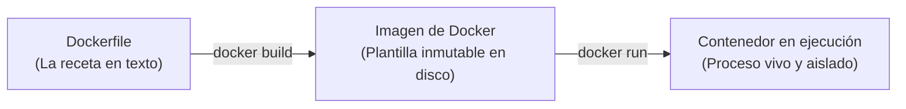

# Lección 02: Docker esencial: Imágenes, contenedores y Dockerfile

> **Nivel:** 🟡 Intermedio · **Duración estimada:** 30 min

---

## Situación

Roberto Treviño te concede una máquina virtual de pruebas con Linux Red Hat en la red de Halcón. Sin embargo, cuando intentas correr el script de sincronización, descubres que el servidor tiene instalada una versión antigua de Python (3.6) que no soporta las librerías modernas, no tiene compiladores C y no tienes permisos de administrador (`sudo`) para actualizar paquetes del sistema operativo.

Si dependieras de instalar software en el servidor anfitrión, el proyecto estaría bloqueado durante semanas esperando aprobaciones corporativas. Con **Docker**, empaquetas el sistema operativo base, la versión exacta de Python (3.10) y tu código en una sola unidad sellada: el **contenedor**.

---

## Conceptos clave

### 1. Imagen vs. Contenedor



- **Dockerfile:** Archivo de texto plano con los pasos para construir el entorno.
- **Imagen:** Plantilla empaquetada e inmutable (como una clase en POO).
- **Contenedor:** Una instancia viva en ejecución de esa imagen (como un objeto en POO).

---

### 2. Anatomía de un `Dockerfile` profesional para FDE

Para entornos de clientes corporativos, las imágenes deben ser **ligeras**, **reproducibles** y **seguras**:

```dockerfile
# 1. Usar imagen base oficial ligera (slim)
FROM python:3.10-slim

# 2. Configurar variables de entorno para que Python no bufferice logs
ENV PYTHONUNBUFFERED=1 \
    PYTHONDONTWRITEBYTECODE=1

# 3. Crear usuario no privilegiado (Seguridad: ¡nunca correr como root!)
RUN useradd -m -u 1000 appuser

# 4. Establecer directorio de trabajo dentro del contenedor
WORKDIR /app

# 5. Copiar únicamente el código necesario con los permisos del usuario
COPY --chown=appuser:appuser modulos/06-integracion-de-sistemas/ejemplos/cliente_resiliente.py /app/cliente_resiliente.py
COPY --chown=appuser:appuser modulos/07-despliegue-y-cloud/ejemplos/worker_sincronizacion.py /app/worker.py

# 6. Cambiar al usuario seguro
USER appuser

# 7. Comando por defecto al encender el contenedor
CMD ["python", "worker.py"]
```

---

### 3. Las tres reglas de oro de seguridad en contenedores

1. **Nunca ejecutes como `root` en producción:** Por defecto, los contenedores arrancan como superusuario `root`. Si un atacante compromete tu aplicación mediante una vulnerabilidad, obtendría privilegios de root en el host. Usa siempre `USER appuser`.
2. **Usa imágenes base mínimas (`-slim` o `-alpine`):** Una imagen completa de Ubuntu pesa 800 MB y contiene cientos de utilidades innecesarias que aumentan la superficie de ataque. Una imagen `python:3.10-slim` pesa menos de 150 MB.
3. **Optimiza la caché de capas de Docker:** Coloca los pasos que cambian con menos frecuencia (como dependencias del sistema) arriba en el Dockerfile, y tu código de aplicación (que cambia frecuentemente) al final.

---

### 4. Comandos esenciales de Docker

```bash
# Construir la imagen localmente con una etiqueta (tag)
docker build -t nexo/conector-halcon:1.0 -f Dockerfile .

# Ejecutar el contenedor en segundo plano inyectando variables de entorno
docker run -d \
  --name conector-halcon \
  -e CLIENT_ID="nexo-demo" \
  -e CLIENT_SECRET="secreto-de-practica" \
  --memory="256m" \
  nexo/conector-halcon:1.0

# Ver contenedores en ejecución
docker ps

# Inspeccionar logs en vivo del contenedor
docker logs -f conector-halcon

# Detener y eliminar el contenedor
docker stop conector-halcon && docker rm conector-halcon
```

---

## Errores comunes

- **Copiar la carpeta `.git` o `.env` dentro de la imagen:** Olvidar crear un archivo `.dockerignore`. Si copias tu `.env` a la imagen, cualquiera que tenga acceso a la imagen de Docker podrá ver tus contraseñas.
- **Dejar procesos como `root`:** Muy mal visto por equipos de seguridad corporativa como el de Roberto Treviño.
- **No definir límites de memoria con `--memory`:** Si tu script tiene una fuga de memoria y no tiene límite, el kernel de Linux matará otros procesos críticos del servidor del cliente.

---

## En el día a día de un FDE

Cuando Roberto Treviño te pregunte: *"¿Qué requisitos de sistema operativo tiene su conector?"*, tu respuesta será:
> *"Solo necesitamos que su servidor tenga Docker o Podman instalado. El contenedor incluye su propio runtime aislado de Python 3.10 y corre bajo un usuario sin privilegios, consumiendo un máximo de 256 MB de RAM."*

---

## Resumen

- Docker empaqueta la aplicación con todas sus dependencias garantizando reproducibilidad absoluta.
- Un `Dockerfile` define la receta para construir una imagen inmutable.
- Ejecuta siempre bajo un usuario no privilegiado (`USER appuser`) y usa imágenes ligeras (`-slim`).
- Usa siempre `.dockerignore` para evitar filtrar secretos o historiales de Git dentro de las capas de la imagen.

---

## Preguntas de repaso

1. ¿Cuál es la diferencia entre una imagen de Docker y un contenedor?
2. ¿Por qué es un riesgo de seguridad crítico ejecutar procesos dentro de un contenedor como usuario `root`?
3. ¿Para qué sirve el archivo `.dockerignore` al construir una imagen?

---

⬅️ [Lección anterior: Metodología 12-Factor](01-de-mi-maquina-a-produccion-12-factor.md) | 📦 [Módulo](../README.md) | [Siguiente lección: Docker Compose](03-orquestacion-con-docker-compose-y-secretos.md) ➡️
