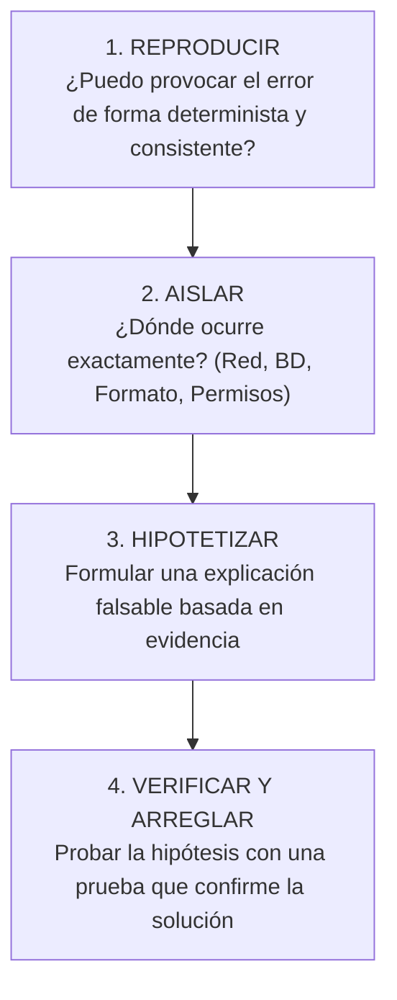

# Lección 01: El método sistemático de debugging en sistemas distribuidos

> **Nivel:** 🟡 Intermedio · **Duración estimada:** 25 min

---

## Situación

Mariana López te manda un mensaje urgente: *"Alex, los pedidos de la Tienda 0045 no aparecen en el sistema. Ayer sí funcionaba y hoy no"*.

El impulso del programador inexperto es abrir el código, cambiar tres variables al tanteo, volver a correr y esperar que funcione. Si no funciona, cambia otra cosa. Esto se llama **"debugging por escopetazo"** (*Shotgun Debugging*): no solo no encuentra el problema, sino que suele introducir nuevos bugs inadvertidos.

Un FDE aborda los problemas como un médico especialista o un detective forense: aplicando el **método científico**.

---

## Conceptos clave

El método sistemático de debugging se compone de **4 fases estrictas**:

---

### Paso 1: Reproducir el error de forma confiable

Si no puedes reproducir el error localmente o en el entorno de pruebas, no puedes afirmar que lo has resuelto.
- **Preguntas clave:**
  - ¿Con qué datos exactos de entrada falló? (¿Qué SKU, qué fecha, qué tienda?)
  - ¿Qué versión del código estaba corriendo a esa hora?
  - ¿El error ocurre el 100 % de las veces o solo de forma intermitente?

---

### Paso 2: Aislar los componentes (*Divide y Vencerás*)

Una integración tiene múltiples capas:
$$\text{Red / Firewall} \longrightarrow \text{Autenticación} \longrightarrow \text{Validación de datos} \longrightarrow \text{Base de datos}$$

Usa la técnica de división binaria:
1. ¿El archivo CSV llegó físicamente al servidor? *(Revisar con `ls -la`)*.
2. Si llegó, ¿la fila de la Tienda 0045 está dentro del archivo? *(Revisar con `grep`)*.
3. Si está, ¿el script de Python la procesó o la envió a `auditoria_rechazos`?
4. Si la procesó, ¿se insertó en SQLite? *(Ejecutar `SELECT` en terminal)*.

En 2 minutos sabes en qué eslabón exacto de la cadena se rompió el flujo.

---

### Paso 3: Formular una hipótesis comprobable

Una buena hipótesis no es *"a lo mejor la API falló"*. Es una afirmación específica y verificable:
> *"Hipótesis: La Tienda 0045 envió un número de teléfono con formato inválido ('SIN_NUMERO'), lo que provocó que la función `normalizar_tiendas()` la clasificara como rechazada en la línea 452."*

---

### Paso 4: Verificar, solucionar y agregar prueba de regresión

1. Corrige la causa raíz en el código.
2. Ejecuta la prueba con los datos que antes fallaban y comprueba que ahora tengan éxito.
3. **Agrega una prueba automática (de regresión):** Para asegurar que nadie en el futuro vuelva a romper ese caso extremo.

---

## Errores comunes

- **Modificar múltiples variables al mismo tiempo:** Si cambias la URL, el timeout y el formato de fecha al mismo tiempo y empieza a funcionar, nunca sabrás cuál de las tres cosas era la causa real del problema.
- **Confundir correlación con causalidad:** *"El script falló justo cuando reiniciaron el router, así que la culpa es del router"*. Revisa los logs antes de culpar a la infraestructura.
- **Declarar victoria sin revisar los logs de producción:** Creer que porque corrió una vez en tu laptop ya está resuelto en el servidor de Halcón.

---

## En el día a día de un FDE

Frente a un cliente estresado, seguir este método te da una serenidad contagiosa. Mientras otros discuten o se echan la culpa, tú abres la terminal, aíslas el componente y presentas la evidencia en minutos.

---

## Resumen

- Nunca hagas cambios al azar en código de producción.
- Sigue el ciclo: Reproducir -> Aislar -> Hipotetizar -> Verificar.
- Divide el sistema en capas para aislar el punto exacto de falla.
- Toda corrección de bug debe acompañarse de una prueba de regresión.

---

## Preguntas de repaso

1. ¿Por qué el "debugging por escopetazo" (*shotgun debugging*) es peligroso en entornos de producción?
2. ¿Cuáles son las 4 etapas del método sistemático de resolución de problemas?
3. ¿Qué es una prueba de regresión y por qué es obligatoria tras solucionar un bug?

---

📦 [Volver al módulo](../README.md) | [Siguiente lección: Logging estructurado](02-logging-estructurado-y-niveles.md) ➡️
