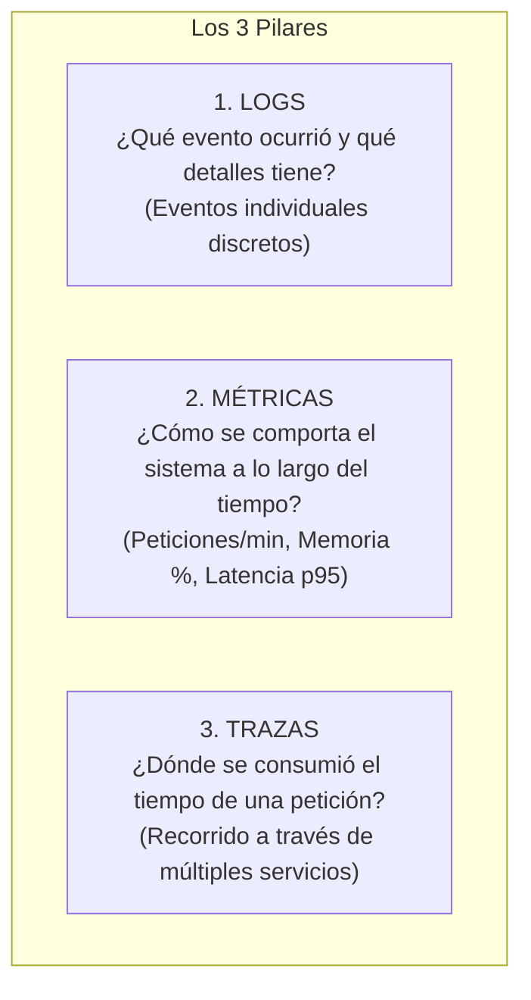

# Lección 03: Observabilidad práctica: Métricas, trazas y SLOs

> **Nivel:** 🟡 Intermedio · **Duración estimada:** 25 min

---

## Situación

El conector de inventario nocturno está corriendo. No hay ningún error en los logs. Sin embargo, Laura Garza nota que el tablero de existencias tardó 45 minutos en actualizarse en lugar de los 3 minutos habituales.

El sistema no se cayó, pero su rendimiento se degradó drásticamente. Si solo miras los logs de error, no verás nada sospechoso. Necesitas herramientas de **Observabilidad**: la capacidad de inferir el estado interno de un sistema a partir de sus salidas externas.

---

## Conceptos clave

### 1. Los Tres Pilares de la Observabilidad

- **Logs:** Te dicen el *por qué* ocurrió un error puntual.
- **Métricas:** Te alertan de *cuándo* algo empieza a salirse de los parámetros normales antes de que se caiga.
- **Trazas:** Te muestran el *dónde* está el cuello de botella en sistemas distribuidos.

---

### 2. SLI, SLO y SLA: El lenguaje del rendimiento

En contratos empresariales B2B, la calidad del servicio se mide con tres acrónimos fundamentales:

| Término | Qué significa | Definición sencilla | Ejemplo en Distribuidora Halcón |
|---------|---------------|---------------------|---------------------------------|
| **SLI** (*Service Level Indicator*) | Indicador de Nivel de Servicio | La **métrica real** que mides en tiempo real. | *"Porcentaje de sincronizaciones nocturnas exitosas antes de las 05:00 AM"*. |
| **SLO** (*Service Level Objective*) | Objetivo de Nivel de Servicio | La **meta interna** de calidad que tu equipo se fija. | *"99.5 % de las sincronizaciones nocturnas concluidas con éxito al mes"*. |
| **SLA** (*Service Level Agreement*) | Acuerdo de Nivel de Servicio | El **compromiso contractual** con el cliente con penalizaciones económicas si se incumple. | *"99.0 % de disponibilidad; si cae por debajo, se bonifica el 10 % de la mensualidad"*. |

$$\text{SLI (Métrica Real)} \longrightarrow \text{SLO (Meta Interna)} \longrightarrow \text{SLA (Contrato Legal)}$$

---

### 3. Las cuatro señales doradas (*The Four Golden Signals*)

Definidas en el manual de SRE (*Site Reliability Engineering*) de Google:

1. **Latencia:** El tiempo que toma procesar una petición (medir promedio y percentil 95/99).
2. **Tráfico:** La demanda que recibe el sistema (peticiones por segundo o registros procesados).
3. **Errores:** La tasa de peticiones que fallan explícitamente (códigos 5xx o excepciones).
4. **Saturación:** Qué tan cerca del límite de capacidad están los recursos más restringidos (memoria RAM, CPU, conexiones a base de datos).

---

## Errores comunes

- **Medir solo el promedio de latencia:** Si 99 peticiones tardan 10 milisegundos y 1 petición tarda 30 segundos, el promedio parecerá bueno (~310 ms), pero un cliente sufrió una espera inaceptable. Mide siempre los percentiles **p95** y **p99**.
- **Alertar por todo (*Alert Fatigue*):** Configurar alertas que mandan correos o mensajes a Slack cada vez que una sola petición da 503 y se recupera con un reintento. Esto provoca que el equipo ignore las alertas cuando ocurra una verdadera catástrofe.
- **Comprometer SLAs imposibles de cumplir:** Prometer al cliente 99.99 % de disponibilidad cuando la API interna del cliente se cae dos veces por semana. Tu SLA nunca puede ser más alto que el de las dependencias sobre las que corres.

---

## En el día a día de un FDE

En tu reporte mensual para Roberto Treviño, presentas una gráfica sencilla con las 4 señales doradas:
> *"Durante los últimos 30 días, el conector alcanzó un SLI de 99.8 % de éxito, con una latencia promedio de 1.2 segundos por lote y un consumo máximo de RAM de 118 MB. Superamos con creces el SLO acordado del 99.5 %."*

Ese reporte renueva contratos.

---

## Resumen

- La observabilidad combina Logs (detalles), Métricas (tendencias) y Trazas (recorridos).
- Un SLI es la medición real; un SLO es el objetivo interno; un SLA es el contrato formal.
- Monitorea siempre las cuatro señales doradas: Latencia, Tráfico, Errores y Saturación.

---

## Preguntas de repaso

1. ¿Cuál es la diferencia entre un SLI (*Service Level Indicator*) y un SLO (*Service Level Objective*)?
2. ¿Por qué es engañoso evaluar el rendimiento de un sistema usando únicamente el promedio de latencia en lugar de percentiles como p95 o p99?
3. ¿Cuáles son las cuatro señales doradas de monitoreo según la metodología de SRE de Google?

---

⬅️ [Lección anterior: Logging estructurado](02-logging-estructurado-y-niveles.md) | 📦 [Módulo](../README.md) | [Siguiente lección: Gestión de incidentes](04-gestion-de-incidentes-y-postmortems-blameless.md) ➡️
