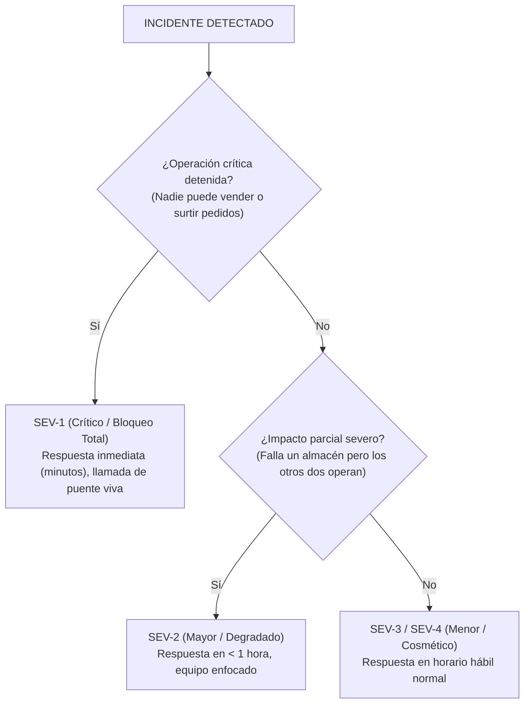

# Lección 04: Gestión de incidentes con clientes y postmortems sin culpa

> **Nivel:** 🟡 Intermedio · **Duración estimada:** 30 min

---

## Situación

Viernes, 11:30 AM. El conector en producción de Nexo se detiene súbitamente. Las tiendas abarroteras no pueden registrar pedidos para el fin de semana. Laura Garza está al borde de un ataque de nervios, Roberto Treviño pide explicaciones urgentes y el canal de Slack de tu empresa arde con alertas.

En ese momento de máxima presión, tu valor como Forward Deployed Engineer se pone a prueba: ¿entras en pánico y buscas a quién culpar, o asumes el control con templanza, mitigas el impacto, comunicas con empatía y conviertes la crisis en una demostración de excelencia operativa?

---

## Conceptos clave

### 1. Clasificación de Severidad de Incidentes

No todos los problemas son igual de graves. Clasificar la severidad determina el nivel de respuesta:



---

### 2. La regla de oro en crisis: **Mitigar ANTES de arreglar**

En medio de un incendio operativo, tu prioridad absoluta es **detener el dolor del negocio**, no encontrar la solución arquitectónica perfecta:

- Si el nuevo conector falla: haz **rollback** inmediato a la versión anterior que sí funcionaba.
- Si el servidor se quedó sin memoria: reinicia el contenedor de inmediato para restablecer el servicio.
- Si la API externa está colapsada: activa el modo de contingencia con una carga de respaldo manual.

Una vez que los camiones de Halcón vuelvan a despachar pedidos y la operación esté a salvo, tendrás todo el tiempo del mundo para investigar la causa raíz con calma.

---

### 3. Comunicación transparente con el cliente

El peor error durante un incidente es el **silencio**. Aunque aún no sepas qué causó el problema, el cliente necesita saber que estás al frente de la situación:

#### ❌ Comunicación deficiente:
*(Silencio de 2 horas mientras investigas... y luego un mensaje escueto: "Ya quedó").*

#### ✅ Comunicación profesional de FDE:
```text
[11:45 AM - Actualización de Incidente Halcón]
• Estado: Identificando causa raíz.
• Impacto: Los pedidos del almacén Monterrey están demorados; Guadalajara y CDMX operan con normalidad.
• Acción en curso: Estamos revirtiendo el contenedor a la versión estable de las 10:00 AM para restablecer el flujo.
• Próxima actualización: En 20 minutos (12:05 PM) o antes si hay novedades.
```

---

### 4. La cultura del Postmortem sin culpas (*Blameless Postmortem*)

Cuando el polvo se asienta, un equipo novato busca un chivo expiatorio: *"La culpa fue de Juan porque se equivocó en una coma en el código"*.

Las mejores organizaciones de ingeniería del mundo (Google, Etsy, Netflix) aplican la filosofía **Blameless**:
- **Premisa fundamental:** Los ingenieros son profesionales competentes que toman las mejores decisiones posibles con la información que tienen a la mano. Si ocurrió un error catastrófico, **el sistema, las herramientas o los procesos de validación fallaron al permitir que ese error humano llegara a producción**.

Estructura de un Postmortem profesional:
1. **Resumen Ejecutivo:** Fecha, duración del incidente y usuarios afectados.
2. **Impacto de Negocio:** Cuántos pedidos o dinero se retrasaron.
3. **Línea de Tiempo (*Timeline*):** Cronología minuto a minuto de los hechos.
4. **Causa Raíz (*Root Cause*):** Qué fallo técnico y qué salvaguarda faltó.
5. **Qué funcionó bien y qué funcionó mal:** Lecciones aprendidas.
6. **Elementos de Acción (*Action Items*):** Tareas concretas con responsable y fecha límite para garantizar que ese incidente específico **nunca más vuelva a ocurrir**.

---

## Errores comunes

- **Buscar culpables individuales:** Destruye la seguridad psicológica del equipo y hace que la gente oculte los errores en el futuro por miedo a represalias.
- **Minimizar el impacto frente al cliente:** Decirle a Laura *"no fue para tanto, solo se paró una hora"* cuando ella tuvo camiones detenidos.
- **No documentar los elementos de acción:** Escribir un postmortem bonito que se archiva en una carpeta y olvidar implementar las salvaguardas prometidas.

---

## En el día a día de un FDE

Un incidente bien manejado, con comunicación proactiva cada 20 minutos y un postmortem profesional entregado el lunes a primera hora, paradójicamente **aumenta la confianza del cliente en tu empresa**. Roberto y Laura sabrán que cuando las cosas se pongan difíciles, Nexo responde con madurez y rigor.

---

## Resumen

- Clasifica la severidad (Sev-1 a Sev-3) para dimensionar la respuesta adecuada.
- Mitiga el impacto operativo primero (rollback o reinicio); investiga y arregla la causa raíz después.
- Comunica periódicamente al cliente el estado, las acciones en curso y la hora de la próxima actualización.
- Los postmortems sin culpa (*blameless*) mejoran el sistema y los procesos sin señalar a personas.

---

## Preguntas de repaso

1. ¿Por qué se debe priorizar mitigar el impacto operativo (ej. hacer rollback) antes de ponerse a investigar y arreglar el bug de fondo?
2. ¿Cuál es el principio fundamental detrás de un postmortem sin culpa (*blameless*)?
3. ¿Qué componentes indispensables deben incluirse en una actualización de incidente enviada a un cliente corporativo?

---

⬅️ [Lección anterior: Observabilidad y SLOs](03-observabilidad-metricas-trazas-y-slos.md) | 📦 [Módulo](../README.md) | [Ir a Ejemplos del módulo](01-metodo-sistematico-de-debugging.md) ➡️
