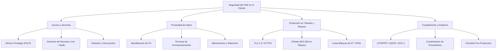

# Módulo 09: Seguridad y datos del cliente

> **Nivel:** 🟡 Intermedio  
> **Duración estimada:** 3 horas  
> **Prerrequisitos:** Módulo 01 (Herramientas esenciales), Módulo 06 (Integración de sistemas), Módulo 07 (Despliegue y nube)

---

## 🎯 Objetivo del módulo

Comprender la postura de seguridad que debe adoptar un Forward Deployed Engineer al interactuar con la infraestructura y los datos confidenciales de una empresa cliente. Aprenderás a aplicar el principio de mínimo privilegio, proteger y enmascarar información personal identificable (PII), entender el cifrado en tránsito y en reposo, y responder cuestionarios de cumplimiento normativo y seguridad de la información.

---

## 🗺️ Mapa conceptual del módulo

---

## 📚 Lecciones

| # | Lección | Duración | Descripción |
|---|---------|----------|-------------|
| 01 | [**Mínimo privilegio y manejo de secretos**](lecciones/01-minimo-privilegio-y-manejo-de-secretos.md) | 45 min | Gestión segura de credenciales, scopes de API, rotación y prevención de filtraciones en Git. |
| 02 | [**Protección de datos personales y PII**](lecciones/02-proteccion-de-datos-personales-y-pii.md) | 45 min | Identificación de Personally Identifiable Information, enmascaramiento, hashing y tokenización. |
| 03 | [**Cifrado y postura de seguridad operativa**](lecciones/03-cifrado-y-postura-de-seguridad.md) | 45 min | Cifrado en tránsito y reposo, segmentación de redes, VPNs y defensas en profundidad. |
| 04 | [**Cuestionarios de seguridad y cumplimiento**](lecciones/04-cuestionarios-de-seguridad-y-compliance.md) | 45 min | Marcos normativos (LFPDPPP, GDPR, SOC 2, ISO 27001) y cómo superar auditorías de seguridad corporativa. |

---

## 🛠️ Ejemplos de código y plantillas

En la carpeta [`ejemplos/`](ejemplos/) encontrarás:
* [`enmascarar_pii.py`](ejemplos/enmascarar_pii.py): Script en Python puro que sanitiza y enmascara campos sensibles de `tiendas.csv`.
* [`checklist_seguridad_implementacion.md`](ejemplos/checklist_seguridad_implementacion.md): Lista de verificación de 25 puntos de seguridad antes de desplegar en producción.

---

## 🏋️ Ejercicios prácticos

En la carpeta [`ejercicios/`](ejercicios/) pondrás a prueba tus conocimientos:
1. [**Auditor automatizado de fugas de PII**](ejercicios/01-auditor-de-fugas-de-pii.md): Desarrollar una herramienta que escanee logs o archivos y detecte patrones de correos, teléfonos y RFCs expuestos.
2. [**Evaluación de riesgos y respuesta a cuestionario de seguridad**](ejercicios/02-evaluacion-de-riesgos-y-cuestionario-soc2.md): Completar las respuestas de seguridad exigidas por el CISO de Distribuidora Halcón.

---

## 🎬 Guía para el instructor: Grabación de videos

* **Tono del módulo:** Riguroso, ético y pragmático. Como FDE, la reputación de tu startup descansa en que nunca comprometas los datos de un cliente.
* **Demostración clave:** Muestra con un ejemplo en vivo cómo un simple `git push` con una API key puede ser indexado en segundos, y cómo un script de enmascaramiento previene que datos de directivos lleguen a entornos de pruebas.
* **Tiempo sugerido en video:** 4 cápsulas de 10 a 12 minutos cada una.
