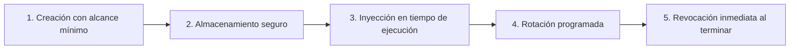

# Lección 01: Mínimo privilegio y manejo de secretos

## 🎯 Objetivos de aprendizaje

* Comprender el Principio de Mínimo Privilegio (*Principle of Least Privilege*, PoLP) aplicado al trabajo de un FDE en el cliente.
* Aprender a solicitar y gestionar accesos de base de datos, APIs y entornos con alcance restringido.
* Implementar buenas prácticas de almacenamiento e inyección de secretos para evitar fugas en repositorios de código.

---

## 🔐 1. El Principio de Mínimo Privilegio (PoLP)

El Principio de Mínimo Privilegio establece que cualquier usuario, servicio, proceso o programa debe tener únicamente los permisos mínimos estrictamente necesarios para desempeñar su función, y nada más.

Cuando un FDE llega a las oficinas o a los sistemas de un cliente corporativo como Distribuidora Halcón, es muy común encontrarse con dos extremos peligrosos:
1. **La barrera infranqueable:** El equipo de TI se rehúsa a otorgar cualquier acceso por semanas, congelando el proyecto.
2. **El "toma el usuario admin":** Por falta de tiempo, el administrador le entrega al FDE una cuenta con rol `sa` (Super Admin) o `root` en la base de datos de producción.

> [!CAUTION]
> **Nunca aceptes permisos de superusuario si no son estrictamente necesarios.** Si tienes acceso `root` o `admin` y ocurre una anomalía o pérdida de datos en la base de datos del cliente (incluso causada por un tercero), tú y tu empresa serán los primeros sospechosos de la investigación forense.

### Matriz de accesos para un FDE

| Recurso | Acceso ideal solicitado | Por qué restringirlo |
|---------|-------------------------|----------------------|
| **Base de datos ERP** | Usuario de solo lectura (`SELECT`) acotado a las vistas o tablas de inventario y pedidos. | Previene bloqueos por `UPDATE/DELETE` accidentales o inyecciones maliciosas. |
| **API del Cliente** | Token con scope limitado: `inventory:read`, `orders:read,write`. | Evita que una credencial comprometida modifique catálogos maestros o datos fiscales. |
| **Servidores / Cloud** | Usuario sin privilegios `sudo`, acceso mediante llaves SSH personales (nunca llaves compartidas). | Trazabilidad y auditoría forense clara. |
| **Red / VPN** | Acceso enrutado únicamente a la subred o IP del servidor de integración. | Reduce la superficie de ataque lateral si tu equipo de cómputo sufre un incidente. |

---

## 🔑 2. Anatomía y ciclo de vida de los secretos

Un secreto es cualquier dato confidencial que sirve como mecanismo de autenticación o autorización:
* Llaves de API (*API Keys*)
* Tokens de acceso (JWT, Bearer Tokens)
* Certificados privados TLS / SSL
* Contraseñas de bases de datos
* Llaves de firmado HMAC para Webhooks

### El ciclo de vida de un secreto



1. **Creación:** Generar con entropía criptográfica alta (mínimo 32 bytes aleatorios).
2. **Almacenamiento seguro:** Nunca en texto plano en wikis, mensajes de Slack, correos o código fuente.
3. **Inyección:** Pasar al proceso únicamente a través de variables de entorno del sistema operativo (`os.environ`).
4. **Rotación:** Cambiar las credenciales periódicamente (p. ej., cada 30, 60 o 90 días) sin interrumpir el servicio.
5. **Revocación:** Eliminar credenciales inmediatamente si un empleado sale de la empresa o cuando concluye el proyecto del cliente.

---

## 🚫 3. Cómo evitar fugas de credenciales en Git

Una de las pesadillas más frecuentes en implementaciones de software es el commit accidental de archivos `.env`, llaves privadas `.pem` o credenciales *hardcodeadas* dentro de scripts de Python.

Existen bots automatizados rastreando commits públicos de GitHub cada segundo. Si publicas una llave de AWS o OpenAI, puede ser explotada en menos de 2 minutos.

### Reglas de oro:
1. **Configurar `.gitignore` antes del primer commit:**
   ```gitignore
   .env
   .env.*
   *.pem
   *.key
   credentials.json
   secrets/
   ```
2. **Utilizar siempre `.env.example`:**
   Proporciona a tu equipo y al cliente un archivo `.env.example` con las variables necesarias pero con valores vacíos o ficticios:
   ```bash
   # .env.example
   HALCON_API_KEY=tu_api_key_aqui
   HALCON_DB_PASSWORD=contrasena_segura
   ```
3. **Instalar hooks de pre-commit:**
   Herramientas como `git-secrets`, `trufflehog` o `detect-secrets` analizan el código antes de permitir que `git commit` se ejecute localmente.

---

## 💻 4. Extracción segura de secretos en Python

En lugar de definir credenciales directamente en el código:

```python
# ❌ INCORRECTO: Jamás guardes credenciales en el código fuente
API_KEY = "halcon_live_secret_998127391823"
```

Aplica el estándar de las Doce Capas (*Twelve-Factor App*):

```python
# ✅ CORRECTO: Leer de variables de entorno con validación estricta
import os
import sys

def obtener_credenciales():
    api_key = os.environ.get("HALCON_API_KEY")
    if not api_key:
        print("ERROR FATAL: La variable de entorno HALCON_API_KEY no está configurada.", file=sys.stderr)
        sys.exit(1)
    return api_key
```

---

## 📌 Conclusiones clave

* Limita siempre tus solicitudes de permisos a lo estrictamente indispensable para entregar valor.
* El código fuente no debe contener secretos bajo ninguna circunstancia.
* Si el cliente te entrega credenciales de prueba por correo o Slack, almacénalas en un gestor corporativo (como 1Password o Bitwarden) y elimina el mensaje del canal.
