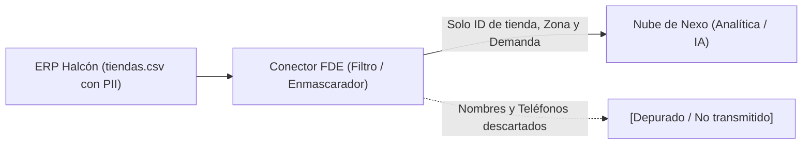

# Lección 02: Protección de datos personales y PII

## 🎯 Objetivos de aprendizaje

* Definir con precisión qué constituye Información de Identificación Personal (*Personally Identifiable Information*, PII).
* Comprender el principio de minimización de datos en arquitecturas de integración.
* Dominar técnicas prácticas de anonimización: enmascaramiento (*masking*), seudonimización mediante hashing con sal (*salt*) y tokenización.

---

## 👤 1. ¿Qué es PII y por qué le importa al FDE?

La **Información de Identificación Personal (PII)** es cualquier dato que permite identificar de forma directa o indirecta a un individuo en el mundo físico o digital.

En el caso de estudio de Distribuidora Halcón, el archivo [`recursos/caso-de-estudio/datos/tiendas.csv`](../../../recursos/caso-de-estudio/datos/tiendas.csv) contiene:
* Nombres completos de los encargados de tienda (p. ej., *"Carlos Morales"*, *"Mariana Benítez"*).
* Correos electrónicos personales o corporativos directos.
* Números de teléfono celular o directo.
* Direcciones físicas exactas de las sucursales.

En otros sectores (fintech, salud, recursos humanos), la PII incluye además:
* Identificadores oficiales: RFC, CURP, Número de Seguridad Social (NSS), INE o pasaporte.
* Datos financieros: Números de tarjeta de crédito (PAN), cuentas bancarias (CLABE).
* Datos sensibles: Estado de salud, datos biométricos, preferencias o afiliaciones.

> [!WARNING]
> La filtración accidental de PII no solo acarrea multas financieras severas bajo legislaciones como la LFPDPPP o GDPR, sino que destruye la confianza comercial depositada en la startup proveedora.

---

## 📉 2. El principio de minimización de datos

La regla número uno en la ingeniería de integración es la **minimización de datos**:
> *"No recopiles, no transmitas y no almacenes ningún dato que tu aplicación no necesite de forma imprescindible para resolver el problema de negocio."*

Si el algoritmo de Nexo solo necesita predecir la demanda de inventario de las tiendas de abarrotes, **¿para qué necesita conocer el nombre y el celular personal del encargado de la sucursal?** 

La respuesta es: **no lo necesita**. Por lo tanto, el trabajo del FDE consiste en filtrar esos campos en la capa de ingesta (*ETL*), evitando que viajen hacia la nube de Nexo.



---

## 🎭 3. Técnicas de anonimización y protección

Cuando ciertos datos son necesarios para la operación pero no se debe exponer la identidad real, el FDE implementa técnicas de transformación:

### A. Enmascaramiento parcial (*Masking*)
Oculta una parte de la cadena para permitir soporte técnico o verificación visual sin exponer el valor completo.
* Correo electrónico: `carlos.morales@halcon.com.mx` ➔ `c***s@halcon.com.mx`
* Teléfono celular: `81-1234-5678` ➔ `******5678`
* Tarjeta de crédito: `4111 2222 3333 4444` ➔ `**** **** **** 4444`

### B. Seudonimización con Hashing y Sal (*Salting*)
Convierte un dato identificador en un hash unidireccional determinista. Permite correlacionar registros sin conocer la identidad real.

Si solo usamos un hash simple como `sha256("carlos.morales@halcon.com.mx")`, un atacante puede usar una tabla arcoíris (*rainbow table*) para revertirlo. Por eso es obligatorio añadir un **secreto aleatorio (*salt*)**:

```python
import hashlib

def anonimizar_identificador(identificador: str, salt_secreta: str) -> str:
    cadena = f"{identificador}:{salt_secreta}".encode("utf-8")
    return hashlib.sha256(cadena).hexdigest()[:16]
```

### C. Tokenización
Reemplaza el dato confidencial por un identificador generado aleatoriamente (UUID) y almacena el mapeo inverso en una base de datos de alta seguridad (*Token Vault*) a la que solo ciertos servicios autorizados pueden acceder.

---

## 🧹 4. Políticas de retención y purga

Los datos almacenados son un pasivo de seguridad. Si tu sistema guarda archivos CSV temporales en `/tmp` o en logs para depuración, esos datos deben expirar de forma automática.

* **Archivos temporales:** Deben borrarse inmediatamente después de ser procesados o contar con un cron job que elimine archivos con más de 24 horas de antigüedad.
* **Logs de producción:** Nunca deben imprimir payloads completos que contengan contraseñas, tokens o PII. Los logs deben purgarse o archivarse en almacenamiento frío cifrado tras 30 o 90 días según el SLA contratado.

---

## 📌 Conclusiones clave

* Identifica la PII en cada integración desde el primer día de descubrimiento.
* Aplica minimización: si la IA no necesita el dato personal, no lo envíes a tu API.
* Enmascara o anonimiza antes de persistir o emitir logs.
