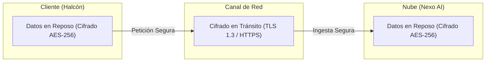

# Lección 03: Cifrado y postura de seguridad operativa

## 🎯 Objetivos de aprendizaje

* Diferenciar los mecanismos de cifrado en tránsito frente al cifrado en reposo.
* Conocer las arquitecturas de red típicas de clientes empresariales: VPNs, listas blancas de IP (*IP Whitelisting*) y VPC Peering.
* Desarrollar una postura de seguridad proactiva durante la operación del FDE en producción.

---

## 🔒 1. Cifrado en tránsito vs. Cifrado en reposo

La protección de datos en una arquitectura B2B se sustenta en dos pilares fundamentales:

### Cifrado en tránsito (*Data in Transit*)
Protege los datos mientras viajan a través de redes públicas o privadas para evitar ataques de intermediario (*Man-in-the-Middle*, MitM) y espionaje de paquetes (*packet sniffing*).
* **Protocolo estándar:** HTTPS sobre TLS 1.3 (o TLS 1.2 como mínimo absoluto).
* **Certificados:** Emitidos por Autoridades Certificadoras (CA) reconocidas y renovados automáticamente (vía Let's Encrypt o AWS ACM).
* **Validación de certificados:** Tu cliente HTTP en Python **nunca** debe usar `verify=False` en producción para ignorar errores SSL.

### Cifrado en reposo (*Data at Rest*)
Protege la información cuando se encuentra grabada en discos duros, bases de datos o volúmenes de respaldo, neutralizando el riesgo de que alguien acceda físicamente al medio de almacenamiento.
* **Estándar de la industria:** Cifrado simétrico AES-256 (Advanced Encryption Standard).
* **Llaves de cifrado:** Gestionadas mediante servicios dedicados como AWS KMS, GCP Cloud KMS o HashiCorp Vault, con soporte para rotación automática de llaves maestros (*CMKs*).

---

## 🌐 2. Controles de red y perímetros empresariales

Los clientes enterprise rara vez exponen sus bases de datos o APIs internas directamente a internet. Como FDE, trabajarás a través de barreras de red:

### A. Listas blancas de IP (*IP Whitelisting*)
El firewall del cliente solo permite conexiones originadas desde direcciones IP estáticas predefinidas pertenecientes a tus servidores de Nexo.
* **Implicación para el FDE:** Si despliegas un conector en un contenedor que cambia de IP dinámica cada reinicio, el firewall del cliente bloqueará el tráfico inmediatamente. Se requiere configurar un *NAT Gateway* o IP fija (*Elastic IP*).

### B. Redes Privadas Virtuales (VPN)
Túnel cifrado punto a punto (OpenVPN, WireGuard, IPsec) que conecta tu máquina de desarrollo o el servidor de Nexo con la red corporativa interna de Halcón.

### C. Emparejamiento de Redes (*VPC Peering*) o PrivateLink
Si tanto el cliente como tu empresa operan en la nube (por ejemplo, AWS o Google Cloud), se establece un enlace de red privado interno que no viaja por la internet pública.

---

## 🛡️ 3. Postura de seguridad operativa del FDE

Como FDE, eres el embajador técnico de tu empresa. La negligencia individual de un ingeniero puede abrir brechas de seguridad críticas.

### Hábitos indispensables:
1. **Autenticación multifactor (MFA/2FA):** Obligatoria en tu correo corporativo, cuenta de GitHub, consola de la nube y gestor de contraseñas.
2. **Máquina de trabajo cifrada:** Disco duro cifrado con FileVault (macOS) o BitLocker (Windows/Linux), y bloqueo automático de pantalla en 2 minutos de inactividad.
3. **No utilizar redes Wi-Fi públicas sin VPN:** Si estás en un aeropuerto, hotel o cafetería, nunca abras consolas de producción o conexiones SSH sin tener la VPN corporativa activa.
4. **Separación de entornos:** Nunca conectes tu laptop local directamente a la base de datos de producción de un cliente para "ver qué pasa". Usa entornos de prueba (*Staging* o *Sandbox*) o scripts auditables.

---

## 📌 Conclusiones clave

* TLS 1.3 y AES-256 son los estándares innegociables para tránsito y reposo.
* Desactivar la verificación de certificados (`verify=False`) es una vulnerabilidad crítica inaceptable.
* La seguridad no es solo de servidores; tu computadora personal de trabajo es parte del perímetro de seguridad del cliente.
