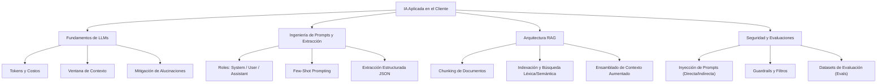

# Módulo 10: Inteligencia Artificial aplicada para FDEs

> **Nivel:** 🟡 Intermedio  
> **Duración estimada:** 6 horas  
> **Prerrequisitos:** Módulo 02 (Python para FDE), Módulo 03 (HTTP y APIs), Módulo 04 (Datos y SQL)

---

## 🎯 Objetivo del módulo

Comprender cómo integrar Modelos de Lenguaje Grande (*LLMs*) y técnicas de Generación Aumentada por Recuperación (*RAG*) en soluciones empresariales reales. Aprenderás a diseñar prompts que emitan estructuras JSON estrictas, implementar motores de recuperación contextual sobre documentación corporativa sin depender de infraestructura pesada, evaluar la calidad de las respuestas y blindar tus sistemas contra inyecciones de prompts y fugas de datos.

---

## 🗺️ Mapa conceptual del módulo

---

## 📚 Lecciones

| # | Lección | Duración | Descripción |
|---|---------|----------|-------------|
| 01 | [**Fundamentos de LLMs para FDEs**](lecciones/01-fundamentos-de-llms-para-fdes.md) | 1 h 30 min | Tokenomics, costos, latencia, temperatura, ventana de contexto y comprensión de límites técnicos. |
| 02 | [**Consumo de APIs y salidas estructuradas**](lecciones/02-consumo-de-apis-y-salidas-estructuradas.md) | 1 h 30 min | Esquemas JSON, modo estructurado (*Structured Outputs*), *function calling* y validación robusta. |
| 03 | [**Arquitectura RAG mínima y recuperación**](lecciones/03-arquitectura-rag-minima.md) | 1 h 30 min | Fragmentación (*chunking*), estrategias de búsqueda léxica (TF-IDF/BM25) vs. embeddings, y síntesis contextual. |
| 04 | [**Evaluaciones, guardrails y riesgos**](lecciones/04-evaluaciones-guardrails-y-riesgos.md) | 1 h 30 min | Inyecciones de prompts, aislamiento de datos sensibles del cliente, *eval sets* y métricas de calidad. |

---

## 🛠️ Ejemplos de código

En la carpeta [`ejemplos/`](ejemplos/) encontrarás implementaciones completas en Python sin librerías de terceros:
* [`cliente_llm_simulado.py`](ejemplos/cliente_llm_simulado.py): Cliente de LLM con soporte de conexión real vía variables de entorno o modo de simulación offline para correr sin API key.
* [`rag_minimo.py`](ejemplos/rag_minimo.py): Motor RAG completo en biblioteca estándar con indexación léxica TF-IDF sobre los documentos de Halcón.
* [`extractor_estructurado.py`](ejemplos/extractor_estructurado.py): Extractor de pedidos y tickets que convierte texto libre de WhatsApp en objetos JSON tipados y validados.

---

## 🏋️ Ejercicios prácticos

En la carpeta [`ejercicios/`](ejercicios/):
1. [**Pipeline RAG con evaluación cuantitativa**](ejercicios/01-pipeline-rag-con-evaluacion.md): Construir un motor de preguntas y respuestas sobre las políticas de crédito de Halcón y medir su precisión.
2. [**Extractor de pedidos con guardrails de seguridad**](ejercicios/02-extractor-de-tickets-con-guardrails.md): Procesar mensajes no estructurados filtrando intentos de manipulación (*prompt injection*).

---

## 🎬 Guía para el instructor: Grabación de videos

* **Enfoque práctico:** Evita debates teóricos profundos sobre matemáticas de transformadores; céntrate en cómo un FDE usa LLMs como componentes de software predecibles en la arquitectura de un cliente.
* **Énfasis en costos y latencia:** Explica por qué no todo problema se resuelve con un LLM y cómo medir el costo por millón de tokens antes de prometer características al cliente.
* **Duración sugerida en video:** 4 cápsulas de 15 minutos cada una.
