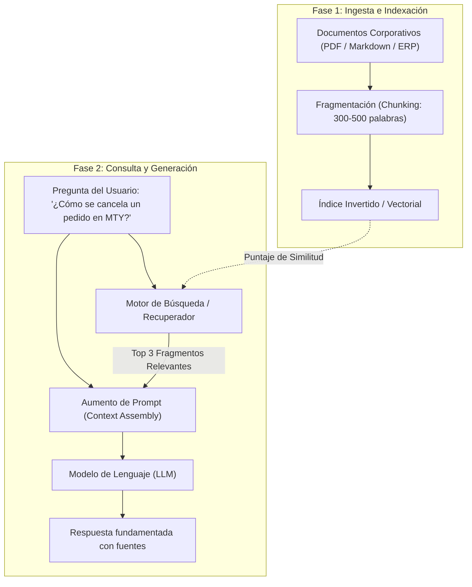

# Lección 03: Arquitectura RAG mínima y recuperación de información

## 🎯 Objetivos de aprendizaje

* Comprender qué es la Generación Aumentada por Recuperación (*Retrieval-Augmented Generation*, RAG) y cuándo utilizarla frente a Fine-Tuning.
* Aprender el pipeline completo de RAG: ingesta, fragmentación (*chunking*), indexación, recuperación y aumento de contexto.
* Implementar un motor RAG ligero y transparente usando búsqueda léxica (TF-IDF / BM25) sin bases de datos vectoriales complejas.

---

## 🔍 1. ¿Qué es RAG y por qué lo necesita un FDE?

Los LLMs pre-entrenados tienen dos grandes limitaciones en el contexto empresarial:
1. **Corte de conocimiento (*knowledge cutoff*):** No saben lo que ocurrió después de su entrenamiento.
2. **Desconocimiento de datos privados:** Jamás han visto las políticas internas de crédito, los manuales de procedimientos o los acuerdos de servicio (SLAs) de Distribuidora Halcón.

### Las tres formas de adaptar un modelo a un cliente:

| Enfoque | Costo / Complejidad | Actualización | Riesgo de alucinación | Cuándo usarlo |
|---------|---------------------|---------------|-----------------------|---------------|
| **Prompt Engineering básico** | Muy bajo | Inmediata | Medio | Tareas sencillas de transformación o clasificación. |
| **RAG (Retrieval-Augmented Generation)** | Moderado | En tiempo real (basta actualizar el índice) | Bajo (con citas y fuentes) | **90% de los casos de uso en clientes:** consultar manuales, políticas, catálogos y contratos. |
| **Fine-Tuning (Reentrenamiento)** | Muy alto | Lento y costoso | Medio | Cambiar el tono, estilo lingüístico o especialización extrema de sintaxis médica/legal. No sirve para memorizar hechos dinámicos. |

---

## ⚙️ 2. El pipeline de RAG paso a paso



---

## ✂️ 3. Fragmentación (*Chunking*) de documentos

Un documento corporativo de 40 páginas no puede ni debe enviarse completo como contexto. Debe dividirse en fragmentos manejables (*chunks*):

### Reglas para una buena fragmentación:
* **Tamaño del fragmento (*Chunk Size*):** Entre 200 y 500 palabras o tokens. Si es demasiado pequeño, pierde contexto; si es demasiado grande, diluye la relevancia.
* **Superposición (*Chunk Overlap*):** Mantener un traslape de 30 a 50 palabras entre fragmentos contiguos para no cortar oraciones o ideas a la mitad.
* **Respetar fronteras semánticas:** Cortar por párrafos (`\n\n`), encabezados Markdown (`#`, `##`) o secciones en lugar de cortar ciegamente por conteo de caracteres.

---

## 🧮 4. Búsqueda Léxica vs. Búsqueda Semántica

En la comunidad de IA se asume frecuentemente que para hacer RAG es obligatorio desplegar una base de datos vectorial especializada (Pinecone, Weaviate, Milvus, Qdrant). 

Como Forward Deployed Engineer pragmático, debes saber que:
> **Para colecciones pequeñas y medianas (cientos o miles de documentos técnicos, catálogos de SKUs, códigos de error y manuales internos), la búsqueda léxica (TF-IDF / BM25) o la búsqueda híbrida suele ser más rápida, económica y precisa que los embeddings puros.**

### ¿Por qué?
* **Coincidencia exacta de identificadores:** Si el usuario pregunta por `"SKU-ARROZ-01"`, un modelo de embeddings puede devolver por error `"SKU-FRIJOL-02"` porque ambos son "alimentos básicos". La búsqueda léxica premia la coincidencia exacta de caracteres.
* **Cero latencia de inferencia de embeddings:** No tienes que pagar una API para calcular vectores de 1536 dimensiones en cada búsqueda.
* **Facilidad de auditoría:** Puedes explicarle al cliente exactamente por qué un fragmento obtuvo una puntuación alta basándote en la frecuencia de términos.

---

## 🧩 5. Ensamblado del prompt aumentado

Una vez recuperados los 3 fragmentos con mayor puntuación, el FDE ensambla el prompt final para el LLM:

```text
Eres un asistente operativo para Distribuidora Halcón.
Responde a la pregunta del usuario ÚNICAMENTE utilizando los fragmentos de contexto provistos abajo.
Si la información no se encuentra en el contexto, responde textualmente: "La información solicitada no está disponible en las políticas de Halcón."

--- FRAGMENTOS DE CONTEXTO ---
[Fuente 1: politica_devoluciones.md]
Las devoluciones de mercancía perecedera en el Almacén Monterrey deben reportarse dentro de las primeras 24 horas posteriores a la entrega física.

[Fuente 2: manual_operativo.md]
Los abarrotes secos (arroz, frijol, azúcar) cuentan con hasta 7 días hábiles para reporte de mermas con firma del encargado de tienda.
--- FIN DE CONTEXTO ---

Pregunta del usuario: ¿Cuánto tiempo tengo para devolver un costal de frijol con merma en Monterrey?
```

El modelo responderá con precisión quirúrgica citando los 7 días hábiles sin inventar datos.

---

## 📌 Conclusiones clave

* RAG es el patrón arquitectónico por excelencia para dotar a los LLMs de conocimiento privado empresarial.
* No introduzcas bases de datos vectoriales en un cliente si una búsqueda léxica ligera o híbrida resuelve el problema de forma más barata y auditable.
* El éxito de un sistema RAG depende en un 80% de la calidad de la fragmentación y recuperación (*retrieval*), y solo en un 20% del modelo de lenguaje elegido.
