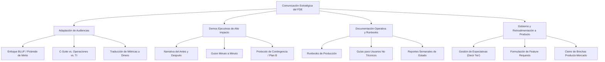

# Módulo 11: Comunicación, demos y documentación

> **Nivel:** 🟡 Intermedio  
> **Duración estimada:** 4 horas  
> **Prerrequisitos:** Módulo 00 (El rol del FDE), Módulo 05 (Descubrimiento con clientes), Módulo 08 (Debugging y producción)

---

## 🎯 Objetivo del módulo

Desarrollar las habilidades de comunicación estratégica, liderazgo en reuniones con clientes y redacción técnica indispensables para un Forward Deployed Engineer. Aprenderás a adaptar tu discurso entre audiencias de negocios y de tecnología, estructurar demostraciones en vivo memorables y a prueba de fallos, documentar manuales operativos (*Runbooks*) de alta calidad y retroalimentar de forma accionable al equipo de producto interno.

---

## 🗺️ Mapa conceptual del módulo

---

## 📚 Lecciones

| # | Lección | Duración | Descripción |
|---|---------|----------|-------------|
| 01 | [**Comunicación con audiencias técnicas y no técnicas**](lecciones/01-comunicacion-con-audiencias-tecnicas-y-no-tecnicas.md) | 1 hora | Principio BLUF, matriz de stakeholders (Negocio vs. TI) y traducción de conceptos de ingeniería a valor financiero. |
| 02 | [**Anatomía de una demo ejecutiva de alto impacto**](lecciones/02-anatomia-de-una-demo-ejecutiva-de-alto-impacto.md) | 1 hora | Narrativa persuasiva, preparación de datos de prueba, guion minuto a minuto y qué hacer cuando algo falla en vivo. |
| 03 | [**Redacción de runbooks y documentación operativa**](lecciones/03-redaccion-de-runbooks-y-documentacion-operativa.md) | 1 hora | Estructura de runbooks de producción para garantizar autonomía del cliente, resolución de dudas y reducción de soporte. |
| 04 | [**Gestión de expectativas y retroalimentación a producto**](lecciones/04-gestion-de-expectativas-y-retroalimentacion-a-producto.md) | 1 hora | Cómo decir "no" con alternativas viables, controlar la expansión del alcance (*scope creep*) y redactar feature requests rigurosos. |

---

## 🛠️ Ejemplos y plantillas profesionales

En la carpeta [`ejemplos/`](ejemplos/) encontrarás artefactos listos para uso en proyectos reales:
* [`guion_demo_ejecutiva_halcon.md`](ejemplos/guion_demo_ejecutiva_halcon.md): Guion cronometrado para la demo final ante Don Javier Halcón y directivos.
* [`reporte_semanal_estado.md`](ejemplos/reporte_semanal_estado.md): Plantilla y ejemplo de actualización ejecutiva semanal (*Weekly Status Report*).
* [`runbook_integracion_halcon.md`](ejemplos/runbook_integracion_halcon.md): Manual operativo paso a paso para despliegue, reinicio y contingencia en producción.
* [`feature_request_producto.md`](ejemplos/feature_request_producto.md): Solicitud de funcionalidad con justificación de negocio para el equipo central de ingeniería.

---

## 🏋️ Ejercicios prácticos

En la carpeta [`ejercicios/`](ejercicios/):
1. [**Guion de demo y manejo de objeciones difíciles**](ejercicios/01-guion-de-demo-y-manejo-de-objeciones.md): Preparar la narrativa de presentación y reaccionar ante interrupciones y dudas hostiles de directivos.
2. [**Redacción de Runbook de emergencia y Feature Request**](ejercicios/02-redaccion-de-runbook-y-feature-request.md): Elaborar la documentación de contingencia ante fallas de red y redactar una solicitud de cambio formal.

---

## 🎬 Guía para el instructor: Grabación de videos

* **El superpoder del FDE:** Resalta que el código perfecto no sirve de nada si el cliente no entiende cómo usarlo o si no logras convencer a los tomadores de decisiones en la demo final.
* **Simulación en cámara:** Graba la lección 02 alternando entre el rol de Don Javier (escéptico, enfocado en utilidades) y el FDE (empático, ágil, orientado a resultados).
* **Duración sugerida:** 4 cápsulas de 12 a 15 minutos.
