# Guion de Demostración Ejecutiva: Go-Live Distribuidora Halcón

**Objetivo de la reunión:** Demostrar la sincronización automatizada de inventario y el asistente de pedidos ante Don Javier Halcón para obtener la aprobación formal de paso a producción (*Go-Live*).  
**Duración total:** 15 minutos (10 min presentación/demo + 5 min preguntas y respuestas).  
**Asistentes:**
* Don Javier Halcón (Fundador y Director General)
* Laura Garza (Directora de Operaciones)
* Roberto Treviño (Gerente de TI)
* Forward Deployed Engineer (Nexo AI)

---

## ⏱️ Cronograma Minuto a Minuto

```mermaid
gantt
    title Cronograma de la Demo (15 Minutos)
    dateFormat mm
    axisFormat %M min
    section Presentación
    Apertura y dolor actual    : 00, 2m
    El estado actual (Antes)    : 02, 2m
    section Demo en Vivo
    Conciliación automática     : 04, 4m
    Asistente de pedidos WhatsApp : 08, 2m
    section Cierre
    Métricas de impacto y ROI   : 10, 2m
    Preguntas y Acuerdos        : 12, 3m
```

---

## 🎤 Minuto 00:00 - 02:00 | Apertura y Gancho de Negocio

**Acción física:** Proyector encendido con una sola diapositiva ejecutiva con el logo de Distribuidora Halcón y Nexo AI. Laptop lista con terminal oculta y navegador en pantalla completa.

> **FDE:**  
> *"Buenos días, Don Javier, Laura, Roberto. Gracias por recibirnos hoy.  
> Hace cuatro semanas Don Javier nos compartió una inquietud muy clara: 'No es posible que en pleno 2026 tengamos a las tiendas de Monterrey llamando enojadas a las 8:00 de la mañana porque el camión no les llevó el frijol o el arroz que pidieron la noche anterior'.  
> Hoy estamos aquí para demostrarles en vivo cómo hemos erradicado ese problema. En los próximos 10 minutos verán cómo el inventario de sus tres almacenes se concilia en menos de 30 segundos y cómo sus encargados de tienda ahora pueden solicitar reabastecimiento al instante sin errores."*

---

## 🎤 Minuto 02:00 - 04:00 | El Contraste: El Proceso Manual

**Acción física:** Mostrar en pantalla durante 30 segundos el reporte anterior de Excel con filas marcadas en rojo (duplicados, fechas mixtas y cantidades negativas).

> **FDE:**  
> *"Para dimensionar el cambio: antes, cada madrugada el equipo de Laura en Monterrey tenía que descargar este archivo plano de 15,000 líneas del ERP legado. Detectar errores de captura tomaba hasta 4 horas manuales. Si un operador se equivocaba en una celda, el camión salía incompleto.  
> Ahora, veamos qué ocurre hoy."*

---

## 🎤 Minuto 04:00 - 08:00 | La Solución en Vivo: Sincronización Automática

**Acción física:** Cambiar al navegador web en el panel de control de Nexo. Cargar en vivo el archivo de datos del ERP.

> **FDE:**  
> *"Laura, voy a procesar en vivo el lote de inventario que tu ERP generó esta madrugada para Monterrey, Guadalajara y Ciudad de México.  
> Hacemos clic en 'Ejecutar Sincronización'.  
> *(El conector procesa las filas; una barra de progreso limpia avanza rápidamente)*.  
> Listo: 18 segundos exactos.  
> Noten lo siguiente en pantalla:
> 1. El conector detectó de forma automática dos códigos SKU duplicados y los unificó sin detener el proceso.
> 2. Normalizó las cantidades y descartó un registro con número negativo proveniente de un error tipográfico en mostrador.
> 3. Concilió 1,200 tiendas contra el catálogo central.  
> Roberto, a nivel técnico: toda esta comunicación viajó cifrada con TLS 1.3 hacia la base de datos segura y el conector renovó sus llaves de acceso de forma transparente sin tocar tu servidor legado."*

---

## 🎤 Minuto 08:00 - 10:00 | La Experiencia del Cliente: Asistente de Pedidos

**Acción física:** Mostrar la interfaz de captura rápida o simulación de mensaje de WhatsApp de una tienda afiliada.

> **FDE:**  
> *"Pero no nos quedamos solo en el almacén. Queríamos facilitarle la vida a sus encargados de tienda.  
> Vean este mensaje recibido hace un momento: 'Habla Juan de la tienda Doña Mary en Monterrey, nos urgen 60 bultos de frijol para mañana'.  
> *(El FDE muestra cómo el extractor con IA procesa el mensaje)*.  
> El sistema traduce ese mensaje informal en un pedido oficial: detecta que corresponde al SKU-FRIJOL-02, valida que Monterrey tiene 150 piezas en stock, calcula el precio de lista exacto y emite la orden validada hacia el ERP.  
> Cero fricción para Don Juan, cero recaptura para el equipo de ventas de Halcón."*

---

## 🎤 Minuto 10:00 - 12:00 | El Cierre: Impacto en Resultados (ROI)

**Acción física:** Mostrar diapositiva con métricas finales de impacto.

> **FDE:**  
> *"Don Javier, en resumen, con esta integración en marcha:
> - **Tiempo de cierre nocturno:** Reducido de 4 horas a 18 segundos.
> - **Errores de stock y mermas por desabasto:** Disminución proyectada del 94%.
> - **Ahorro operativo directo:** Más de $35,000 pesos mensuales en horas extra y recapturas.
> 
> Roberto ya validó la seguridad de los contenedores Docker y el Runbook de operación. Laura ya capacitó a sus primeros 20 supervisores.  
> Con su visto bueno hoy, estamos listos para encender la sincronización automática de Monterrey este lunes a las 02:00 AM."*

---

## 🎤 Minuto 12:00 - 15:00 | Manejo de Objeciones y Preguntas

### Pregunta anticipada de Don Javier:
* *"¿Y si se va el internet en el almacén de Monterrey en la madrugada, se pierden las órdenes?"*
> **Respuesta del FDE:**  
> *"Excelente pregunta, Don Javier. El sistema cuenta con memoria local y reintentos automáticos con backoff. Si la conexión a internet se interrumpe, las órdenes se guardan de forma segura en la base de datos local y, en cuanto vuelve el enlace, el conector reanuda la transmisión sin duplicar un solo registro ni requerir que nadie se despierte a reiniciar la máquina."*

### Pregunta anticipada de Roberto (TI):
* *"¿Cómo sé que el script no se va a quedar colgado consumiendo toda la RAM del servidor?"*
> **Respuesta del FDE:**  
> *"Roberto, en el `docker-compose.yml` que dejamos configurado establecimos un límite duro de 512 MB de memoria y 0.5 CPUs. Si el proceso llegara a exceder ese umbral, Docker reinicia el contenedor de manera aislada y nos dispara una alerta a Slack en menos de 60 segundos."*

---

## 🧯 Protocolo Plan B (Por si falla la red en la sala de juntas)

1. Si la red local o Wi-Fi se corta:
   * Activar inmediatamente el punto de acceso móvil (*hotspot*) del celular (ya vinculado previamente a la laptop).
2. Si la API simulada se cae:
   * Ejecutar la demo contra el respaldo local pre-cargado: `python modulos/06-integracion-de-sistemas/ejemplos/sincronizador_inventario.py`.
3. Si el proyector o laptop falla por completo:
   * Abrir la tablet con el video pre-grabado en alta resolución (`demo_halcon_respaldo.mp4`) y presentar caminando junto a Don Javier.
