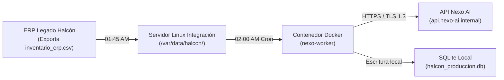

# Runbook de Operación: Conector de Inventario Halcón-Nexo

**Servicio:** Conector Batch de Inventario y Alertas (`nexo-halcon-worker`)  
**Criticidad:** Tier 1 (Proceso nocturno esencial para reabastecimiento matutino)  
**Ambiente:** Producción (Servidor Linux `srv-integracion-01.halcon.internal`)  
**Responsable Primario:** Equipo de TI Halcón (`soporte-ti@distribuidorahalcon.com`)  
**Soporte Externo / Escalamiento:** Nexo AI FDE (`fde-guardia@nexo-ai.internal`, Tel: +52 81 0000 1122)  
**Última actualización:** 14 de octubre de 2026  

---

## 🏗️ 1. Arquitectura y Dependencias



### Puertos y Red:
* **Salida requerida:** Puerto TCP 443 hacia `api.nexo-ai.internal` (o IP fija de Nexo).
* **Entrada:** Ningún puerto expuesto a internet abierto.

---

## 🚀 2. Comandos de Operación Habitual

Todos los comandos deben ejecutarse en la terminal del servidor bajo el usuario `operador_nexo`:

```bash
cd /opt/nexo-integracion
```

### A. Verificar el estado del servicio
```bash
docker compose ps
```
*Salida esperada:* El contenedor `nexo-worker` debe mostrar estado `Up` o `Exited (0)` si terminó su tarea programada.

### B. Inspeccionar logs en tiempo real
```bash
docker compose logs -f --tail=100 worker
```

### C. Ejecutar sincronización manual fuera de horario
Si el archivo del ERP se generó tarde y se requiere forzar la sincronización:
```bash
docker compose run --rm worker python src/sincronizar_inventario.py --almacen MTY --forzar
```

---

## 🩺 3. Verificación de Salud (Health Checks)

1. **Revisar código de salida de la última corrida:**
   ```bash
   grep "PROCESO FINALIZADO CON ÉXITO" /var/log/nexo/sincronizacion.log | tail -n 1
   ```
2. **Validar conexión con la API de Nexo:**
   ```bash
   curl -I -s https://api.nexo-ai.internal/v1/health | head -n 1
   ```
   *Debe responder:* `HTTP/1.1 200 OK`

---

## 🚨 4. Árbol de Resolución de Incidentes (Troubleshooting)

| Síntoma | Causa Probable | Verificación | Solución Paso a Paso |
|---------|----------------|--------------|----------------------|
| **Error en logs: `HTTP 401 Unauthorized` persistente.** | El token de API expiró o la llave secreta fue revocada. | Revisar `/opt/nexo-integracion/.env` | 1. Generar nueva llave en el portal Nexo.<br>2. Editar `HALCON_API_KEY` en `.env`.<br>3. Reiniciar: `docker compose restart`. |
| **Error en logs: `HTTP 429 Too Many Requests`.** | El conector superó el límite de peticiones por minuto. | Buscar en logs `rate_limit_exceeded` | 1. Detener el proceso: `docker compose stop worker`.<br>2. Esperar 2 minutos para que el servidor libere la ventana.<br>3. Relanzar con backoff activo. |
| **Falla: `FileNotFoundError: inventario_erp.csv`.** | El ERP de Halcón no exportó el archivo a tiempo. | Ejecutar `ls -lh /var/data/halcon/` | 1. Notificar a Roberto Treviño para verificar el cron del ERP.<br>2. En cuanto aparezca el archivo, lanzar corrida manual. |
| **Contenedor detenido por falta de memoria (`OOMKilled`).** | El archivo del ERP superó los 50,000 registros de golpe. | `docker inspect nexo-worker \| grep OOMKilled` | 1. Aumentar temporalmente la memoria en `docker-compose.yml` de 512M a 1G.<br>2. Relanzar: `docker compose up -d`. |

---

## 🧯 5. Procedimiento de Rollback de Emergencia

Si una actualización del conector rompe la compatibilidad con el ERP:

```bash
# 1. Detener la versión defectuosa
docker compose down

# 2. Cambiar a la versión estable anterior etiquetada en Git
git checkout tags/v1.0.2-estable

# 3. Reconstruir y levantar el contenedor estable
docker compose up -d --build

# 4. Validar ejecución
docker compose logs -f worker
```

---

## 📞 6. Matriz de Escalamiento

* **Nivel 1 (0 a 15 min):** Operador de TI de guardia en Halcón aplica este Runbook.
* **Nivel 2 (15 a 30 min):** Notificar a Roberto Treviño (`roberto.trevino@distribuidorahalcon.com`).
* **Nivel 3 (> 30 min o SEV-1):** Escalar a la línea de guardia del FDE de Nexo AI (+52 81 0000 1122).
