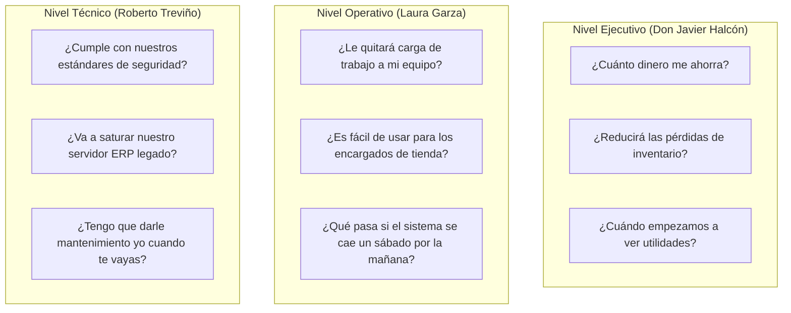

# Lección 01: Comunicación con audiencias técnicas y no técnicas

## 🎯 Objetivos de aprendizaje

* Dominar el principio BLUF (*Bottom Line Up Front*) y la estructura de la Pirámide de Minto para comunicaciones de alta dirección.
* Mapear las motivaciones, incentivos y preocupaciones de diferentes tipos de *stakeholders*.
* Aprender a traducir métricas técnicas (latencia, TPS, concurrencia, reintentos) a impacto medible en el negocio (costos, mermas, ingresos y tiempo).

---

## 🎯 1. El principio BLUF (Bottom Line Up Front)

Los ingenieros de software tradicionales suelen comunicarse de forma cronológica:
> *"Primero abrimos la consola, luego vimos que falló la conexión con el puerto 8080 debido a un timeout en el handshake SSL, por lo que tuvimos que revisar los logs de Nginx y después de tres horas nos dimos cuenta de que la IP cambió..."*

Para un director general como Don Javier Halcón o una directora de operaciones como Laura Garza, esa forma de hablar resulta agotadora y genera desconfianza.

El Forward Deployed Engineer utiliza el estándar **BLUF (Bottom Line Up Front)**:
1. **La conclusión o resultado primero:** *"El sistema de sincronización de Monterrey ya está funcionando al 100% y todos los pedidos de la mañana saldrán a tiempo."*
2. **El contexto e impacto:** *"Tuvimos un retraso de 30 minutos a las 3:00 AM por una renovación de credenciales, pero ningún cliente sufrió desabasto."*
3. **La acción preventiva o siguiente paso:** *"Ya dejamos una actualización automatizada para que las credenciales no vuelvan a expirar."*

---

## 👥 2. La matriz de stakeholders en un cliente empresarial

Un FDE interactúa simultáneamente con tres tipos de perfiles en cada implementación:

### Tabla de traducción: De jerga técnica a lenguaje de impacto

| Si dices a un directivo (❌ Jerga técnica) | Lo que el directivo escucha | Lo que debes decir (✅ Impacto en negocio) |
|-------------------------------------------|----------------------------|-------------------------------------------|
| *"Implementamos un cliente HTTP con backoff exponencial y jitter para evitar códigos 429."* | *"Se cayó el servidor y están inventando palabras raras."* | *"Configuramos el conector para que no sature su sistema contable en horas pico, garantizando que sus tiendas nunca se queden sin sistema."* |
| *"La latencia en el endpoint P99 bajó de 1,200ms a 150ms."* | *"Me da igual, no sé qué es P99."* | *"Las pantallas de los cajeros en las 1,200 tiendas ahora cargan 8 veces más rápido, reduciendo las filas de clientes en mostrador."* |
| *"El modelo RAG tiene un hit rate de recuperación del 88%."* | *"Se equivoca el 12% de las veces."* | *"El asistente automático responde con éxito 9 de cada 10 dudas de crédito de las tiendas al instante, liberando 15 horas semanales del equipo de atención telefónica."* |

---

## ⏱️ 3. Reglas de oro para reuniones y correos ejecutivos

1. **La regla de los 30 segundos:** Los primeros 30 segundos de cualquier llamada o el primer párrafo de cualquier correo deben dejar perfectamente claro si el proyecto va bien, si hay un problema y qué decisión se requiere del cliente.
2. **Sin sorpresas:** Nunca dejes que un cliente se entere de un retraso el día de la fecha de entrega. Si un entregable se va a retrasar, avisa al menos con el 50% de anticipación del tiempo total del sprint.
3. **Presenta opciones, no callejones sin salida:** Cuando haya un problema técnico (p. ej., *"El ERP de Halcón no soporta Webhooks"*), nunca digas simplemente *"No se puede"*. Di: *"El ERP no soporta avisos automáticos en tiempo real; sin embargo, podemos hacer una consulta programada cada 5 minutos por lotes sin sobrecargar su servidor. ¿Prefieren esa opción o consultamos con su proveedor de ERP?"*

---

## 📌 Conclusiones clave

* Comunica siempre la conclusión al principio (BLUF).
* Adapta tu vocabulario según estés hablando con Don Javier (pesos y centavos), Laura (operación del día a día) o Roberto (seguridad y arquitectura).
* Como FDE, tu valor no radica en sonar inteligente, sino en hacer que el cliente entienda con claridad cómo la tecnología resuelve sus problemas.
