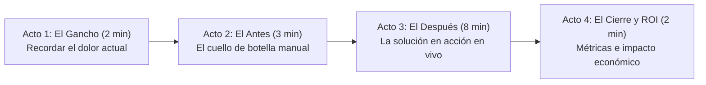

# Lección 02: Anatomía de una demo ejecutiva de alto impacto

## 🎯 Objetivos de aprendizaje

* Dominar la estructura narrativa en 4 actos de una demostración de software enterprise.
* Aprender a preparar un entorno de demostración reproducible y blindado contra sorpresas.
* Elaborar un Plan de Contingencia (*Plan B*) para mantener el control y cerrar la venta si el sistema falla en vivo.

---

## 🎬 1. La estructura en 4 actos de una demo ejecutiva

Una demo técnica para desarrolladores muestra código y arquitectura; una **demo ejecutiva de un FDE** cuenta una historia de transformación de negocio donde el software es el facilitador.

### Acto 1: El Gancho (*The Hook* - 2 minutos)
* Conecta emocionalmente con el dolor del cliente:  
  *"Don Javier, Laura: hace tres semanas nos sentamos en esta sala y vimos cómo cada noche el equipo pierde más de 4 horas cuadrando a mano los pedidos de Monterrey, provocando que 15 tiendas abran sin abarrotes básicos al día siguiente."*

### Acto 2: El Antes (*The Villain* - 3 minutos)
* Muestra brevemente la fricción de la situación actual (el archivo CSV con errores, la pantalla congelada del ERP) sin burlarte del sistema del cliente, reconociendo el esfuerzo de sus operadores.

### Acto 3: El Después (*The Hero Journey* - 8 minutos)
* Ejecuta la demostración en vivo mostrando el flujo de valor de punta a punta:
  1. Cargar el inventario real.
  2. Mostrar cómo el algoritmo detecta discrepancias y sugiere reabastecimiento en segundos.
  3. Emitir la orden sincronizada hacia la API de Nexo.
* **Regla de oro de la demo:** No muestres pantallas de configuración o terminales de Linux a menos que Roberto (TI) lo pida específicamente; muestra el resultado visible que impacta a la tienda.

### Acto 4: El Cierre y ROI (*The Promised Land* - 2 minutos)
* Traduce la demo a resultados comerciales:  
  *"Con esto, el tiempo de conciliación nocturna pasa de 4 horas a solo 18 segundos. Para Distribuidora Halcón esto representa un ahorro anual proyectado de \$380,000 MXN en horas extra y cero quejas por desabasto matutino."*

---

## 🛡️ 2. Preparación del entorno: La regla de la semilla determinista

La "Ley de Murphy de las Demos" dice:  
> *"Si algo puede salir mal en un proyector frente al cliente más importante de la empresa, saldrá mal en el minuto 3."*

### Lista de verificación pre-demo (60 minutos antes):
1. **Semilla de datos fija (*Deterministic Seeding*):** No utilices la base de datos de producción cambiante; usa una copia con datos sanitizados donde conozcas exactamente qué productos tienen stock bajo y qué tiendas dispararán alertas.
2. **Ambiente local o precalentado:** Si dependes de una conexión Wi-Fi inestable en la sala de juntas del cliente, ten una instancia de Docker corriendo localmente en tu computadora portátil como respaldo.
3. **Pestañas del navegador y terminal listas:** Abre únicamente las pantallas necesarias, aumenta el zoom del navegador a 125% o 150% para que sea legible en proyector, y desactiva las notificaciones de Slack, WhatsApp y correo.
4. **Batería y cables:** Adaptadores HDMI/USB-C probados y cargador conectado a la corriente eléctrica.

---

## 🧯 3. El Plan B: Qué hacer cuando la demo falla en vivo

Incluso a los ingenieros más experimentados les falla un servicio en vivo (un error 500, un certificado expirado, una red Wi-Fi que se cae).

### Lo que distingue a un FDE profesional de un novato:

| Reacción del principiante (❌ Pánico) | Reacción del FDE senior (✅ Dominio) |
|-------------------------------------|--------------------------------------|
| Se sonroja, empieza a sudar, teclea furiosamente en silencio intentando debuggear el código durante 5 minutos incómodos. | Sonríe con calma, explica con total tranquilidad qué está pasando y cambia de inmediato al plan de respaldo. |
| Le echa la culpa al Wi-Fi del cliente o al servidor del compañero de backend. | *"Como vemos, el servidor acaba de rechazar la conexión por seguridad. Afortunadamente tengo grabada la ejecución idéntica de hace 20 minutos con los mismos datos, veámosla juntos."* |
| Pide cancelar la reunión y reagendar para otro día. | Muestra el video de respaldo de alta resolución y se gana el respeto del cliente por su nivel de preparación. |

> [!TIP]
> **Ten siempre un video corto (screen recording de 90 segundos) o capturas de pantalla de alta resolución de la demo completa en tu disco local.** Si la red del cliente falla, abres el video y narras encima como si estuviera ocurriendo en vivo. El cliente valorará tu profesionalismo y previsión.

---

## 📌 Conclusiones clave

* Una demo no es un tour de botones; es una historia de transformación de negocio.
* Limpia los datos de prueba y ensaya la demo al menos dos veces con cronómetro en mano antes de pararte en la sala de juntas.
* Tener un Plan B grabado no es pesimismo; es el estándar de oro de la ingeniería de campo.
