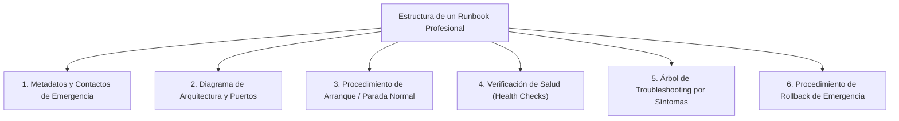

# Lección 03: Redacción de runbooks y documentación operativa

## 🎯 Objetivos de aprendizaje

* Comprender por qué la documentación es la verdadera garantía de la adopción del cliente y de la reducción de tickets de soporte.
* Dominar la anatomía estándar de un Runbook de Producción (*Production Runbook / Playbook*).
* Aprender a redactar manuales y guías de contingencia claras para operadores no técnicos.

---

## 📖 1. El rol de la documentación en el Time-to-Value

Muchos desarrolladores consideran que la documentación es un trámite burocrático que se redacta a las prisas al final del proyecto. Para un Forward Deployed Engineer, **la documentación es parte del producto entregable**:

1. **Garantiza la autonomía del cliente:** Si Roberto Treviño o sus analistas no saben cómo reiniciar el conector ante un fallo de red un domingo, llamarán a soporte de emergencia de tu startup.
2. **Protege tu tiempo como FDE:** Si documentas bien el sistema, podrás hacer la transición del proyecto al equipo de Customer Success y pasar al siguiente cliente estratégico.
3. **Genera confianza institucional:** Una empresa tradicional como Distribuidora Halcón juzga la madurez de una startup de software por la claridad y profesionalismo de sus manuales.

---

## 🏗️ 2. Anatomía de un Runbook de Producción

Un **Runbook** es una guía operativa procedimental diseñada para que un ingeniero de guardia (que podría estar medio dormido a las 3:00 AM) pueda operar, diagnosticar y restaurar un servicio con el menor esfuerzo mental posible.



### Secciones obligatorias de un Runbook:

1. **Ficha técnica y contactos:**
   * Nombre del servicio, criticidad (Tier 1 / SEV-1), repositorio de Git, y datos del equipo responsable (correo, canal de Slack, teléfono de guardia).
2. **Prerrequisitos de entorno:**
   * Versión de Python/Docker, puertos de red abiertos (ej. 8080 hacia la API de Nexo), variables de entorno indispensables (`HALCON_API_KEY`, etc.).
3. **Comandos de operación diaria:**
   * Comandos exactos listos para copiar y pegar: cómo levantar el contenedor (`docker compose up -d`), cómo ver logs en vivo (`docker logs -f ...`) y cómo reiniciar el proceso.
4. **Árbol de diagnóstico rápido (*Troubleshooting*):**
   * Tabla con el formato: **Síntoma ➔ Causa probable ➔ Comando de verificación ➔ Acción de resolución**.
5. **Procedimiento de reversión (*Rollback*):**
   * Qué hacer si una nueva versión falla catastróficamente y cómo volver a la versión estable anterior en menos de 5 minutos.

---

## ✍️ 3. Redacción técnica para operadores de negocio

Además del Runbook técnico para Roberto (TI), el FDE suele redactar una **Guía Rápida de Operación** para Laura Garza y los supervisores de almacén.

### Reglas de redacción:
* **Usa capturas de pantalla anotadas:** Rodea con un recuadro rojo el botón exacto que el usuario debe presionar.
* **Prohibido el lenguaje ambiguo:** En lugar de *"Espera un momento prudente"*, escribe *"Espera 45 segundos hasta que el indicador cambie de amarillo a verde"*.
* **Formato paso a paso numerado:** Cada acción física debe ser un paso independiente con su resultado esperado inmediato:
  ```markdown
  1. Abre tu navegador web e ingresa a `https://portal.halcon.internal`.
     ➔ *Resultado esperado:* Verás la pantalla de inicio de sesión con el logotipo de Halcón.
  2. Escribe tu usuario y contraseña de supervisor y presiona **Iniciar Sesión**.
  3. En el menú superior izquierdo, haz clic en **Inventario > Conciliación Diaria**.
  ```

---

## 📌 Conclusiones clave

* Si un procedimiento no está documentado en el Runbook, para el cliente el procedimiento no existe.
* Todo comando en un Runbook debe ser reproducible mediante copiar y pegar sin requerir edición manual de variables ambiguas.
* Un buen Runbook reduce los incidentes SEV-1 a tareas rutinarias de 5 minutos.
