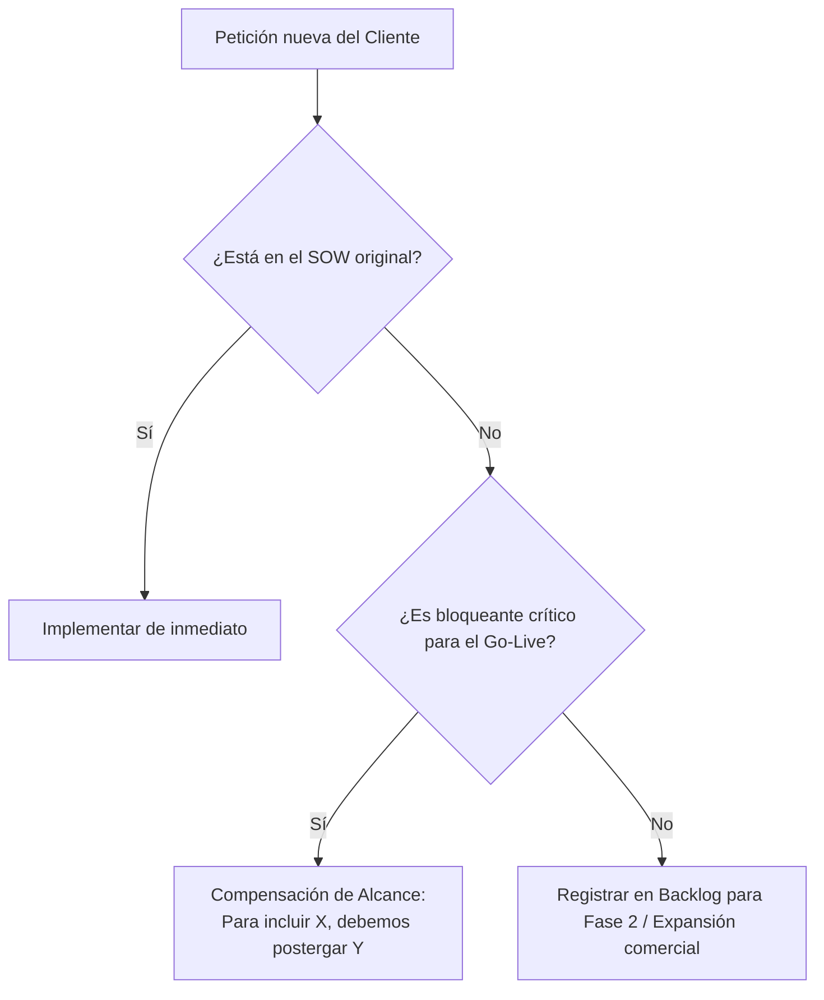

# Lección 04: Gestión de expectativas y retroalimentación a producto

## 🎯 Objetivos de aprendizaje

* Aprender a decir "no" a peticiones fuera de alcance (*Scope Creep*) manteniendo una relación comercial empática y constructiva.
* Dominar el ciclo de retroalimentación bidireccional entre el cliente y el equipo central de Producto e Ingeniería.
* Aprender a redactar una Solicitud de Funcionalidad (*Feature Request*) rigurosa basada en dolor de negocio real.

---

## 🛑 1. El arte de decir "no" protegiendo el alcance

Durante una implementación, es casi inevitable que el cliente comience a pedir funcionalidades adicionales no contempladas en el contrato original:
> *"Oye, ya que están conectando el inventario, ¿por qué no nos hacen de una vez un módulo para calcular las comisiones de los choferes de reparto y predecir el clima en Monterrey?"*

Si el FDE dice **"sí a todo"**, el proyecto sufrirá de *Scope Creep* (expansión descontrolada del alcance), la fecha de entrega se retrasará semanas, el equipo interno se quemará (*burnout*) y el cliente se frustrará.

Pero si el FDE dice un **"no tajante"**, el cliente sentirá que el proveedor es inflexible y burocrático.

### El método FDE: "Sí, en la Fase 2 con esta alternativa"



### La fórmula de respuesta profesional:
1. **Validar la necesidad con empatía:** *"Entiendo perfectamente por qué el cálculo de comisiones de los choferes sería muy valioso para la operación de Don Javier."*
2. **Explicar el impacto en la meta actual:** *"Nuestro objetivo prioritario acordado para el 30 de octubre es erradicar el desabasto matutino en las 1,200 tiendas con la sincronización de stock."*
3. **Proponer el camino a seguir:** *"Si desviamos recursos ahora a las comisiones, pondríamos en riesgo la fecha del Go-Live de inventario. Lo que propongo es documentar formalmente este requerimiento como la iniciativa número 1 para la Fase 2, inmediatamente después de estabilizar el inventario en noviembre. ¿Te parece bien?"*

---

## 🔄 2. El FDE como puente hacia el equipo de producto

El FDE se encuentra en una posición privilegiada: **es el único ingeniero de la empresa que ve cómo los clientes reales sufren con el producto**.

Muchos equipos centrales de producto cometen el error de construir funcionalidades basadas en suposiciones de laboratorio. El FDE es la voz de la verdad en las reuniones de producto:

```text
❌ Reporte inútil a producto:
"El cliente Halcón dice que la API de pedidos no sirve y quiere que cambien todo."

✅ Feature Request profesional de FDE:
"Cliente: Distribuidora Halcón (ARR proyectado: $120k USD).
Problema: Su ERP legado tarda 45 minutos en generar el corte diario y la API de Nexo rechaza peticiones con timeout después de 30 segundos.
Impacto: Tienen que partir manualmente el archivo en 15 lotes cada noche.
Propuesta de solución: Habilitar un endpoint asíncrono para ingesta de archivos por lotes (POST /v1/ingesta-batch) que devuelva un job_id y notifique vía Webhook al concluir."
```

---

## 📋 3. Estructura de un Feature Request de alto impacto

Para que los Product Managers (PMs) prioricen tu solicitud en el siguiente ciclo de desarrollo (*roadmap*), tu documento debe incluir:
1. **Contexto de negocio:** Nombre del cliente, tamaño de la cuenta (ARR/MRR) y urgencia comercial.
2. **El problema del usuario (*User Pain*):** Qué tarea no pueden completar hoy y qué costo en horas o dinero les genera.
3. **Frecuencia del problema:** ¿Le pasa solo a Halcón o es un patrón repetido en otros clientes de retail/logística?
4. **Solución provisional (*Workaround*) actual:** Qué script temporal tuvo que inventar el FDE en el cliente para parchar el problema mientras tanto.
5. **Propuesta técnica sugerida:** Especificación de API, esquema JSON o endpoints recomendados.

---

## 📌 Conclusiones clave

* Gestionar el alcance es proteger la entrega a tiempo de la solución.
* Nunca digas "no" a secas; ofrece siempre una alternativa de fases o compensación de alcance (*trade-off*).
* El mejor FDE no es el que hace parches eternos en el cliente, sino el que logra que el producto central evolucione para que esos parches dejen de ser necesarios.
