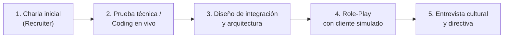

# 04. El proceso de entrevistas para Forward Deployed Engineer

El proceso de selección para un FDE suele ser más variado que el de un desarrollador tradicional, ya que las empresas evalúan tanto la habilidad técnica como la templanza, la comunicación y el criterio de negocio en situaciones complejas.

---

## 🪜 Las 5 etapas típicas del proceso

### Etapa 1: Filtro de Reclutamiento (Recruiter Screen · 30 min)
- **Qué evalúan:** Fluidez en tu trayectoria, motivación para trabajar de cara a clientes, disponibilidad para viajar si aplica y expectativas salariales.
- **Consejo clave:** Enfatiza que te gusta estar cerca del usuario final y ver el impacto directo de tu código en las operaciones.

### Etapa 2: Prueba Técnica / Coding en vivo (60 min)
- **Qué evalúan:** Manipulación de datos en Python, consumo de APIs, manejo de errores y estructuras de datos.
- **Diferencia clave con SWE común:** Rara vez te pedirán invertir árboles binarios complejos o resolver acertijos abstractos de LeetCode Hard. En su lugar, es muy común que te den una API o un archivo JSON/CSV sucio y te pidan:
  - *"Escribe un script que consuma este endpoint paginado y genere un resumen agrupado por cliente."*
  - *"¿Qué pasa si la API responde 429? Modifica tu código para reintentar."*

### Etapa 3: Diseño de Sistemas e Integración (60 min)
- **Qué evalúan:** Capacidad de descomponer un problema y conectar sistemas heterogéneos.
- **Pregunta típica:** *"Un cliente bancario tiene un sistema mainframe que solo exporta un archivo plano a las 2:00 AM vía SFTP y necesita que nuestra plataforma web muestre saldos actualizados antes de las 8:00 AM. ¿Cómo diseñarías la solución?"*

### Etapa 4: La entrevista de Role-Play con Cliente Simulado (45-60 min)
- **Qué evalúan:** Tu capacidad de escucha activa, empatía y manejo de objeciones.
- **La dinámica:** Uno de los entrevistadores actuará como un Director de Operaciones escéptico o un Gerente de TI preocupado por la seguridad. Deberás liderar una llamada de descubrimiento, hacer preguntas abiertas, aterrizar requerimientos y explicar soluciones técnicas sin usar jerga incomprensible.

### Etapa 5: Entrevista Conductual y de Liderazgo (45 min)
- **Qué evalúan:** Manejo de la frustración, trabajo en equipo, capacidad de priorizar y aprender rápido.

---

## 🌟 Dominando las preguntas de comportamiento con el Método STAR

Cuando te pregunten *"Cuéntame sobre una ocasión en la que un cliente te pidió algo imposible..."*, responde siempre usando STAR:

| Componente | Qué debes explicar |
|------------|---------------------|
| **S**ituación | El contexto inicial de la empresa y el problema del cliente. |
| **T**area | Tu responsabilidad específica y el objetivo a alcanzar. |
| **A**cción | Las decisiones concretas que tomaste y el código/proceso que implementaste. |
| **R**esultado | El impacto final medible (tiempo ahorrado, dinero ganado, satisfacción). |

---

⬅️ [03. Portafolio](03-portafolio.md) | [Índice de carrera](README.md) | [05. Banco de preguntas](05-banco-de-preguntas.md) ➡️
