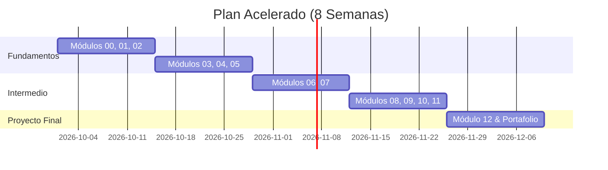

# 06. Planes de estudio recomendados

Elige la ruta que mejor se adapte a tu disponibilidad de tiempo y experiencia previa.

---

## 🏃 Ruta 1: Plan Acelerado de 8 Semanas (10-12 horas semanales)

Ideal si ya tienes bases de programación y quieres hacer una transición rápida al rol de FDE.

- **Semanas 1-2:** Módulos 00 (El rol del FDE), 01 (Herramientas esenciales) y 02 (Python para FDE). Dominar la limpieza de datos con el CSV corrupto de Distribuidora Halcón.
- **Semanas 3-4:** Módulos 03 (HTTP y APIs), 04 (Datos y SQL con SQLite) y 05 (Descubrimiento con clientes).
- **Semanas 5-6:** Módulos 06 (Integración de sistemas y resiliencia) y 07 (Docker y despliegue).
- **Semana 7:** Módulos 08 (Debugging y producción), 09 (Seguridad de datos), 10 (IA aplicada) y 11 (Demos y comunicación técnica).
- **Semana 8:** [Módulo 12 (Proyecto Final Integrador)](../../modulos/12-proyecto-final/README.md) y preparación de tu repositorio de portafolio para postularte a vacantes.

---

## 🧘 Ruta 2: Plan Extendido de 12 Semanas (5-6 horas semanales)

Ideal para quienes estudian o trabajan a tiempo completo y buscan asimilar cada concepto a fondo.

| Semana | Módulo sugerido | Meta semanal concreta |
|--------|-----------------|-----------------------|
| **1** | [00. El rol del FDE](../../modulos/00-el-rol-del-fde/README.md) | Comprender el perfil en T, métricas de éxito y ciclo de vida de una cuenta. |
| **2** | [01. Herramientas esenciales](../../modulos/01-herramientas-esenciales/README.md) | Manejo fluido de terminal, Git, ramas y comandos Unix (`grep`, `curl`, `jq`). |
| **3** | [02. Python para FDE](../../modulos/02-python-para-fde/README.md) | Automatización, parsing de CSV/JSON y validación de datos. |
| **4** | [03. HTTP y APIs](../../modulos/03-http-y-apis/README.md) | Consumo de endpoints con autenticación Bearer y manejo de errores HTTP. |
| **5** | [04. Datos y SQL](../../modulos/04-datos-y-sql/README.md) | Modelado de datos en SQLite, queries analíticos y joins. |
| **6** | [05. Descubrimiento](../../modulos/05-descubrimiento-con-clientes/README.md) | Conducir una entrevista técnica y redactar un documento de alcance (SOW). |
| **7** | [06. Integración de sistemas](../../modulos/06-integracion-de-sistemas/README.md) | Reintentos exponenciales, idempotencia y paginación en red inestable. |
| **8** | [07. Despliegue y Cloud](../../modulos/07-despliegue-y-cloud/README.md) | Dockerizar servicios, manejar variables de entorno y Docker Compose. |
| **9** | [08. Debugging y Producción](../../modulos/08-debugging-y-produccion/README.md) | Análisis de incidentes, lectura de logs estructurados y redacción de postmortem. |
| **10** | [09. Seguridad y PII](../../modulos/09-seguridad-y-datos-del-cliente/README.md) | Enmascaramiento de datos personales y checklist de seguridad. |
| **11** | [10. IA Aplicada](../../modulos/10-ia-aplicada/README.md) & [11. Comunicación](../../modulos/11-comunicacion-demos-y-documentacion/README.md) | Construcción de RAG mínimo y estructuración de demos ejecutivas. |
| **12** | [12. Proyecto Final](../../modulos/12-proyecto-final/README.md) | Entrega completa del proyecto integrador, README final y publicación en GitHub. |

---

⬅️ [05. Banco de preguntas](05-banco-de-preguntas.md) | [Índice de carrera](README.md) | [Volver al inicio del curso](../../README.md) 🏠
